# Topologic Studio

Topologic Studio opens a building model in the browser and works out how
people get out of it. It reads an IFC file, turns its floors, stairs and doors
into a walkable graph, finds the shortest way to an exit, and shows how a
spreading fire and its smoke change that route and what sprinklers do to the
fire.

Open it at <https://libishm1.github.io/Topologic_Studio/>. There is nothing to
install: open your own IFC file, or tap one of the seven example buildings.
A guide to every feature, with the methods and sources, is at
<https://libishm1.github.io/Topologic_Studio/docs/>.

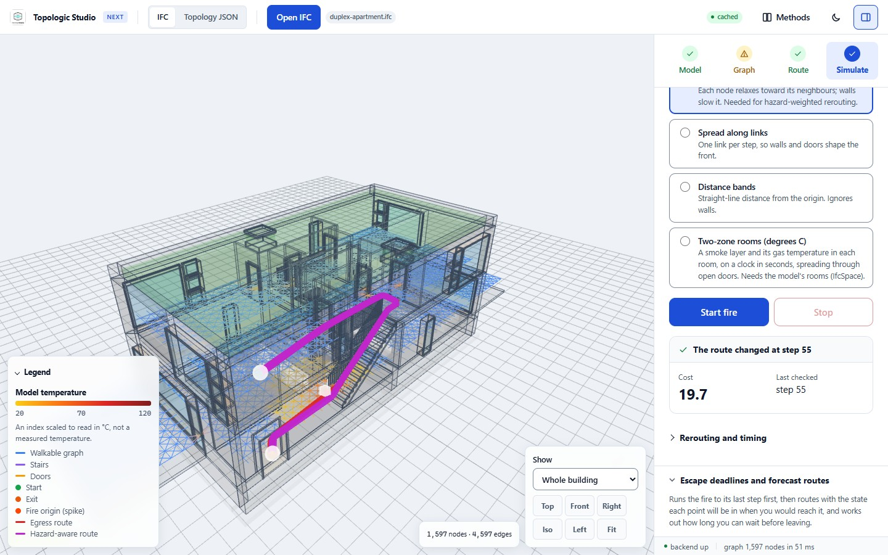

*The Duplex apartment example with a fire at the foot of the stair. The panel
on the right reports that the route changed at fire step 55 to keep clear of
the heat.*

- **On your device.** Opening, routing, alternative routes, fire spread,
  forecasts and reinforcement learning all run in the browser. The IFC file
  is sent to the server only if you ask for the TopologicPy cross-check.
- **On a phone.** The examples open in about a second on an emulated
  mid-range phone, and the whole workflow fits a phone screen.
- **With its assumptions.** Every result comes with its assumptions, the
  Methods page lists what has been proved in Lean 4, and the app tells you
  when a model cannot give an answer (for example two dwellings that no route
  joins).

> Studio is a research tool. Its fire models give an index of heat, not a
> calibrated temperature, so its results do not replace a fire engineer's
> egress assessment.

## Contents

- [Quick start](#quick-start)
- [The example buildings](#the-example-buildings)
- [What Studio does](#what-studio-does): [Model](#model-what-is-in-the-file),
  [Graph](#graph-where-a-person-can-walk), [Route](#route-the-shortest-way-out),
  [Simulate](#simulate-fire-and-smoke), [Fire suppression](#fire-suppression),
  [Checks](#checks-the-code-check-and-the-performance-check)
- [Working with Studio](#working-with-studio): your own IFC files, phones,
  export to TopologicPy, shortcuts
- [How it works and what is verified](#how-it-works-and-what-is-verified)
- [Limits to keep in mind](#limits-to-keep-in-mind)
- [Running Studio on your own computer](#running-studio-on-your-own-computer)
- [Tests and checks](#tests-and-checks)
- [Technical notes](#technical-notes)
- [Further reading](#further-reading)
- [Credits and licences](#credits-and-licences)

---

## Quick start

1. Open the site and tap **Duplex apartment** on the welcome screen, or drop
   an `.ifc` file on the page.
2. In the **Graph** step, press **Build egress graph**.
3. In the **Route** step, press **Set** beside Start (or the S key) and click a
   point on the graph, then press **Use the nearest exit door** and **Find
   egress route**.
4. In the **Simulate** step, press **Set** beside Fire origin (or F), click
   where the fire starts, and press **Start fire**. The route moves away from
   the heat when it has to.
5. To go further, switch on the **Flamescapes combustion solver (optional)**
   and then **Sprinklers** in the Simulate step, press **Plan with the
   forecast**, or run the **Code check** and the **Performance check (with
   the fire)** in the Route step.

You can also watch a guided run on the welcome screen. Studio opens the
Duplex and takes each step itself, with a caption for each, then stops at the
result. *The way out* builds the graph and finds the route from the room
furthest from an exit; *A fire on the route* adds a fire part-way along it;
*Smoke behind closed doors* runs the Flamescapes solver with every door
closed. **Stop** ends a run where it is.


## The example buildings

| Example | What it shows | Source and licence |
| --- | --- | --- |
| **Duplex apartment** (2.3 MB) | Two mirror-image homes over two storeys, each with its own stair and front door. Exit doors, rooms and stairs all come from the file. | Common Building Information Model Files, NIBS buildingSMART alliance and U.S. Army ERDC, 2011 ([wbdg.org](https://www.wbdg.org/bim/cobie/common-bim-files)). No licence stated; shown with credit. |
| **Vienna apartment building (TU Wien)** (13.5 MB) | A real building in Vienna on seven levels, modelled from an approved permit project to test escape-route checks: 111 rooms, 81 doors (32 flagged as fire exits, most of them flat doors), one stairwell of four flights, and two ramps. Two doors lead out: the street door and a fire exit at the back of the first floor. The code check counts those and the stair as exits, so with one stairwell the storeys above the second fail its two-exit rule (Group B values, the stricter of the Saudi Fire Code SBC 801-CR-2018 and IBC 2021; residential buildings have their own single-exit rule, not yet checked). | Fischer, S., Schranz, C., Urban, H., Pfeiffer, D., Flamm, L. (2024). Real-World Test Model for Escape Route Analysis in IFC format (2.0.0). TU Wien. [doi:10.48436/wzp90-dmf60](https://doi.org/10.48436/wzp90-dmf60). [CC BY 4.0](https://creativecommons.org/licenses/by/4.0/); the file is unchanged. |
| **Office building (NIBS)** (4.1 MB) | A two-storey office with 99 rooms: open offices, conference rooms, and server, telecom, electrical and UPS rooms. A model for sprinklers, extinguishers and the performance check. | Office Building, Common Building Information Model Files, NIBS buildingSMART alliance and U.S. Army ERDC, 2011 (NBU_OfficeBuilding_Arch; [wbdg.org](https://www.wbdg.org/bim/cobie/common-bim-files)). The publisher states no licence (the DURAARK repository at TIB, which holds the same file, lists CC0); shown with credit, removed on request. The file is unchanged. |
| **Medical clinic (NIBS)** (13.0 MB) | A two-storey medical and dental clinic with 269 spaces: waiting areas, exam and dental rooms, communication and electrical rooms, a computer room and plant. Its graph is large (about 34,000 nodes) and takes a few seconds to build. | BSI (2020) "Medical-Dental Test Files", buildingSMART International ([Community Sample Test Files](https://github.com/buildingsmart-community/Community-Sample-Test-Files)), from the NIBS Common BIM Files Clinic (2011). [CC BY 4.0](https://creativecommons.org/licenses/by/4.0/); the file is unchanged. |
| **buildingSMART sample scene** (224 KB) | buildingSMART's small IFC4 test building: three slabs, four walls, two spaces. | "ifc silly sample scene", buildingSMART International, [Sample-Test-Files](https://github.com/buildingSMART/Sample-Test-Files). No licence file; shown with credit. |
| **Office, two storeys** (179 KB) | A corridor with ten rooms per floor, a stair and an exit at each end. | Generated by `tools/make_example_ifcs.py`. CC0-1.0. |
| **Courtyard ring** (17 KB) | A corridor round a closed core with one exit, so every start has two ways out. Turned 30 degrees to test wall alignment. | Generated by `tools/make_example_ifcs.py`. CC0-1.0. |

<table>
  <tr>
    <td width="33%">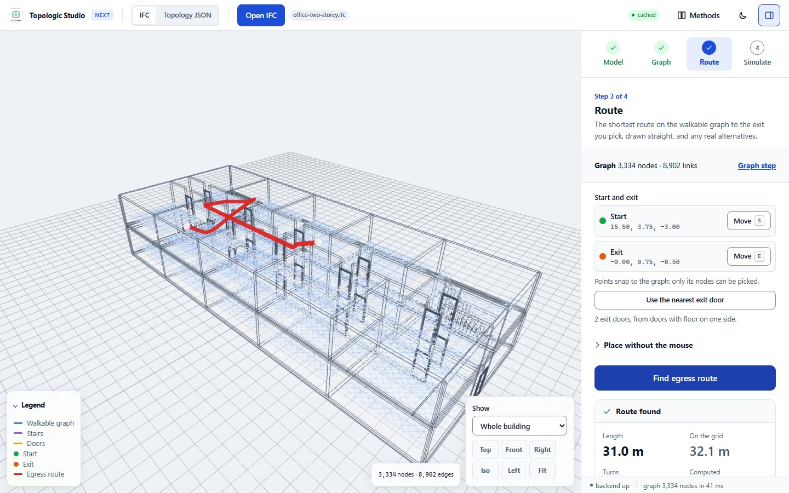</td>
    <td width="33%">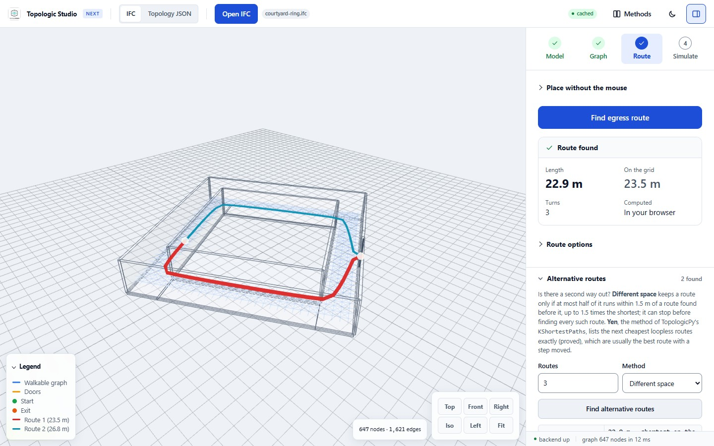</td>
    <td width="33%">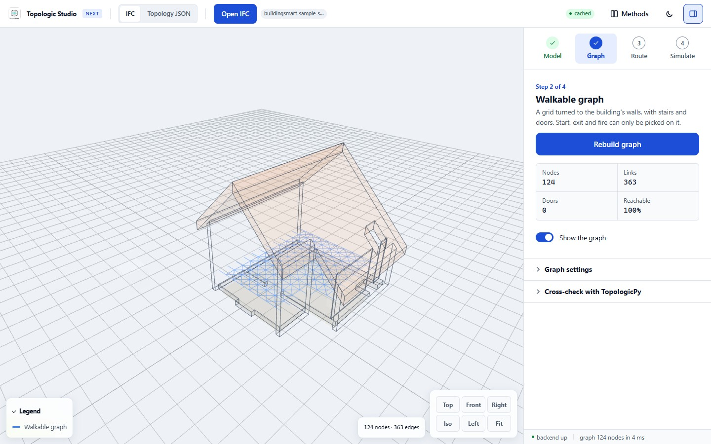</td>
  </tr>
  <tr>
    <td>Office: from an upstairs room along the corridor and down the stair (31.0 m).</td>
    <td>Courtyard ring: the two ways round the core, 23.5 m and 26.8 m.</td>
    <td>buildingSMART sample scene: its walkable graph (124 points, all reachable).</td>
  </tr>
</table>

The examples are converted when the site is built, so they open from a small
pre-converted file (81 KB for the Duplex, 862 KB for the 13.5 MB Vienna
building) without the IFC reader starting at all.

---

## What Studio does

The panel on the right walks through four steps: **Model**, **Graph**,
**Route** and **Simulate**. Each step opens with its one main button and puts
the result right under it. The pictures below follow the Duplex apartment.

### Model: what is in the file

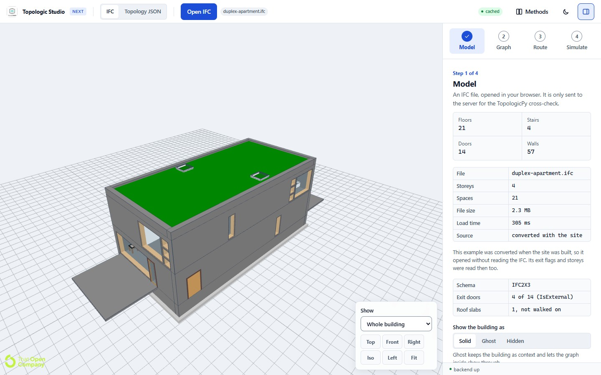

Studio reads IFC2x3 and IFC4 files. The Model step counts the floors, stairs,
doors and walls, the storeys and rooms (`IfcSpace`), and reports which doors
are exits and which slabs are roofs (roofs are not walked on).

Exits come from the file's own data: a door marked `FireExit` or `IsExternal`
in `Pset_DoorCommon`, or a door with an external space boundary. If the file
marks none, Studio falls back to doors with floor on one side only and says
so. The Duplex marks 4 of its 14 doors as external.

The first time you open a file it is converted and stored in your browser, so
the next time it opens from the cache without being read again (up to 24
models or 512 MB; clear them under **Local cache** in the Model step).

**What the elements are** names every element: by its IFC class where the
exporter typed it, and otherwise (furniture and appliances often arrive as
`IfcBuildingElementProxy`) by its name, then by the size of its box. With the
class hidden, these rules named 86% of 6,066 typed elements from 45 models
correctly. **Identify by shape** then runs IFCNet's point-cloud classifier
(Emunds et al. 2021) in your browser on the elements only the box could
place, and keeps its answer when it is at least 90% sure. The first use
downloads 4.5 MB. The comparison with IFCNet, text embeddings and small
language models is in
[wiki/research/ifc-identification-benchmark-2026-11-05.md](wiki/research/ifc-identification-benchmark-2026-11-05.md).

**Describe this model** writes a short plain description of the building,
its ways out and its fire. A language model writes it from the facts Studio
has already worked out (storeys, rooms, doors and exits, the walkable graph,
the route, the fire's results) and from nothing else. The facts are listed
under it before anything is written. On Chrome 148 or later on a desktop
computer, Chrome's built-in model writes it on the computer and nothing is
sent. On other browsers, a site deployed with the Cloudflare describer
([cloudflare/describe-worker](cloudflare/describe-worker/README.md)) can send
those facts, never the IFC, to a Workers AI model on Cloudflare's free
allowance instead.

**Show the building as** switches the model between Solid, Ghost (see-through,
so the graph shows inside) and Hidden. The view buttons give top, front,
side and isometric views, and **Show** cuts the building at a storey. A
**Second model** (an MEP or structural IFC of the same building) can be added
here; see [Fire suppression](#fire-suppression).

### Graph: where a person can walk

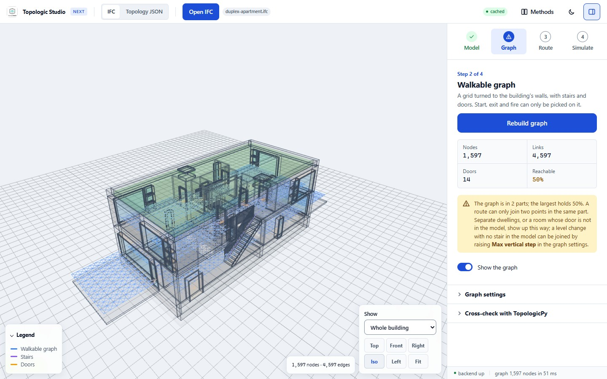

**Build egress graph** lays a grid of points over every floor, 0.5 m apart and
turned to line up with the walls, and joins neighbouring points that a person
could walk between. Walls cut 0.75 m above each floor block the links that
cross them, doors join the rooms on either side, and each stair is walked
along its flight. The whole graph is built in your browser, in a few
hundredths of a second for the Duplex (1,597 points and 4,597 links).

The step reports how much of the building one can reach from its largest
part. The Duplex is two homes side by side, so its graph is in two parts and
the app says so: a route can only join two points in the same part.

**Graph settings** change the grid spacing, the largest step a person can
climb, the agent's height, whether walls block links, and whether lifts and
escalators join floors (off by default, as in an evacuation). **Cross-check
with TopologicPy** builds TopologicPy's own navigation graph on the server
and reports how much of each graph the other covers.

### Route: the shortest way out

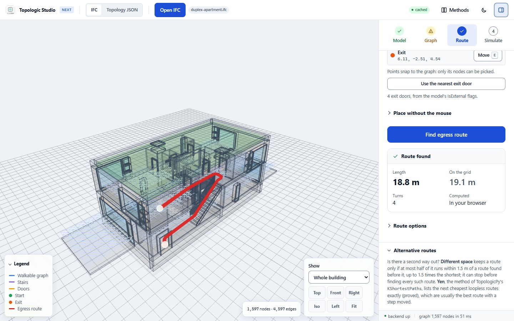

Press **Set** beside Start (or the S key) and click a point on the graph, then
set the Exit the same way, or press **Use the nearest exit door**. **Find
egress route** draws the shortest route and straightens it, so it reads as a
person would walk it rather than as a zigzag across the grid. The result gives
its length, the length on the grid before straightening, and its turns.

The nearest exit door is one of the doors out of the building, drawn as
orange rings. Where the model says which doors are external, these are the
external doors at street level and the fire exits that open onto no walkable
floor. A flat's front door flagged as a fire exit leads only to the stair,
and a balcony door leads nowhere, so neither counts: of the Vienna model's 35
exit doors, two lead out, the street door and a fire exit at the back of the
first floor.

Without a mouse, **Place without the mouse** puts the exit at any door from a
list, or any point at typed coordinates. **Route options** switch between the
built-in A* search (in your browser) and TopologicPy's `TGraph` engine (on the
server). **Alternative routes** look for other ways out: *Different space*
keeps routes that do not run along one already found, and *Yen* lists the next
cheapest routes exactly.

### Simulate: fire and smoke

Press **Set** beside Fire origin (or F), click where the fire starts, and press
**Start fire**. The fire spreads step by step on the graph while the route is
checked every five steps and moved away from the heat when it has to be (the
picture at the top of this page). It may move to any exit out of the
building, by another stair if it must; **Reroute towards**, under
**Rerouting and timing**, keeps it to the exit you picked instead.

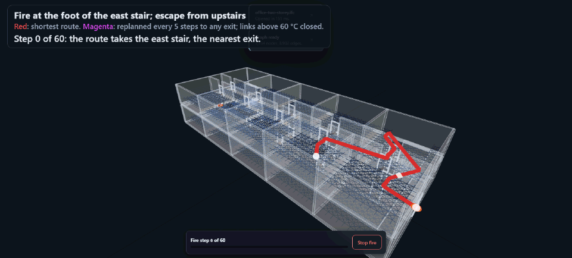

*The Office example, with a Flamescapes fire (class B) at the foot of the
east stair and **Impassable above** set to 60 °C. The route from the
upstairs room takes the east stair until step 20 (100 s), when the way out
by it passes 60 °C at head height; from then on it takes the west stair and
exit. The switch came at step 20 in each of five runs.*

Four fire models are offered, and two more with the optional Flamescapes
solver:

| Model | What it does |
| --- | --- |
| Heat diffusion (default) | Each point relaxes towards its neighbours; walls slow the heat. Needed for heat-weighted rerouting. |
| Spread along links | The fire moves one link per step, so walls and doors shape the front. |
| Distance bands | Straight-line distance from the origin, ignoring walls. |
| Two-zone rooms | A smoke layer and its gas temperature in each room, in seconds and degrees C, spreading through open doors. Needs the model's rooms (`IfcSpace`). |
| Flamescapes: fire and smoke (optional) | The Flamescapes combustion solver on a 3D grid built from the IFC: buoyant gas flow, burning room contents, radiation and smoke, read at head height at every graph node. |
| Flamescapes: fire, smoke and embers (optional) | As above, with embers carried by the hot gas that can start spot fires away from the flame. |

**The Flamescapes solver** is a JavaScript version of the fire solver in
*Flamescapes: Simulating the Wildlandfire Urban Interface* (Wrede, Wagner,
Pałubicki, Michels and Pirk, ACM Transactions on Graphics 2026, CC BY 4.0),
whose gas chemistry is that of *Fire-X* (Wrede et al. 2025). Switch it on
with **Flamescapes combustion solver (optional)** in the Simulate step. It
runs in your browser, on the GPU through WebGPU where the browser offers it
and otherwise on one CPU core; its frames play as they are computed, and the
route reroutes on the gas temperature at head height. How it differs from the
paper is in [Technical notes](#the-flamescapes-solver-in-the-browser).

**Show on the graph** colours the nodes by one of four readings at head
height: heat (the gas temperature), smoke (the visibility, or the soot
concentration, extinction coefficient, obscuration or optical density it
comes from), gases (CO, CO₂ or O₂), or a tenability index. The index is the
largest share of a limit a node has reached, over its gas temperature, its
visibility, and the asphyxiant and heat doses of ISO 13571 against a
fractional effective dose of 0.3, so that 1 means untenable. The smoke the
solver carries (its soot) is drawn as a grey cloud, faint in the heat view
and full in the smoke view. The run card says whether embers are on, and how
many were thrown and how many spot fires they lit.

**Doors** can be open, closed, **as built** or **random**. As built closes
the doors the model says close themselves: `Pset_DoorCommon.SelfClosing`, or
a fire rating whose EN 13501-2 class carries the self-closing mark -C (14 of
the Vienna model's 81 doors, rated EI2 30-C or EI2 30-C-Sm). Random closes a
share of the doors chosen with a seed, so a run can be repeated and compared
with another seed. A finished run is kept in the browser (at most 256 MB), so
the same fire asked for again, after a reload too, plays from its kept frames
instead of being computed; **Forget kept runs** clears them.

**What burns first.** The first item takes the fuel of its fire class: NFPA 10
classes A (ordinary combustibles), B (flammable liquids), C (energised
electrical equipment), D (metals) and K (cooking oils), and class L
(lithium-ion batteries, ISO 3941:2026). The panel says which extinguishers
suit the class and which are dangerous on it, for example water on cooking
oil. Each class's heat of combustion, CO and soot yields, growth and ignition
temperature come from a literature review
([wiki/research/ignition-sources-2026-11-05.json](wiki/research/ignition-sources-2026-11-05.json))
and are cited in
[fireClasses.js](topologicpy-web-frontend/src/core/fireClasses.js).

**Likely ignition points** finds where a fire most often starts in your
model, from its appliances, furniture and rooms ranked by their share of fire
deaths, and **Start here** puts the fire there with its class. **Cause**
narrows the list to one cause (cooking, an electrical fault, gas or liquid
fuel, heating, smoking or candles, lithium-ion batteries, waste, or a
deliberate fire with an accelerant); a gas fire at a cooktop starts as class
B rather than as cooking oil.


*Flamescapes on the Duplex, started at the cooking range (class K) on the
GPU: a pan fire of about 20 kW warms the kitchen at head height, and the
route changes to avoid it.*

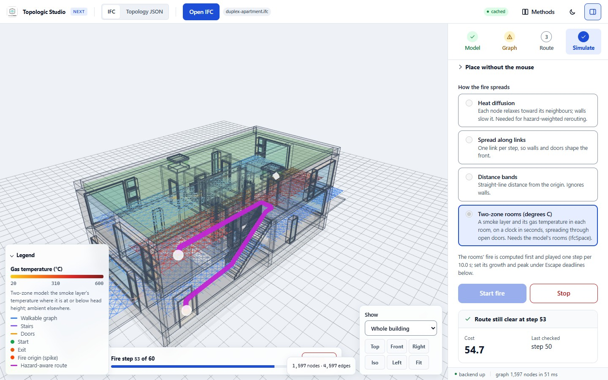

*Two-zone rooms on the Duplex: the rooms around the fire turn red as their
smoke layer heats, on a clock in seconds.*

**Plan with the forecast** runs the fire to its end first, then routes with
the state each point will be in when you would reach it. It reports the
earliest safe route and how long you could wait before leaving, and colours
the graph by escape deadline: for each point, the latest time to set off and
still get out within the dose limit (a fractional effective dose of 0.3,
walking at 1.2 m/s, over a five-minute forecast by default; all of these can
be changed under **Clock, speed and limits**). With a Flamescapes run it plans
on the same run, adding the CO dose of ISO 13571 to the heat dose.

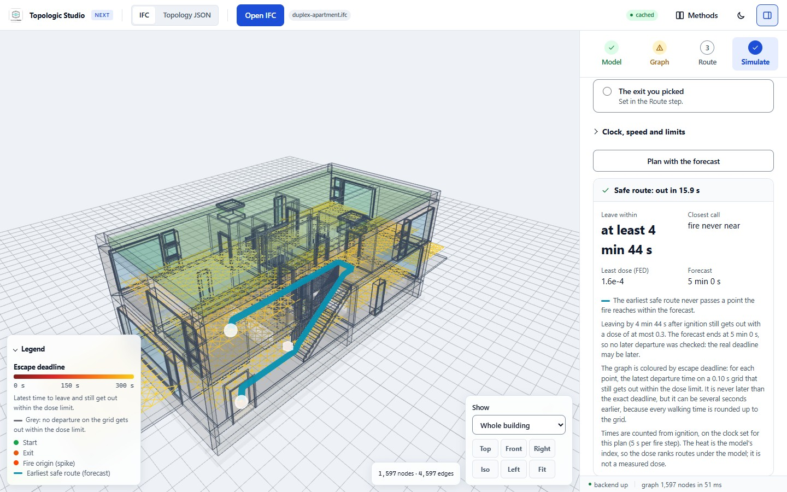

**Train an agent against this fire** trains an agent to find its own way out
while the fire spreads. Studio first checks whether any escape exists, so a
failed agent and an impossible escape are told apart.

- **Shielded (the default):** learns on (node, time) behind a shield that
  never lets it step where the fire will seal it in. It stops when it can
  prove its route is the earliest escape, by any exit door or the chosen one.
  Both properties are proved in Lean (`SafeEscape.lean`).
- **Q-learning:** the earlier tabular Q-learning (after Jabi et al. 2019),
  kept for comparison.

In a study of 848 runs on nine buildings
([wiki/research/rl-egress-study-2026-11-05.md](wiki/research/rl-egress-study-2026-11-05.md),
`tools/rl-bench.mjs`), most "failures" near the fire had no escape at all.
Where one existed, the Q-learning's drawn path missed it in 15% of runs,
mostly from the way its path was drawn. The shielded learner escaped in all
of them, by the earliest route, certified, in a median 1.8 ms.

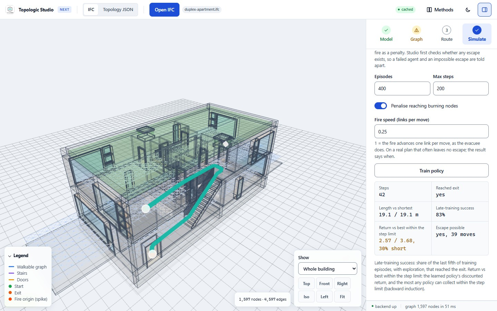

#### A fire in a larger building

The animations below repeat the Simulate step on the Vienna apartment
building (TU Wien), seven levels and 111 rooms. Each is a 300 s Flamescapes
run with embers, computed on the GPU in the browser. The fire starts in a
flat's living-kitchen, and the person leaves from the top floor, 53.8 m down
the stairwell to the street door. (They were recorded before Studio counted
the first-floor fire exit at the back, which is now the nearer way out, at
33.6 m.)

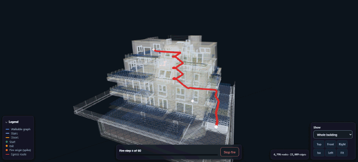

*All doors open. An electrical fault (class C) grows through the flat and
throws embers, which light spot fires. The graph shows the gas temperature
at head height, and the hazard-aware route (magenta) leaves the shortest
route (red) where the heat reaches it. With every door closed, the same fire
on the same grid released under a quarter of the heat. The solver's heat
release depends strongly on its grid, so these runs give no fire size to
quote.*

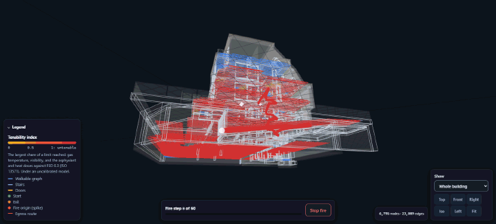

*A gas fire (class B) at the cooking range of the flat above, doors open.
The graph shows the tenability index: yellow as a node nears a limit, red
once it is untenable.*

The building model is by Fischer, Schranz, Urban, Pfeiffer and Flamm (TU
Wien, 2024, [doi:10.48436/wzp90-dmf60](https://doi.org/10.48436/wzp90-dmf60)),
under CC BY 4.0. The animations were made from frames of the running app
with `tools/frames-gif.mjs`.

### Fire suppression

Sprinklers, suppression systems by room use and portable extinguishers are in
the Simulate step, the sprinklers and systems under the Flamescapes models.
All are off by default; off, a run is exactly as before, at the same speed.

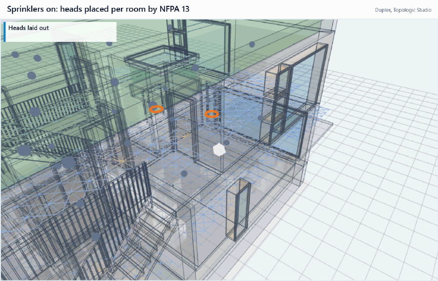

*Switching **Sprinklers** on lays out the heads; a Flamescapes fire then opens
the heads its hot gas reaches, and the open heads spray.*

An 84 s video, recorded from the app, compares the fires below and sums up
the results: [suppression-analysis.mp4](topologicpy-web-frontend/public/docs/media/suppression-analysis.mp4).

**Where the heads come from.** From the IFC where it has them
(`IfcFireSuppressionTerminal`, or an IFC2x3 flow terminal typed as one, with
the Revit property sets' temperature rating and K-factor), else from a second
model of the same building, else placed per room by NFPA 13 on the model's
`IfcSpace` rooms: at most 20.9 m² a head and 4.6 m apart for light hazard
(12.1 m² for kitchens, plant rooms and car parks), no more than half the
spacing from a wall, at least 1.8 m apart, and every point of the floor
covered. Heads hang under the slab or roof over each room. A space with
nothing over it, such as a terrace or a balcony, is taken as outside when no
wall round it rises 1.5 m above its floor or its name says so, and gets no
heads. Each room gets a rule report with the clauses of SBC 801-CR-2018 903.3
and NFPA 13, and the codes' requirement for sprinklers is checked for the
building's occupancy (Group R throughout, a storey with 30 or more occupants
at 16.8 m or more, high-rise). Vienna's heads are laid out in under 50 ms,
and its runs take no longer with them.

**When a head opens.** A Flamescapes run opens each head when its link
reaches its rating, by the RTI equation with conduction to the mount. It is
stepped exactly on two readings of the gas: Alpert's ceiling jet for the
run's heat release under the fire's own ceiling (the estimate) and the gas at
the top cell of the head's column (the late bound). The run card gives both
times and the heat release at each. No IFC carries a head's RTI or C, so
quick response is 50, standard 100 and C 0.4, as the panel says. In the test
fires on the Duplex the first head opened 16 to 21 s after ignition by the
estimate.

Checked against measured tests (Vettori 1998 and 2003, Bittern 2004, UL/NFPRF
1998; `tools/sprinkler-validation.mjs`), the link reproduces Vettori's
activations when given the measured gas (median 1.00), but on the fire grid
the estimate is late in rooms (about 1.1 to 1.7 times the measured time, some
heads not opening) and close under a high open ceiling, because the solver's
walls take much of the ceiling jet's heat. The run card says so. The numbers
are in [Technical notes](#sprinkler-activation-and-its-validation).

**What an open head does** is chosen under **An open head**. Where the head
sprays, part of its water evaporates in the hot gas on the way down (Fire-X's
energy-limited evaporation on the grid), the steam diluting the oxygen.

- **Wets the fuel (the default).** The water that reaches the fuel soaks into
  it, a share calibrated so that at the light hazard density it burns as much
  as Evans's cap.
- **Evans's cap and the spray.** The fuel under the head is capped as Evans
  measured for the spray's density (1993: the least reduction to expect), and
  the head sprays.
- **Evans's cap only**, or **only opens**, which leaves the fire as it is.

The heads show in the view, blue once open, and open heads are drawn
spraying. Wetting is the default because, in 12 test fires on the Duplex,
Vienna, and the NIBS Office and Clinic (`tools/sprinkler-check.mjs`), it cut
the heat released by 20 to 79 % in most fires, while Evans's cap and the spray
ranged from 40 % less to 78 % more. In the Clinic's large rooms the heads
opened late (63 to 68 s, when the fire was already large) and no mode helped. A single run can
mislead: the fire's own scatter is large (see
[Technical notes](#sprinkler-activation-and-its-validation)).

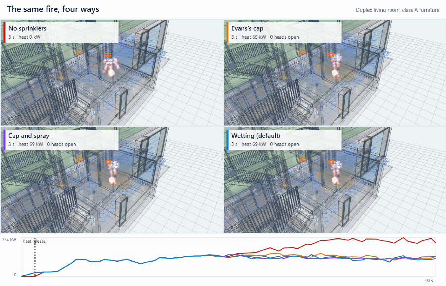

*The same fire with no sprinklers, with Evans's cap, with the spray, and
with wetting, side by side.*

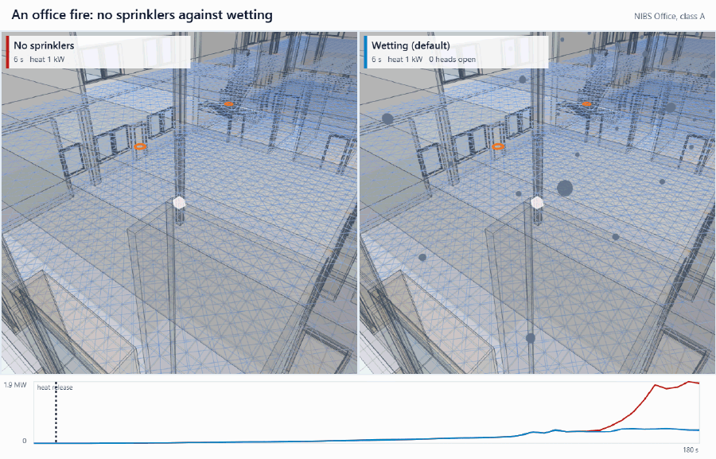

*An open office fire over 180 s. With no sprinklers it grows to several
megawatts, in spikes that are the solver's pyrolysis gas gathering and
flashing; with them, the first head opens at 61 s and the fire stays below
1 MW. One run each: a single run's numbers are not to be quoted.*

**Water by fire class.** Sprinkler drops, about 1 mm across, are too large to
put a flame out in the gas; sprinkler water works by cooling the burning
surface where it reaches it (Rasbash 1986). So an item of class A, or of
class C once the circuit is dead, is wetted and capped, while heptane (B),
cooking oil (K), magnesium (D) and a lithium-ion pack (L) are not, and the
panel says why: the water sinks through the pool, erupts the oil, feeds the
metal hydrogen, or does not reach the cells. The room's class A contents
round them are wetted and capped as usual.

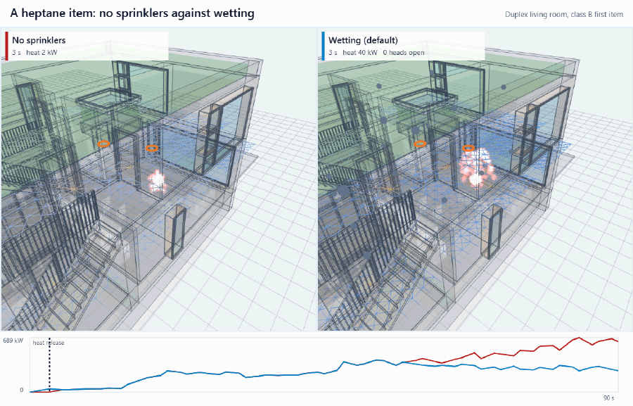

*A heptane item as the first to burn. The water does not reach the pool, but
it wets the room's other contents, so the fire stays smaller.*

**A second model.** In the Model step, an MEP or structural IFC of the same
building is drawn in the first one's frame through the two files'
coordination, or their map conversions when both have one, and checked
(units, site placement, storeys by elevation, how much the plans share). Its
sprinklers feed the layout: the NIBS Office's HVAC model brings 292 heads,
placed 5 cm under the architecture's ceilings. Its beams and ducts are
checked by NFPA 13's beam, three times and wide-obstruction rules, with heads
moved clear of them or added beneath; a switch makes them solid in the fire
grid.

**Extinguishers** (off by default) are read from the IFC by name or placed on
the walk so nowhere is more than 22.86 m from one (SBC 801-CR-2018 906,
NFPA 10). After a fire, one person's attempt is judged against what the
unit's rating can put out: put out, not put out, or cannot tell. On the
Duplex, 4 units are placed in 215 ms; a person who sets off on seeing the
fire attacks at 58 s against 37 kW (put out), and one who waits for the
alarm attacks at 222 s against 547 kW (cannot tell). The attempt does not yet
change the fire in the run.

**Suppression systems by room use** (off by default, under the Flamescapes
models). Each room gets its system from its name and the building's occupancy,
which is the performance check's occupants setting:

- Apartments and hotels (Group R): water sprinklers in every room (SBC
  801-CR-2018 903.2.8).
- Server, computer, telecom, electrical and UPS or battery rooms: a clean
  agent, HFC-227ea (FM-200), at NFPA 2001's class C design concentration of
  7 %. The room keeps its sprinklers (NFPA 75); **Agent only** leaves them
  out, which needs the fire official's approval.
- Generator, fuel, oil, flammable-liquid and hazardous storage rooms:
  foam-water sprinklers at 6.5 L/(min m²) (NFPA 11).
- Every other room: water.

The special rooms also get an extinguisher of their own at the door: carbon
dioxide at IT, telecom and electrical rooms, class B foam at fuel rooms, and
class K at kitchens. The ABC powder units on the routes come from
Extinguishers. The NIBS Office gets 89 water rooms and 9 clean agent rooms
(330 kg of agent). The Clinic gets 250 water, 10 clean agent and 2 foam rooms
(its hazardous and flammable stores). The Duplex, as apartments, gets water
only.

In a run, a clean agent room is released once a detector in each of two zones
under its ceiling sees smoke and 30 s have passed. The agent rises to 7 % over
10 s and holds for 10 minutes. At 5.2 % (6.62 % over a liquid's vapour),
flames and smouldering in the room stop, but hot fuel goes on giving off
vapour. The room is taken as closed and well mixed: the agent does not cool
the room or dilute its oxygen, and the release does not close the model's
doors. In a foam room, the blanket cuts a pool's evaporation to a tenth in
about 10 s and to nothing in about 30 s (Back and Farley 2020), and the
solution's water wets the room's ordinary fuel.

The systems were tested in server room fires (class C, 180 s, the mean of
three contents seeds, `tools/systems-check.mjs`):

- Sprinklers cut the heat released by 65 % in the Office and 28 % in the
  Clinic.
- The clean agent cut it by 95 % and 93 %, acting at 42 s.

In the Clinic's store, a heptane spill kept alight lost 26 % of its heat to
sprinklers and 41 % to foam. The sources and every value are in
`wiki/research/suppression-systems-by-room-2026-11-07.md`.

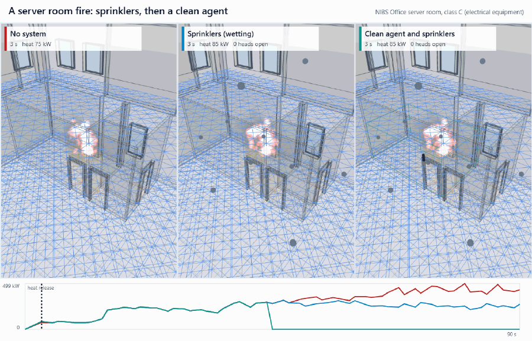

*A server room fire with no system, with sprinklers, and with the clean
agent: the room fills teal once the agent is released.*

### Checks: the code check and the performance check

Both checks are in the Route step.

**Code check** tests each storey's egress for offices (occupancy group B):
the walk to the nearest exit, the number of exits for the occupant load and
their separation, door widths, and whether the building is high-rise. Each
limit is the stricter of the Saudi Fire Code SBC 801-CR-2018 and the
International Building Code 2021, so a pass meets both, and every result
names both clauses.

**Performance check (with the fire)** reads the escape deadlines of a
forecast (Simulate step, **Plan with the forecast**). A place passes when
someone there can wait for detection, the alarm, the 99th percentile of
pre-movement time and any queue at the doors, and still get out with a dose
under the limit. It reports, per storey, the worst margin, the least
ASET/RSET, the share of occupants who start in time and the longest wait at
the doors. **Add fires on every storey** plans more fires, each check adds
the sensitivity cases its plan allows, and **Download the report** saves
every fire, case, input and source as one page.

It is evidence for an alternative method (SBC 801-CR-2018 Section 104.9)
beside the code check, not a replacement for it. Its presets, detectors,
queues, criteria and the Lean statements behind it are in
[Technical notes](#the-performance-check-in-detail).

### The Methods page

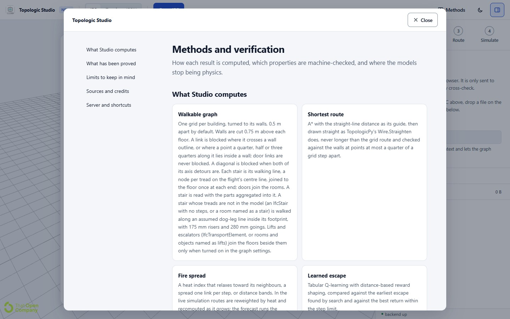

**Methods** in the header opens a page that explains how each result is
computed, which properties are machine-checked in Lean 4 (with the equations
rendered), the limits of each model, the sources, and the server status and
keyboard shortcuts.

---

## Working with Studio

### Using your own IFC files

Studio works best on architectural models with slabs or floors, walls, doors
and stairs. Some things that help, and what Studio does when they are missing:

- **Exits.** Mark exit doors with `FireExit` or `IsExternal` in
  `Pset_DoorCommon`, or give them an external space boundary. Otherwise Studio
  guesses from doors with floor on one side only, and tells you it did.
- **Stairs.** Stairs are walked along their flights, including flights and
  treads aggregated into an `IfcStair`. A stair modelled without treads, or a
  room named as a stair, is walked along an assumed dog-leg line inside its
  footprint.
- **Lifts and escalators** (`IfcTransportElement`, or rooms and objects named
  as lifts) join floors only when **Use lifts and escalators** is on.
- **Rooms** (`IfcSpace`) are needed for the two-zone fire model and for
  placing sprinklers per room. Where a model has few or no floor slabs (the
  NIBS Office walks on its spaces), the Flamescapes grid takes the spaces'
  floors as slabs.
- **Up axis.** Most files are read correctly as they are; if the graph lies on
  a wall instead of a floor, change **Up axis** in the graph settings.
- **Separate parts.** If the Graph step reports several parts, a route cannot
  cross between them: check for missing doors, or raise **Max vertical step**
  where a level change has no stair in the model.

Files in the older IFC2X_FINAL schema, structural or MEP-only models and
models with no floors are refused or give an empty graph, with a message
saying why. A structural or MEP model can still be added as a second model.

### On a phone

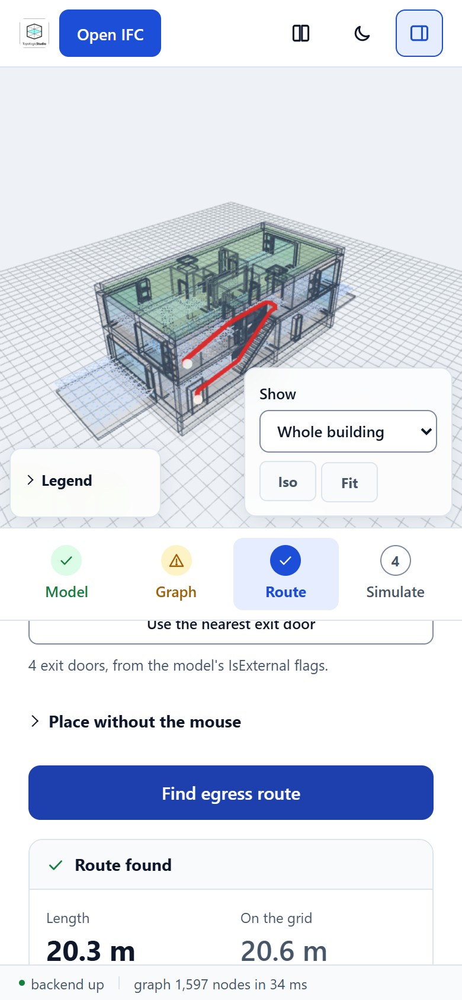

On a narrow screen the viewer sits above the steps, and the panels scroll
underneath. Tap **Set** and then tap the graph to place a point, or use
**Place without the mouse** to pick an exit door from a list. The examples
are the quickest start on a phone; your own files are converted on the phone
itself, so a large model takes longer the first time and opens from the cache
after that.

Measured on an emulated mid-range phone (4G, processor slowed four times,
empty cache), opening the Duplex example until it can be used takes about 1 s,
and opening the Duplex IFC file about 1.2 s.

<br clear="right">

### Exporting results to TopologicPy

**Export for TopologicPy (JSON)**, in the Graph step and under a finished
fire in the Simulate step, downloads the walkable graph in the JSON layout
TopologicPy's `Graph.ExportToJSON` writes, so `Graph.ByJSONFile` reads it
back (checked with topologicpy 0.9.86):

- **Vertices:** every node in the IFC's own world coordinates (metres, Z
  up, at floor level). The viewer's axis turn, the model's coordination
  matrix and the agent's lift are undone.
- **Node attributes:** its kind (floor, stair, door, lift) and its place on
  the route. After a Flamescapes run they also hold the gas temperature,
  visibility, CO, soot, CO₂ and O₂ at head height for every frame, their
  extremes, the time the node became untenable, its tenability index and its
  asphyxiant and heat doses. After a graph fire model they hold whether the
  node was burning at the end.
- **Edges:** source and target, kind, length in metres, and whether the
  edge is on the route.
- **Graph properties:** the source file, the fire model and its settings
  (fire class, doors, windows, ventilation, grid and backend), the fire
  origin in IFC coordinates, the frame times and the heat release series.

```python
from topologicpy.Graph import Graph
from topologicpy.Topology import Topology
from topologicpy.Dictionary import Dictionary

g = Graph.ByJSONFile(open("duplex-apartment-topologicpy.json"))
first = Graph.Vertices(g)[0]
print(Dictionary.PythonDictionary(Topology.Dictionary(first))["untenable_s"])
```

**Export the run as a table (CSV)**, under a finished Flamescapes fire,
writes one row per node per frame: its place and kind, the time, every
reading and measure, the two doses and the tenability index, gzipped for a
spreadsheet or a machine-learning dataset.

### Keyboard shortcuts

| Key | Action |
| --- | --- |
| S | Set the start |
| E | Set the exit |
| F | Set the fire origin |
| G | Show or hide the graph |
| M | Show or hide the building |
| B | Build or rebuild the graph |
| Enter | Find the route |
| Esc | Cancel picking; close the Methods page |

---

## How it works and what is verified

### What runs where

| In your browser | On the server (optional) |
| --- | --- |
| Opening and caching IFC files | TopologicPy `TGraph` route engine and its k-shortest routes |
| Building the walkable graph | Navigation cross-check (the IFC file is uploaded for this) |
| Routes, straightening and alternative routes | The **Topology JSON** viewer for TopologicPy files |
| Fire spread, rerouting and the forecast | |
| The optional Flamescapes solver (WebGPU on your GPU where offered, else one CPU core) | |
| Sprinklers, extinguishers, the code check and the performance check | |
| Reinforcement learning | |

The server is a FastAPI service around
[TopologicPy](https://github.com/wassimj/topologicpy), hosted at
<https://topologicstudio-backend.onrender.com>. When it is connected, the
walkable graph (points and links, not the model) is uploaded in the
background so the TopologicPy features can use it. On its free plan the server
sleeps after about 15 idle minutes, and the first request after that takes
30 to 50 s; everything in the left column keeps working while it wakes, or if
it is never reached.

### The pipeline

```
IFC file
  │
  ├─ SHA-256 ──────────────► IndexedDB cache: fragments + exit flags      lib/fragmentCache.js
  │                               │ hit: open without reading the IFC
  ├─ import worker ◄──── miss ────┘                                       workers/ifc-import.worker.js
  │     IFC → That Open fragments, then exit doors, storeys, roofs        core/ifcSemantics.js
  │
  ├─ viewer: fragments on screen, floor / stair / door / wall geometry     viewer/ViewerManager.js
  │
  ├─ graph worker: wall-aligned walkable lattice, stairs, cores            workers/sampler.worker.js, core/lattice.js, core/cores.js
  │
  ├─ in the page: A* + straightening, alternatives, fire spread            core/route.js, core/straighten.js, core/alternatives.js, core/fire.js
  ├─ forecast worker: time-dependent routes, escape-deadline map, zones    workers/forecast.worker.js, core/forecast.js, core/deadline.js, core/zone.js
  ├─ RL worker: the shielded learner, or Q-learning, against the fire      workers/rl.worker.js, core/rlSafe.js, core/rl.js
  │
  └─ optional server: graph uploaded in the background                    topologicpy-web-backend/
        TGraph routes, Navigation cross-check, Topology JSON
```

Paths are under `topologicpy-web-frontend/src/` unless shown otherwise. The
sprinkler layout and activation are in `core/sprinklers.js` and
`core/suppression.js`, the extinguishers in `core/extinguishers.js`, and the
checks in `core/codeCheck.js` and `core/performanceCheck.js`.
[docs/README-classic.md](docs/README-classic.md) describes the original
version, which built the graph on the server; this line moved that work into
the browser.

### What is verified

- **Tests.** Unit and property tests of the browser core, and a browser suite
  that drives the real app in Chrome through the whole workflow and fails on
  any console error, uncaught exception or failed request
  ([Tests and checks](#tests-and-checks)).
- **Speed and accuracy.** A benchmark on 38 public models, against an exact
  geodesic, with a stress suite of known bugs
  ([benchmark/README.md](benchmark/README.md)).
- **Proofs.** 37 Lean 4 modules with 1,534 theorems and lemmas, on Lean's
  standard axioms only: the routing, the fire models, Fire-X and Flamescapes
  and the browser port, the learned escape, sprinklers and suppression, the
  second model, the obstruction rules, extinguishers, wetting and the
  performance check ([What is proved in Lean](#what-is-proved-in-lean)).
- **Measured tests.** Sprinkler activation against NIST's full-scale tests
  ([Technical notes](#sprinkler-activation-and-its-validation)), the element
  names against 45 models, and the learned escape against 848 runs on nine
  buildings (both above).

## Limits to keep in mind

These are also on the Methods page.

- **A coarse grid.** Flamescapes in the browser is coarse. The paper resolves
  centimetres on a desktop GPU; here a cell is 0.2 to 0.45 m and a step 0.1 s. A surface
  layer of the fuel, a sub-grid rule for where an ember lands, the first item
  alight from the start, the paper's raised solid-gas heat transfer
  coefficient and exact integration of each reaction over a step stand in for
  what the paper resolves. It is not calibrated against room fire tests.
- **Doors, windows and ducts.** Walls and slabs do not burn. Doors are open
  and windows closed unless the **Doors** switch beside the fire controls or
  **Windows** in the Flamescapes settings say otherwise; a closed door or
  window has no gaps. **Ventilation: running** joins the model's air
  terminals through one well-mixed duct volume at an assumed 100 L/s a
  terminal, without reading which system each belongs to or the ducts
  themselves, so it shows the furthest the ducts could spread smoke.
- **Contents, embers and pools.** Room contents are a statistical fire load,
  and CO does not rise when the fire is short of air. Indoors at these cells
  embers seldom land hot enough to light anything: in a 120 s fire in the
  Duplex they lit none. A liquid pool (classes B and K) evaporates at most at
  its burning rate (Babrauskas 1983) and lights, but much of its vapour stays
  unburnt: a 1 m² heptane pool reached 0.3 MW after 30 s in a test room,
  against the 3.2 MW its burning rate allows.
- **Large models and smoke.** Large models are clipped to the area round the
  fire, and the grid's sides are open to outside air, so a clipped building
  is never fully closed. The flow is solved as incompressible: heated gas
  takes up no extra volume, so a closed room never pressurises and smoke may
  reach head height later than it would.
- **Sprinkler timing.** On the fire grid the estimate opened the first head
  later than measured in rooms, up to twice as late or not at all, and heads
  behind beams may not open. A late opening delays the modelled suppression,
  so for tenability the bias is conservative; for anything that starts on
  sprinkler flow, such as an alarm, it is not. An extinguisher attempt is
  judged but does not change the fire in the run.
- **Temperature.** In the graph models the temperature is an index, scaled to
  read 20 to 120 degrees C, not a temperature a sensor would measure. Doses
  computed from it rank routes under the model; the ISO 13571 limits do not
  carry over.
- **Time in steps.** Fire time is counted in steps; the forecast converts
  steps to seconds with a factor you set. Fire growth is not calibrated.
- **Waiting.** In the live simulation the evacuee waits while the fire grows,
  and each reroute starts from the original start. A route that has to pass
  through fire is drawn but reported as not safe.
- **One part.** A route stays within one part of the graph.
- **Walking.** Stairs are walked at level speed (reference tools use about
  half to nine tenths of it). The routes have no queues at doors, no slowing
  in smoke and no pre-movement time; the performance check adds pre-movement
  and queues at doors, but not stair flow or speed classes. These are the
  next modelling gaps; see [wiki/HANDOFF.md](wiki/HANDOFF.md).
- **Assumed stairs and lifts.** They are approximate: an assumed stair has no
  known width, and a lift ride counts as walking its rise, with no wait for
  the car.

---

## Running Studio on your own computer

### Just the app (no server)

Needs [Node.js](https://nodejs.org/) 20.11 or later.

```bash
git clone https://github.com/libishm1/Topologic_Studio.git
cd Topologic_Studio/topologicpy-web-frontend
npm ci        # also copies web-ifc's WASM and the fragments worker into public/
npm run dev   # http://localhost:5173
```

Everything in the browser column above works without the server; the status
bar shows "backend offline". To make the examples open pre-converted in
development too, run `npm run prepare-examples` once. This guide is served at
<http://localhost:5173/docs/index.html>.

### With the server

Needs Python 3.12.

```bash
cd Topologic_Studio
python -m venv .venv-next
.venv-next/Scripts/python -m pip install -r topologicpy-web-backend/requirements-dev.txt   # bin/python on macOS and Linux

cd topologicpy-web-backend
../.venv-next/Scripts/python -m uvicorn app.main:app --reload --port 8000
```

Check it: <http://localhost:8000/api/capabilities> should report
`"usable": true`. API documentation is at <http://localhost:8000/docs>. If the
server is not on `localhost:8000`, copy `topologicpy-web-frontend/.env.example`
to `.env` and set `VITE_API_BASE`.

> **TopologicPy packaging.** TopologicPy 0.9 moved its geometry kernel into a
> separate `topologic-core` package. Installing `topologicpy` alone imports
> fine and then fails at the first geometry call. Both are pinned in
> `requirements.txt` (`topologicpy==0.9.86`, not 0.9.87, which removes
> `Graph`).

On Windows, `studio.cmd` at the repository root starts both in their own
windows (`studio`, `studio stop`, `studio status`, `studio test`), and
`dev.ps1` does the same from PowerShell.

## Tests and checks

| What | Command | Where |
| --- | --- | --- |
| Unit and property tests of the browser core (349 on 2026-11-07) | `npm test` | `topologicpy-web-frontend` |
| Lint | `npm run lint` | `topologicpy-web-frontend` |
| Production build (also converts the examples) | `npm run build` | `topologicpy-web-frontend` |
| Server tests | `../.venv-next/Scripts/python -m pytest tests -q` | `topologicpy-web-backend` |
| The real app in Chrome, end to end | `npm install`, then `npm run test:browser -- --ifc topologicpy-web-frontend/public/examples/duplex-apartment.ifc` (add `--mobile` for a phone) | repository root, with the app running |
| Speed, accuracy and robustness benchmark on 38 public models | `node tools/benchmark.mjs` | see [benchmark/README.md](benchmark/README.md) |
| Speed and sanity of all six fire models, Flamescapes timed per stage | `node tools/fire-bench.mjs [model.ifc ...]` (add `--sprinklers` for heads placed per room) | repository root; results in `benchmark/results/` |
| The Flamescapes solver on one IFC | `node tools/flamescapes-check.mjs [model.ifc] [--embers]` | repository root |
| Sprinklers: each mode against the free fire, and activation against NIST's measured tests | `node tools/sprinkler-check.mjs [model.ifc ...]`, `node tools/sprinkler-validation.mjs` | repository root |
| Lean 4 proofs (37 modules, 1,534 theorems and lemmas) | `lake build` | [formal/fireegress](formal/fireegress/README.md) |
| This README's screenshots | `node tools/readme-shots.mjs` | repository root, with the app running |

The browser suite drives the installed Chrome (no browser download) through
the whole workflow and fails on any console error, uncaught exception or
failed request.

---

## Technical notes

These notes hold the detail behind the sections above. The
[guide](https://libishm1.github.io/Topologic_Studio/docs/) sets the same
material out by topic.

### The Flamescapes solver in the browser

The solver runs on the GPU through WebGPU where the browser offers it,
otherwise on one CPU core at 2.8 to 2.9 times real time for the Duplex (34 to
36 ms a step, `tools/fire-bench.mjs`), several times faster on a GPU. **Plan
with the forecast** plans on the same run, adding the CO dose of ISO 13571 to
the heat dose. Where it departs from the paper, and why, is under
[Limits](#limits-to-keep-in-mind); the transcriptions of both papers, with the
changes stated, are in [wiki/sources/papers/](wiki/sources/papers/).

### Sprinkler activation and its validation

- **On measured gas** the link opens Vettori's 1998 heads at 0.81 to 1.18 of
  the measured time (median 1.00).
- **On the fire grid** the estimate's median is 1.68 times the measured time
  in Vettori's 1998 room, 1.09 under his 2003 flat ceiling and 1.18 in
  Bittern's rooms (9 of 16 heads opening); under UL/NFPRF's high open ceiling
  the first heads open at 0.98 to 1.11. Heads behind the 2003 beams did not
  open, and the late bound opened 1 head of 110 within twice the measured
  time, so it is not shown as the time a head opens.
- **The cause** is mostly the solver's surface coefficient of 200 W/(m² K),
  which takes most of the jet's heat into the walls, with a coarse plume; a
  0.2 m grid does not help. Changing it would change every Flamescapes run,
  so it is left open.
- **Scatter.** The same Duplex fire with its room contents laid out three
  ways released 137 to 272 MJ with no sprinklers; across the three, wetting
  cut 60 to 79 %, the spray changed the heat by +20 to -55 % and the cap by
  +11 to -38 % (`tools/sprinkler-seeds.mjs`).

The table by data set, the causes and Evans's cap against his own data are
in the [guide](https://libishm1.github.io/Topologic_Studio/docs/suppression.html#validation);
the results R1 to R9, with the data sets and their licences, in
[wiki/research/sprinkler-validation-data-2026-11-07.md](wiki/research/sprinkler-validation-data-2026-11-07.md);
and the build in
[wiki/research/fire-suppression-sprinklers-2026-11-07.md](wiki/research/fire-suppression-sprinklers-2026-11-07.md).

### The performance check in detail

- **Presets** give the alarm and pre-movement times, the share of occupants
  who never respond and the floor area per occupant for offices, classrooms,
  apartments, hotels and assembly (PD 7974-6, ISO/TR 16738, the Australian
  FSVM data sheets, New Zealand's C/VM2 and IBC 2021 Table 1004.5).
- **Detection.** With a Flamescapes fire, detection is when the smoke reaches
  a smoke detector's optical density (0.097 per metre, C/VM2) at virtual
  detectors under the ceiling, 7 m from the fire or as far as its room
  allows.
- **Queues.** Occupants on every place walk to the nearest exit and queue at
  each door at 1.32 persons a second per metre of effective width (C/VM2
  3.5.3), with the door widths from the IFC.
- **Measured pre-movement.** A measured spread (the Weibull fits of Lovreglio
  et al. 2019) is judged beside the design log-normal and drawn with it,
  without changing the verdict.
- **Criterion.** A base case, ASET at least twice RSET and at least 30 s over
  it (Singapore SFEG 2025, the Italian fire code), a sensitivity case at 1.2
  times, or the 99th percentile alone.
- **Report.** **Add fires on every storey** plans two more fires a storey
  (one next to an exit, one farthest from the exits), and each check adds the
  sensitivity cases its plan allows (the exit nearest the fire blocked; the
  first detector failing).
- **Proved in Lean** (`Performance.lean`, `DoorQueue.lean`,
  `PreMovement.lean`): a pass at the 99th percentile means at least 99 % of
  those who respond start in time, the factor on RSET is a margin of at least
  the factor less one times RSET, a pass on the conservative deadline map is
  a pass on the exact deadline, the door queues never pass more than a door's
  capacity and have cleared everyone by the time the check reads, a later
  start never leaves a door earlier, and the report passes only when every
  case of every fire does.

### What is proved in Lean

[formal/fireegress/README.md](formal/fireegress/README.md) lists each of the
37 modules, what it proves, what it leaves out, and where it shows in the
app. Every theorem depends only on Lean's standard axioms, with no `sorry`
(`formal/fireegress/axioms-all-2026-11-07.txt`). Among them: A* returns a
least-cost route (`AStar.lean`), the shielded learner's route is a safe and
earliest escape (`SafeEscape.lean`), the equations of Fire-X and Flamescapes
and the port's schemes (`FireX.lean`, `Flamescapes.lean`,
`FlamescapesPort.lean`), the sprinkler layout, link and Evans's cap
(`Sprinklers.lean`, `Suppression.lean`), the obstruction rules, extinguishers,
the second model's frame and wetting (`Obstructions.lean`,
`Extinguishers.lean`, `Federation.lean`, `Wetting.lean`), and the performance
check above. The proofs also found errors, in the review and in the code's
own comments, which the README there lists.

### Server API

| Method | Path | Purpose |
| --- | --- | --- |
| `POST` | `/api/ifc/graph/import` | Store a graph built in the browser |
| `POST` | `/api/ifc/graph` | Build a graph from a sampled point cloud |
| `GET`, `DELETE` | `/api/ifc/graph/{id}` | Fetch or drop a stored graph |
| `GET` | `/api/graphs` | Store contents |
| `POST` | `/api/ifc/path` | Route, optionally heat-weighted, on either engine |
| `POST` | `/api/ifc/path/compare` | Run both engines and report whether they agree |
| `POST` | `/api/ifc/path/alternatives` | Up to k routes: through different space, or Yen k-shortest |
| `POST` | `/api/ifc/navigation-check` | Upload an IFC; compare TopologicPy's Navigation graph with Studio's |
| `POST` | `/api/fire/timeline`, `GET` `/api/fire/stream` | Server-side fire runs (the app runs fire in the browser) |
| `POST` | `/api/rl/train` | Server-side Q-learning |
| `GET` | `/health`, `/api/capabilities` | Status and what this server can do |

The original version's routes (`/ifc-egress-graph`, `/ifc-egress-path`,
`/graph-meta`, `/upload-topology`, `/upload-ifc`) are still served with their
original shapes.

### Repository layout

```
Topologic_Studio/
├── topologicpy-web-frontend/   the app (React + Vite, That Open engine, web-ifc)
│   ├── src/core/               routing, graph, fire, sprinklers, checks, forecast, RL, IFC semantics, with their tests
│   ├── src/workers/            import, graph, forecast and RL workers
│   ├── src/viewer/             the 3D viewer
│   ├── src/ui/                 the panels, viewport and Methods page
│   ├── public/examples/        the seven example IFCs and their credits (index.json)
│   ├── public/docs/            the guide on the website
│   └── scripts/                asset sync and the build-time example conversion
├── topologicpy-web-backend/    the optional FastAPI + TopologicPy server
├── tools/                      browser suite, benchmarks, model and sprinkler checks, screenshot script
├── benchmark/                  the benchmark's model list, validation data and results
├── formal/fireegress/          Lean 4 proofs of the routing, fire and suppression models
├── wiki/                       handoff, research notes, roadmap and reviews
├── docs/                       images for this README and the original version's README
└── render.yaml                 the server's Render blueprint
```

### Deployment

- **Website.** Every push to `main` runs
  `.github/workflows/deploy-frontend.yml`, which builds the app with
  `BASE_PATH=/Topologic_Studio/` and the server address from the repository
  variable `VITE_API_BASE` (default: the Render service), and publishes it to
  GitHub Pages. The guide in `public/docs/` is published with it.
- **Server.** The Render service `topologicstudio-backend` runs the Docker
  image in `topologicpy-web-backend/` as described in `render.yaml`. Redeploy
  it from the Render dashboard after server changes.
  `.github/workflows/backend-image.yml` builds the image and runs the server
  tests inside it on pushes to `main` and the development branches.
- Development happens on the `next/browser-core` branch; `main` is moved to it
  only after the tests, lint, build and both browser suites pass. The
  version that ran before 2026-10-27 is tagged `classic-2026-10-27`.

## Further reading

- [The guide on the website](https://libishm1.github.io/Topologic_Studio/docs/):
  the features, the fire and suppression models, the checks and the methods,
  page by page.
- [wiki/HANDOFF.md](wiki/HANDOFF.md): the current state, the latest changes and
  the open work.
- [benchmark/README.md](benchmark/README.md): speed and accuracy on 38 public
  models, against an exact geodesic, with a stress suite of known bugs.
- [formal/fireegress/README.md](formal/fireegress/README.md): what has been
  proved in Lean 4 and where each proof shows in the app.
- [wiki/research/](wiki/research/): the fire-egress methods review, the
  verified equations, the gap analysis, a study of open-source evacuation
  tools, and the sprinkler, extinguisher and performance-check notes.
- [docs/README-classic.md](docs/README-classic.md): the original version, its
  image series and its deployment guide.

## Credits and licences

- [TopologicPy](https://github.com/wassimj/topologicpy) (LGPL-3.0-or-later)
  by Wassim Jabi and contributors, for the server's graph engine and
  Navigation graph. The approach follows Jabi et al. (2019), *The synergy of
  non-manifold topology and reinforcement learning for fire egress*
  ([doi:10.5151/proceedings-ecaadesigradi2019_671](https://doi.org/10.5151/proceedings-ecaadesigradi2019_671)).
- [That Open Engine](https://github.com/ThatOpen) (`@thatopen/components`,
  `@thatopen/fragments`, MIT) for the viewer and fragments, and
  [web-ifc](https://github.com/ThatOpen/engine_web-ifc) (MPL-2.0) for reading
  IFC. [three.js](https://threejs.org/), [React](https://react.dev/) and
  [KaTeX](https://katex.org/) (all MIT).
- *Flamescapes: Simulating the Wildlandfire Urban Interface* (Wrede, Wagner,
  Pałubicki, Michels, Pirk 2026; ACM Transactions on Graphics 45(6) 246;
  [project page](https://helgewrede.github.io/flamescapes/); its DOI
  10.1145/3842518 was not yet registered on 2026-11-05) and *Fire-X:
  Extinguishing Fire with Stoichiometric Heat Release* (Wrede et al. 2025;
  [doi:10.1145/3763338](https://doi.org/10.1145/3763338)), both CC BY 4.0,
  for the optional fire solver. Their transcriptions, with the changes stated,
  are in [wiki/sources/papers/](wiki/sources/papers/). No code from them is
  used: their repositories hold project pages, and the solver here is written
  from the papers.
- *IFCNet: A Benchmark Dataset for IFC Entity Classification* (Emunds,
  Pauen, Richter, Frisch, van Treeck; EG-ICE 2021;
  [doi:10.48550/arXiv.2106.09712](https://doi.org/10.48550/arXiv.2106.09712)).
  Its code is MIT
  ([RWTH-E3D/ifcnet-models](https://github.com/RWTH-E3D/ifcnet-models)). Its
  DGCNN weights, published by the authors at ifcnet.e3d.rwth-aachen.de with
  no stated licence, are shipped converted and pruned in
  `public/models/`, with credit
  ([NOTICE](topologicpy-web-frontend/public/models/NOTICE-ifcnet.md)), and
  will be removed if the authors ask.
  [onnxruntime-web](https://github.com/microsoft/onnxruntime) (MIT) runs it,
  loaded from jsDelivr when first used.
- The fire classes' values: the sources listed in
  [fireClasses.js](topologicpy-web-frontend/src/core/fireClasses.js), among
  them NFPA 10, ISO 3941:2026 and peer-reviewed calorimetry and cooktop studies.
- The sprinkler validation data: NIST reports (Vettori 1998, NISTIR 6253;
  Vettori 2003, NISTIR 7079; UL/NFPRF 1998, NISTIR 6196-1; Evans 1993,
  NISTIR 5254), US Government works, and the digitised measurements and
  validation inputs of NIST's firemodels repositories, kept with NIST's
  notice in `benchmark/validation/sprinkler-tests.json`. The Bittern (2004)
  values come from the FDS Validation Guide.
- The example buildings are credited in the table above and in
  `topologicpy-web-frontend/public/examples/index.json`.
- The full source list for the methods is on the app's Methods page.

Project licence: see the original version's
[licence section](docs/README-classic.md#license-and-third-party-licenses).
