# Topologic Studio

Open a building model in your browser and find out how people get out of it.
Studio reads an IFC file, turns its floors, stairs and doors into a walkable
graph, finds the shortest way to an exit, and shows how a spreading fire
changes that route.

**Try it: <https://libishm1.github.io/Topologic_Studio/>.** There is nothing
to install. Open your own IFC file, or tap one of the four example buildings.

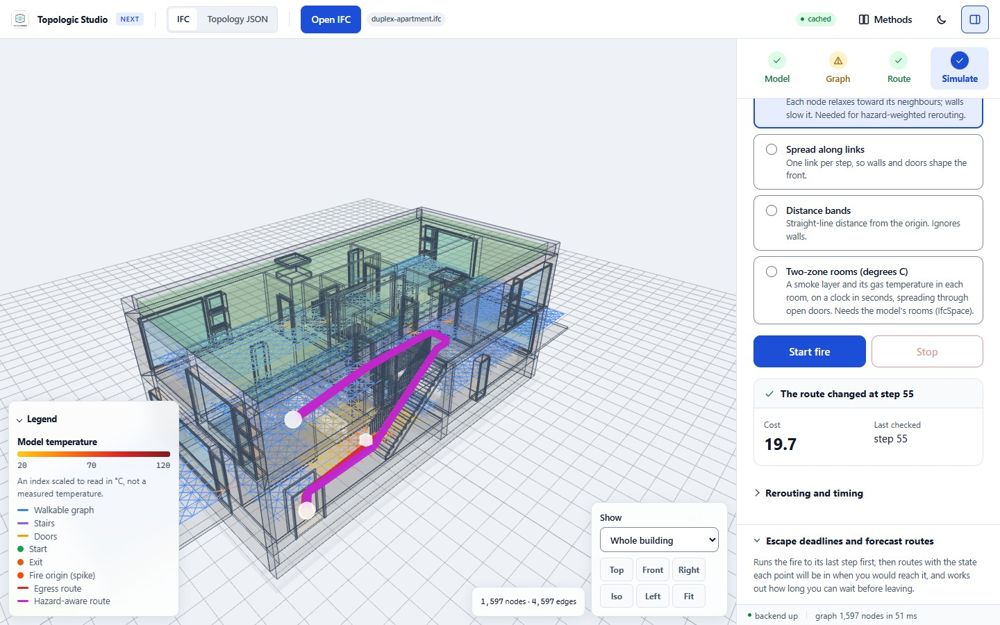

*The Duplex apartment example with a fire at the foot of the stair. The panel
on the right reports that the route changed at fire step 55 to keep clear of
the heat.*

- **Your model stays on your device.** Opening, routing, alternative routes,
  fire spread, forecasts and reinforcement learning all run in the browser.
  The IFC file is sent to the server only if you ask for the TopologicPy
  cross-check.
- **It works on a phone.** The examples open in about a second on an emulated
  mid-range phone, and the whole workflow fits a phone screen.
- **It says how sure it is.** Every result comes with its assumptions, the
  Methods page lists what has been proved in Lean 4, and the app tells you
  when a model cannot give an answer (for example two dwellings that no route
  joins).

> Studio is a research tool. Its fire models give an index of heat, not a
> calibrated temperature, so its results do not replace a fire engineer's
> egress assessment.

## Contents

- [A tour in four steps](#a-tour-in-four-steps)
- [The example buildings](#the-example-buildings)
- [On a phone](#on-a-phone)
- [Using your own IFC files](#using-your-own-ifc-files)
- [Keyboard shortcuts](#keyboard-shortcuts)
- [What runs where](#what-runs-where)
- [Limits to keep in mind](#limits-to-keep-in-mind)
- [Running Studio on your own computer](#running-studio-on-your-own-computer)
- [Tests and checks](#tests-and-checks)
- [How it works](#how-it-works)
- [Repository layout](#repository-layout)
- [Deployment](#deployment)
- [Further reading](#further-reading)
- [Credits and licences](#credits-and-licences)

---

## A tour in four steps

The panel on the right walks through four steps: **Model**, **Graph**,
**Route** and **Simulate**. Each step opens with its one main button and puts
the result right under it. The pictures below follow the **Duplex apartment**
example from start to finish.

### Start: open a model

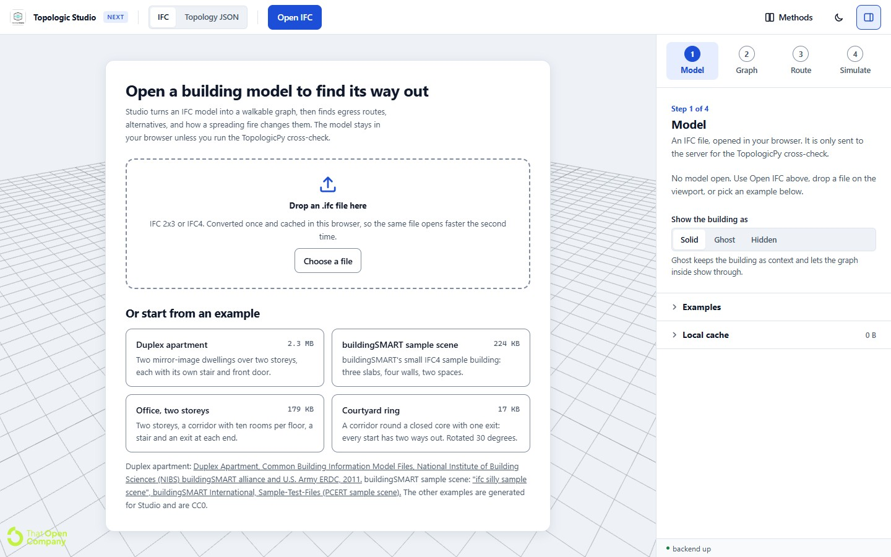

Drop an `.ifc` file on the page, press **Open IFC**, or pick one of the
examples. Studio reads IFC2x3 and IFC4 files. The first time you open a file
it is converted and stored in your browser, so the next time it opens from
the cache without being read again (up to 24 models or 512 MB; clear them
under **Local cache** in the Model step).

### Step 1, Model: what Studio found in the file

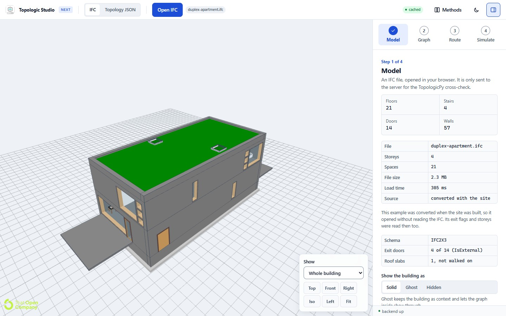

The Model step counts the floors, stairs, doors and walls, the storeys and
rooms (`IfcSpace`), and reports which doors are **exits** and which slabs are
roofs (roofs are not walked on). Exits come from the file's own data: a door
marked `FireExit` or `IsExternal` in `Pset_DoorCommon`, or a door with an
external space boundary. If the file marks none, Studio falls back to doors
with floor on one side only and says so. The Duplex marks 4 of its 14 doors
as external.

**Show the building as** switches the model between Solid, Ghost (see-through,
so the graph shows inside) and Hidden. The view buttons give top, front,
side and isometric views, and **Show** cuts the building at a storey.

### Step 2, Graph: where a person can walk

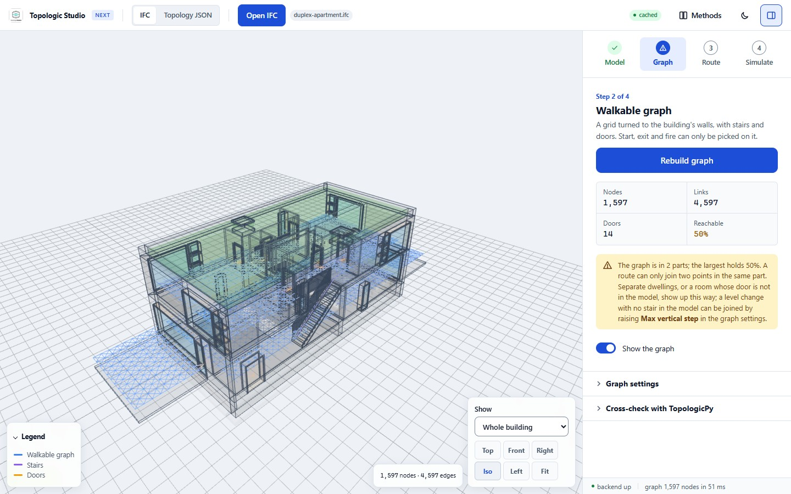

**Build egress graph** lays a grid of points over every floor, 0.5 m apart and
turned to line up with the walls, and joins neighbouring points that a person
could walk between. Walls cut 0.75 m above each floor block the links that
cross them, doors join the rooms on either side, and each stair is walked
along its flight. The whole graph is built in your browser, in a few
hundredths of a second for the Duplex (1,597 points and 4,597 links).

The step reports how much of the building one can reach from its largest
part. The Duplex is two homes side by side, so its graph is in two parts and
the app says so: a route can only join two points in the same part.

**Graph settings** change the grid spacing, the largest step a person can
climb, the agent's height, whether walls block links, and whether lifts and
escalators join floors (off by default, as in an evacuation). **Cross-check
with TopologicPy** builds TopologicPy's own navigation graph on the server
and reports how much of each graph the other covers.

### Step 3, Route: the shortest way out

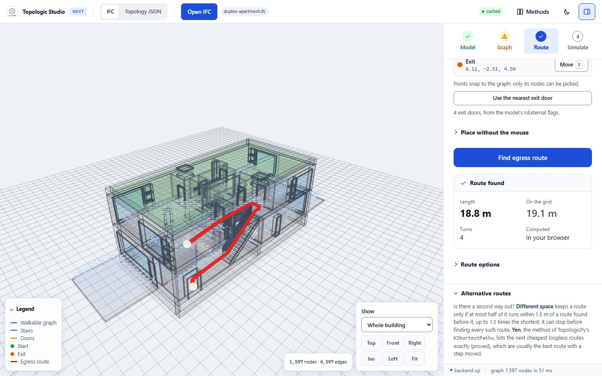

Press **Set** beside Start (or the S key) and click a point on the graph, then
set the Exit the same way, or press **Use the nearest exit door**. **Find
egress route** draws the shortest route and straightens it, so it reads as a
person would walk it rather than as a zigzag across the grid. The result gives
its length, the length on the grid before straightening, and its turns.

Without a mouse, **Place without the mouse** puts the exit at any door from a
list, or any point at typed coordinates. **Route options** switch between the
built-in A* search (in your browser) and TopologicPy's `TGraph` engine (on the
server). **Alternative routes** look for other ways out: *Different space*
keeps routes that do not run along one already found, and *Yen* lists the next
cheapest routes exactly.

### Step 4, Simulate: what a fire changes

Press **Set** beside Fire origin (or F), click where the fire starts, and press
**Start fire**. The fire spreads step by step on the graph while the route is
checked every five steps and moved away from the heat when it has to be (the
picture at the top of this page). Four fire models are offered:

| Model | What it does |
| --- | --- |
| Heat diffusion (default) | Each point relaxes towards its neighbours; walls slow the heat. Needed for heat-weighted rerouting. |
| Spread along links | The fire moves one link per step, so walls and doors shape the front. |
| Distance bands | Straight-line distance from the origin, ignoring walls. |
| Two-zone rooms | A smoke layer and its gas temperature in each room, in seconds and degrees C, spreading through open doors. Needs the model's rooms (`IfcSpace`). |

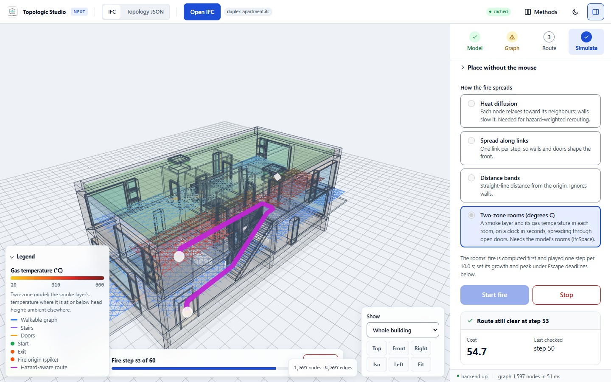

*Two-zone rooms on the Duplex: the rooms around the fire turn red as their
smoke layer heats, on a clock in seconds.*

**Plan with the forecast** runs the fire to its end first, then routes with
the state each point will be in when you would reach it. It reports the
earliest safe route and how long you could wait before leaving, and colours
the graph by **escape deadline**: for each point, the latest time to set off
and still get out within the dose limit (a fractional effective dose of 0.3,
walking at 1.2 m/s, over a five-minute forecast by default; all of these can
be changed under **Clock, speed and limits**).

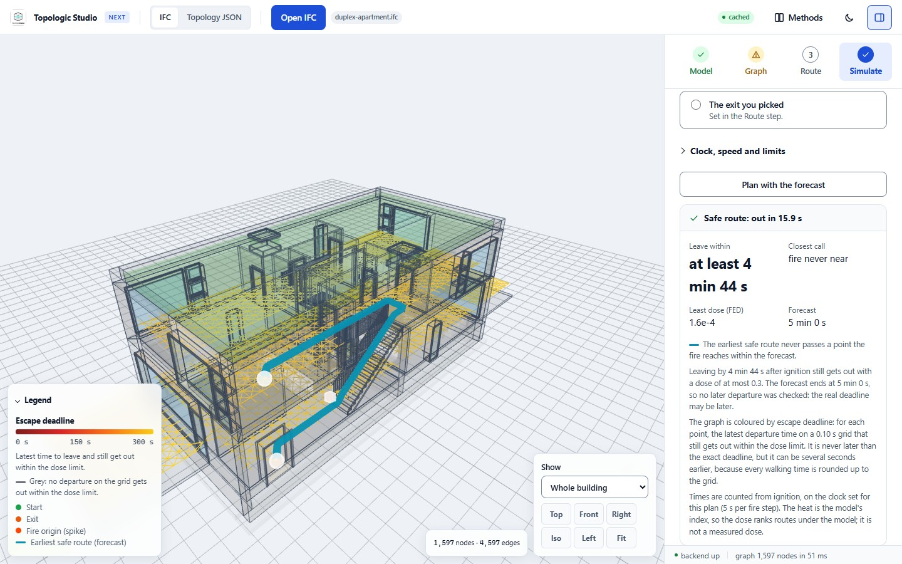

**Train an agent against this fire** trains a reinforcement-learning agent
(tabular Q-learning) to find its own way out while the fire spreads. Studio
first checks whether any escape exists, so a failed agent and an impossible
escape are told apart, and it compares the agent's result with the best
possible one.

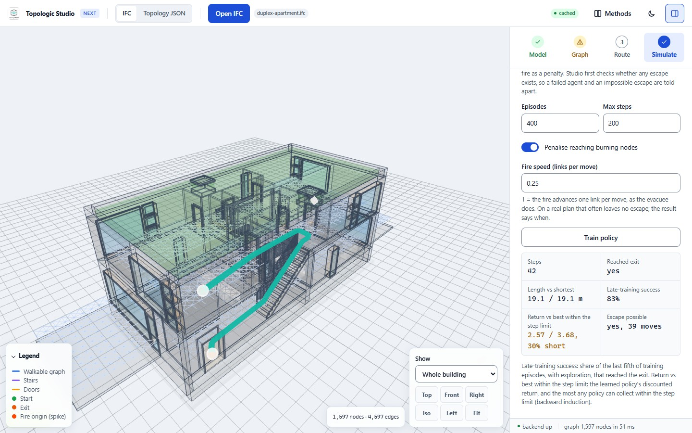

### The Methods page

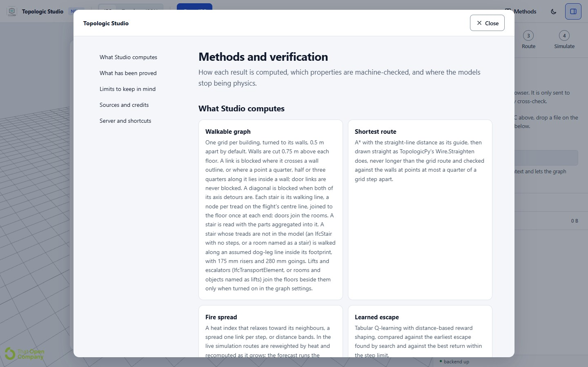

**Methods** in the header opens a page that explains how each result is
computed, which properties are machine-checked in Lean 4 (with the equations
rendered), the limits of each model, the sources, and the server status and
keyboard shortcuts.

---

## The example buildings

| Example | What it shows | Source and licence |
| --- | --- | --- |
| **Duplex apartment** (2.3 MB) | Two mirror-image homes over two storeys, each with its own stair and front door. Exit doors, rooms and stairs all come from the file. | Common Building Information Model Files, NIBS buildingSMART alliance and U.S. Army ERDC, 2011 ([wbdg.org](https://www.wbdg.org/bim/cobie/common-bim-files)). No licence stated; shown with credit. |
| **buildingSMART sample scene** (224 KB) | buildingSMART's small IFC4 test building: three slabs, four walls, two spaces. | "ifc silly sample scene", buildingSMART International, [Sample-Test-Files](https://github.com/buildingSMART/Sample-Test-Files). No licence file; shown with credit. |
| **Office, two storeys** (179 KB) | A corridor with ten rooms per floor, a stair and an exit at each end. | Generated by `tools/make_example_ifcs.py`. CC0-1.0. |
| **Courtyard ring** (17 KB) | A corridor round a closed core with one exit, so every start has two ways out. Turned 30 degrees to test wall alignment. | Generated by `tools/make_example_ifcs.py`. CC0-1.0. |

<table>
  <tr>
    <td width="33%">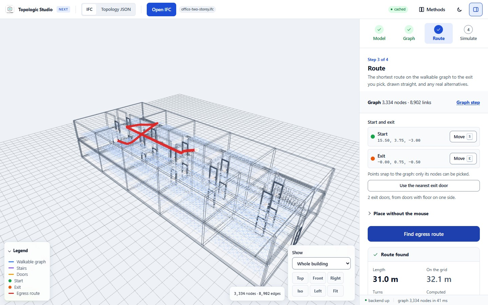</td>
    <td width="33%">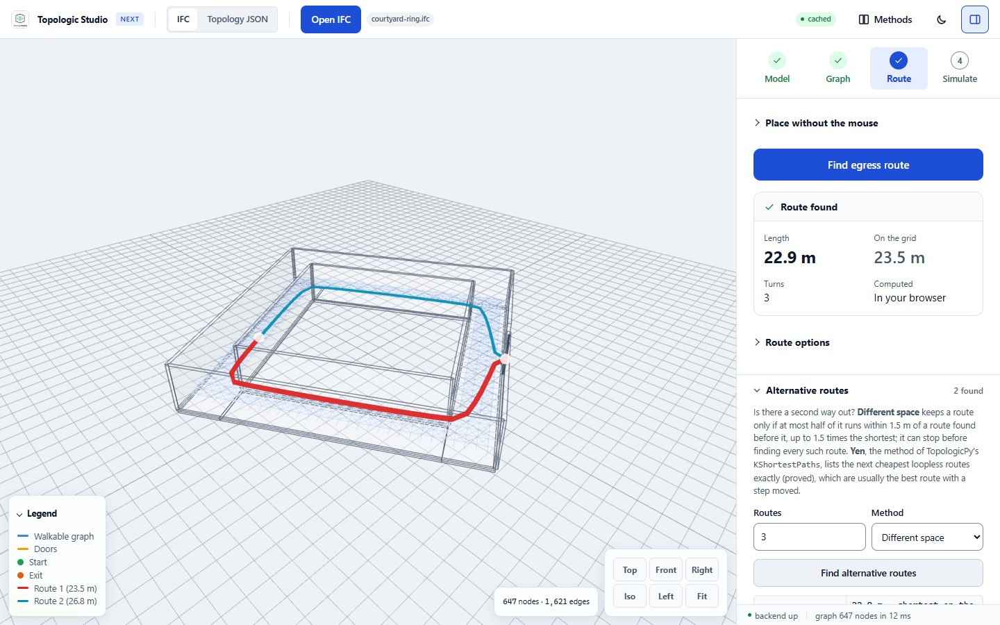</td>
    <td width="33%">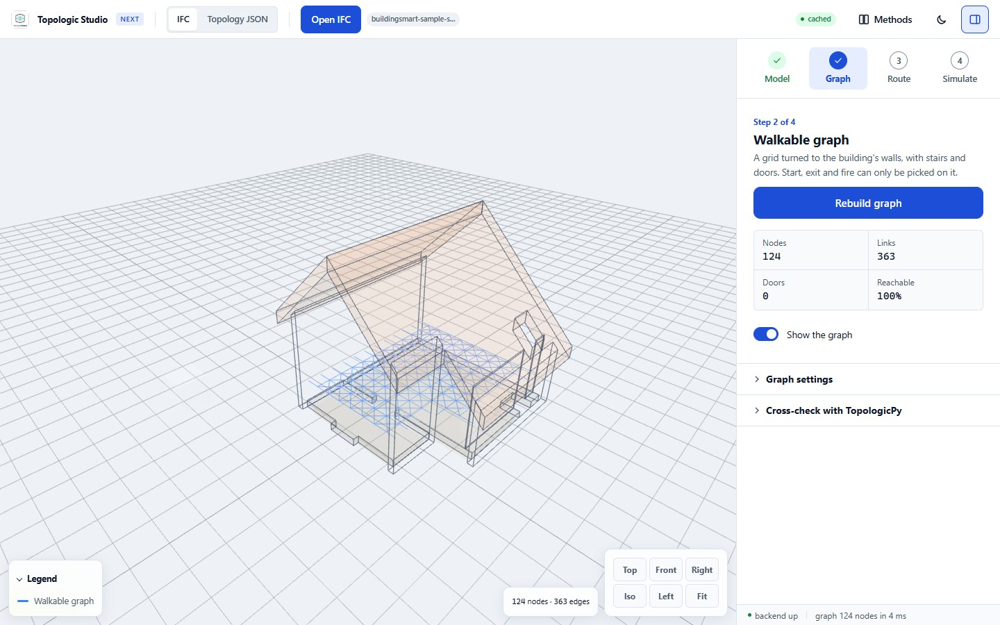</td>
  </tr>
  <tr>
    <td>Office: from an upstairs room along the corridor and down the stair (31.0 m).</td>
    <td>Courtyard ring: the two ways round the core, 23.5 m and 26.8 m.</td>
    <td>buildingSMART sample scene: its walkable graph (124 points, all reachable).</td>
  </tr>
</table>

The examples are converted when the site is built, so they open from a small
pre-converted file (81 KB for the Duplex) without the IFC reader starting at
all.

## On a phone

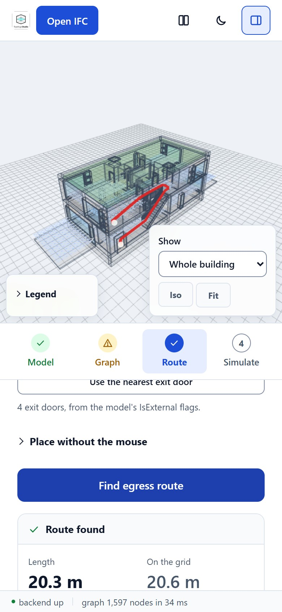

On a narrow screen the viewer sits above the steps, and the panels scroll
underneath. Tap **Set** and then tap the graph to place a point, or use
**Place without the mouse** to pick an exit door from a list. The examples
are the quickest start on a phone; your own files are converted on the phone
itself, so a large model takes longer the first time and opens from the cache
after that.

Measured on an emulated mid-range phone (4G, processor slowed four times,
empty cache), opening the Duplex example until it can be used takes about 1 s,
and opening the Duplex IFC file about 1.2 s.

<br clear="right">

## Using your own IFC files

Studio works best on architectural models with slabs or floors, walls, doors
and stairs. Some things that help, and what Studio does when they are missing:

- **Exits.** Mark exit doors with `FireExit` or `IsExternal` in
  `Pset_DoorCommon`, or give them an external space boundary. Otherwise Studio
  guesses from doors with floor on one side only, and tells you it did.
- **Stairs.** Stairs are walked along their flights, including flights and
  treads aggregated into an `IfcStair`. A stair modelled without treads, or a
  room named as a stair, is walked along an assumed dog-leg line inside its
  footprint.
- **Lifts and escalators** (`IfcTransportElement`, or rooms and objects named
  as lifts) join floors only when **Use lifts and escalators** is on.
- **Rooms** (`IfcSpace`) are needed for the two-zone fire model.
- **Up axis.** Most files are read correctly as they are; if the graph lies on
  a wall instead of a floor, change **Up axis** in the graph settings.
- **Separate parts.** If the Graph step reports several parts, a route cannot
  cross between them: check for missing doors, or raise **Max vertical step**
  where a level change has no stair in the model.

Files in the older IFC2X_FINAL schema, structural or MEP-only models and
models with no floors are refused or give an empty graph, with a message
saying why.

## Keyboard shortcuts

| Key | Action |
| --- | --- |
| S | Set the start |
| E | Set the exit |
| F | Set the fire origin |
| G | Show or hide the graph |
| M | Show or hide the building |
| B | Build or rebuild the graph |
| Enter | Find the route |
| Esc | Cancel picking; close the Methods page |

## What runs where

| In your browser | On the server (optional) |
| --- | --- |
| Opening and caching IFC files | TopologicPy `TGraph` route engine and its k-shortest routes |
| Building the walkable graph | Navigation cross-check (the IFC file is uploaded for this) |
| Routes, straightening and alternative routes | The **Topology JSON** viewer for TopologicPy files |
| Fire spread, rerouting and the forecast | |
| Reinforcement learning | |

The server is a FastAPI service around
[TopologicPy](https://github.com/wassimj/topologicpy), hosted at
<https://topologicstudio-backend.onrender.com>. When it is connected, the
walkable graph (points and links, not the model) is uploaded in the
background so the TopologicPy features can use it. On its free plan the server
sleeps after about 15 idle minutes, and the first request after that takes
30 to 50 s; everything in the left column keeps working while it wakes, or if
it is never reached.

## Limits to keep in mind

These are also on the Methods page.

- **The temperature is an index.** It is scaled to read 20 to 120 degrees C,
  but it is not a temperature a sensor would measure. Doses computed from it
  rank routes under the model; the ISO 13571 limits do not carry over.
- **Fire time is counted in steps.** The forecast converts steps to seconds
  with a factor you set. Fire growth is not calibrated.
- **In the live simulation the evacuee waits while the fire grows**, and each
  reroute starts from the original start. A route that has to pass through
  fire is drawn but reported as not safe.
- **A route stays within one part of the graph.**
- **Stairs are walked at level speed** (reference tools use about half to
  nine tenths of it), and there are no queues at doors, no slowing in smoke
  and no pre-movement time yet. These are the next modelling gaps; see
  [wiki/HANDOFF.md](wiki/HANDOFF.md).
- **Assumed stairs and lifts are approximate.** An assumed stair has no known
  width. A lift ride counts as walking its rise, with no wait for the car.

---

## Running Studio on your own computer

### Just the app (no server)

Needs [Node.js](https://nodejs.org/) 20.11 or later.

```bash
git clone https://github.com/libishm1/Topologic_Studio.git
cd Topologic_Studio/topologicpy-web-frontend
npm ci        # also copies web-ifc's WASM and the fragments worker into public/
npm run dev   # http://localhost:5173
```

Everything in the browser column above works without the server; the status
bar shows "backend offline". To make the examples open pre-converted in
development too, run `npm run prepare-examples` once.

### With the server

Needs Python 3.12.

```bash
cd Topologic_Studio
python -m venv .venv-next
.venv-next/Scripts/python -m pip install -r topologicpy-web-backend/requirements-dev.txt   # bin/python on macOS and Linux

cd topologicpy-web-backend
../.venv-next/Scripts/python -m uvicorn app.main:app --reload --port 8000
```

Check it: <http://localhost:8000/api/capabilities> should report
`"usable": true`. API documentation is at <http://localhost:8000/docs>. If the
server is not on `localhost:8000`, copy `topologicpy-web-frontend/.env.example`
to `.env` and set `VITE_API_BASE`.

> **TopologicPy packaging.** TopologicPy 0.9 moved its geometry kernel into a
> separate `topologic-core` package. Installing `topologicpy` alone imports
> fine and then fails at the first geometry call. Both are pinned in
> `requirements.txt` (`topologicpy==0.9.86`, not 0.9.87, which removes
> `Graph`).

On Windows, `studio.cmd` at the repository root starts both in their own
windows (`studio`, `studio stop`, `studio status`, `studio test`), and
`dev.ps1` does the same from PowerShell.

## Tests and checks

| What | Command | Where |
| --- | --- | --- |
| Unit and property tests of the browser core (166) | `npm test` | `topologicpy-web-frontend` |
| Lint | `npm run lint` | `topologicpy-web-frontend` |
| Production build (also converts the examples) | `npm run build` | `topologicpy-web-frontend` |
| Server tests | `../.venv-next/Scripts/python -m pytest tests -q` | `topologicpy-web-backend` |
| The real app in Chrome, end to end | `npm install`, then `npm run test:browser -- --ifc topologicpy-web-frontend/public/examples/duplex-apartment.ifc` (add `--mobile` for a phone) | repository root, with the app running |
| Speed, accuracy and robustness benchmark on 38 public models | `node tools/benchmark.mjs` | see [benchmark/README.md](benchmark/README.md) |
| Lean 4 proofs | `lake build` | [formal/fireegress](formal/fireegress/README.md) |
| This README's screenshots | `node tools/readme-shots.mjs` | repository root, with the app running |

The browser suite drives the installed Chrome (no browser download) through
the whole workflow and fails on any console error, uncaught exception or
failed request.

## How it works

```
IFC file
  │
  ├─ SHA-256 ──────────────► IndexedDB cache: fragments + exit flags      lib/fragmentCache.js
  │                               │ hit: open without reading the IFC
  ├─ import worker ◄──── miss ────┘                                       workers/ifc-import.worker.js
  │     IFC → That Open fragments, then exit doors, storeys, roofs        core/ifcSemantics.js
  │
  ├─ viewer: fragments on screen, floor / stair / door / wall geometry     viewer/ViewerManager.js
  │
  ├─ graph worker: wall-aligned walkable lattice, stairs, cores            workers/sampler.worker.js, core/lattice.js, core/cores.js
  │
  ├─ in the page: A* + straightening, alternatives, fire spread            core/route.js, core/straighten.js, core/alternatives.js, core/fire.js
  ├─ forecast worker: time-dependent routes, escape-deadline map, zones    workers/forecast.worker.js, core/forecast.js, core/deadline.js, core/zone.js
  ├─ RL worker: tabular Q-learning against the fire                        workers/rl.worker.js, core/rl.js
  │
  └─ optional server: graph uploaded in the background                    topologicpy-web-backend/
        TGraph routes, Navigation cross-check, Topology JSON
```

Paths are under `topologicpy-web-frontend/src/` unless shown otherwise.
[docs/README-classic.md](docs/README-classic.md) describes the original
version, which built the graph on the server; this line moved that work into
the browser.

### Server API

| Method | Path | Purpose |
| --- | --- | --- |
| `POST` | `/api/ifc/graph/import` | Store a graph built in the browser |
| `POST` | `/api/ifc/graph` | Build a graph from a sampled point cloud |
| `GET`, `DELETE` | `/api/ifc/graph/{id}` | Fetch or drop a stored graph |
| `GET` | `/api/graphs` | Store contents |
| `POST` | `/api/ifc/path` | Route, optionally heat-weighted, on either engine |
| `POST` | `/api/ifc/path/compare` | Run both engines and report whether they agree |
| `POST` | `/api/ifc/path/alternatives` | Up to k routes: through different space, or Yen k-shortest |
| `POST` | `/api/ifc/navigation-check` | Upload an IFC; compare TopologicPy's Navigation graph with Studio's |
| `POST` | `/api/fire/timeline`, `GET` `/api/fire/stream` | Server-side fire runs (the app runs fire in the browser) |
| `POST` | `/api/rl/train` | Server-side Q-learning |
| `GET` | `/health`, `/api/capabilities` | Status and what this server can do |

The original version's routes (`/ifc-egress-graph`, `/ifc-egress-path`,
`/graph-meta`, `/upload-topology`, `/upload-ifc`) are still served with their
original shapes.

## Repository layout

```
Topologic_Studio/
├── topologicpy-web-frontend/   the app (React + Vite, That Open engine, web-ifc)
│   ├── src/core/               routing, graph, fire, forecast, RL, IFC semantics, with their tests
│   ├── src/workers/            import, graph, forecast and RL workers
│   ├── src/viewer/             the 3D viewer
│   ├── src/ui/                 the panels, viewport and Methods page
│   ├── public/examples/        the four example IFCs and their credits (index.json)
│   └── scripts/                asset sync and the build-time example conversion
├── topologicpy-web-backend/    the optional FastAPI + TopologicPy server
├── tools/                      browser suite, benchmark, model checks, screenshot script
├── benchmark/                  the benchmark's model list and results
├── formal/fireegress/          Lean 4 proofs of the routing and fire models
├── wiki/                       handoff, research notes, roadmap and reviews
├── docs/                       images for this README and the original version's README
└── render.yaml                 the server's Render blueprint
```

## Deployment

- **Website.** Every push to `main` runs
  `.github/workflows/deploy-frontend.yml`, which builds the app with
  `BASE_PATH=/Topologic_Studio/` and the server address from the repository
  variable `VITE_API_BASE` (default: the Render service), and publishes it to
  GitHub Pages.
- **Server.** The Render service `topologicstudio-backend` runs the Docker
  image in `topologicpy-web-backend/` as described in `render.yaml`. Redeploy
  it from the Render dashboard after server changes.
  `.github/workflows/backend-image.yml` builds the image and runs the server
  tests inside it on pushes to `main` and the development branches.
- Development happens on the `next/browser-core` branch; `main` is moved to it
  only after the tests, lint, build and both browser suites pass. The
  version that ran before 2026-10-27 is tagged `classic-2026-10-27`.

## Further reading

- [wiki/HANDOFF.md](wiki/HANDOFF.md): the current state, the latest changes and
  the open work.
- [benchmark/README.md](benchmark/README.md): speed and accuracy on 38 public
  models, against an exact geodesic, with a stress suite of known bugs.
- [formal/fireegress/README.md](formal/fireegress/README.md): what has been
  proved in Lean 4 and where each proof shows in the app.
- [wiki/research/](wiki/research/): the fire-egress methods review, the
  verified equations, the gap analysis, and a study of open-source evacuation
  tools.
- [docs/README-classic.md](docs/README-classic.md): the original version, its
  image series and its deployment guide.

## Credits and licences

- [TopologicPy](https://github.com/wassimj/topologicpy) (LGPL-3.0-or-later)
  by Wassim Jabi and contributors, for the server's graph engine and
  Navigation graph. The approach follows Jabi et al. (2019), *The synergy of
  non-manifold topology and reinforcement learning for fire egress*
  ([doi:10.5151/proceedings-ecaadesigradi2019_671](https://doi.org/10.5151/proceedings-ecaadesigradi2019_671)).
- [That Open Engine](https://github.com/ThatOpen) (`@thatopen/components`,
  `@thatopen/fragments`, MIT) for the viewer and fragments, and
  [web-ifc](https://github.com/ThatOpen/engine_web-ifc) (MPL-2.0) for reading
  IFC. [three.js](https://threejs.org/), [React](https://react.dev/) and
  [KaTeX](https://katex.org/) (all MIT).
- The example buildings are credited in the table above and in
  `topologicpy-web-frontend/public/examples/index.json`.
- The full source list for the methods is on the app's Methods page.

Project licence: see the original version's
[licence section](docs/README-classic.md#license-and-third-party-licenses).
