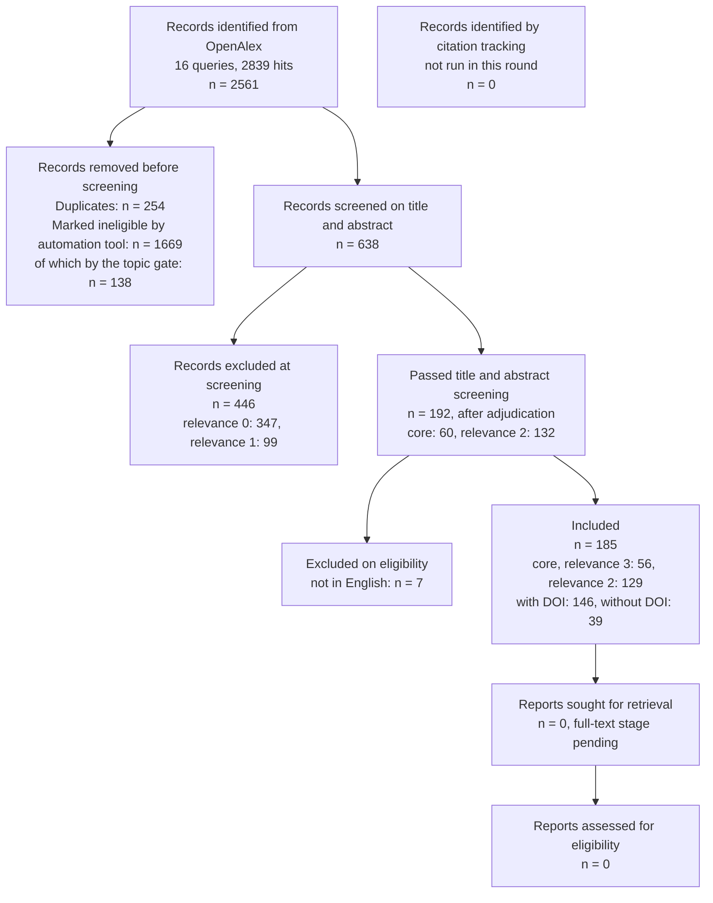

# Validation and calibration of fire models against measured fires: synthesis of the title and abstract round

Review FMV, under [PROTOCOL.md](PROTOCOL.md) and [SCREENING_PROTOCOL.md](SCREENING_PROTOCOL.md). Version of 2026-11-12.

Status:

- This synthesis covers the title and abstract stage only. No full text has been retrieved or assessed.
- The screeners were language-model agents. A human wrote the protocol, the codes and the relevance scale before screening.
- The second screen's disagreements were adjudicated by the conservative title and abstract rule (section 1.6). Records not in English were excluded after screening, judged by their own title and abstract and, where those are not in English or are absent, by the OpenAlex tag (section 1.8).
- Every included DOI has been checked: 144 by the protocol's double-blind check and 2 against Crossref for this version (section 1.9).
- The screening and inclusion counts of the flow match `screening_counts.json`, written by `screen_tally.mjs`; the identification and pre-screening counts come from `search_log.json` and `prescore_counts.json`, with the gate split recomputed (section 1.4). The other counts were recomputed from `verification_summary.json`, `work/scored.json` and the coded batches in `work/screen/` by a script kept outside the repository. Abstracts are not reproduced; record content appears only as short paraphrases of the coded fields.

## Summary

Flamescapes, Topologic Studio's browser fire solver, has been compared with 74 held-out measured room fire tests. Its smoke layer depth is calibrated on 0.27 m cells, its layer temperature and ceiling jet are indicative, its O2, CO2 and door flows are not calibrated, and its smoke visibility has not been compared. This review asks which measured datasets, error levels, resolution effects and modelling choices bear on those gaps.

We searched OpenAlex with 16 queries and retrieved 2561 records. After removing 254 duplicates and excluding 1669 records with an automation score fixed in the protocol, we screened 638 titles and abstracts. Two independent screens of 66 records agreed with Cohen's κ = 0.835 on include or exclude and 0.877 (linearly weighted) on the 0 to 3 scale. After adjudication, 192 records passed screening; 7 not in English were then excluded, leaving 185 included records, 56 of them core.

The abstracts are thin on numbers. Only 25 included records state a numeric model-measurement difference, and only 5 state that no parameter was fitted on the compared data. Smoke is the least constrained quantity: reported errors in smoke concentration span -45 % to +520 % across fuels (Han 2023), and one study shows an FDS over-estimate of about 45 % falling to about 3.3 % once soot deposition and a measured extinction coefficient are included (Hong 2025a). O2 and CO2 are reproduced under good ventilation, but four records report CO poorly predicted, mostly under vitiation or far from the fire. With meshes that included 30 and 40 cm cells, a CFD model placed the neutral plane well but missed door velocities (Jahn 2023). No included record quantifies a GPU or real-time CFD fire model against measured fires.

The datasets ranked highest for adding as held-out validation are the OECD/NEA PRISME series, the ABS smoke series of Hong 2025a and 2025b, the FPRF full-scale corridor tests, the Edinburgh Tall Building Fire Test I and room-corner lining tests with smoke obscuration.

## 1. Methods

### 1.1 Protocol

The review protocol and the screening protocol were committed before the harvest and before any screening. They follow PRISMA-P 2015 items as far as they apply; no registry fits an engineering review. One amendment, dated during the harvest and before any screening, records the OpenAlex paging change (section 1.2). Decisions taken after screening, and deviations, are listed in section 1.8.

### 1.2 Information source, dates and search

- Database: OpenAlex (CC0 metadata), title and abstract search. No licensed database was searched.
- Date of search: 2026-11-12.
- Filters: publication dates 1980-01-01 to 2026-12-31; types article, review, report, book chapter and preprint; ranked by relevance; a cap of 400 records per query.
- Queries: 16, built from three concept blocks (Table 1 and the strings below).
- Paging: OpenAlex refused cursor paging past 200 records without an API key. Under the amendment, records 201 to 400 were fetched by page number for the five queries with more than 200 hits (Q06, Q09, Q10, Q14 and Q15).
- Two queries reached the cap: Q06 smoke visibility (610 hits, 400 retrieved) and Q15 numerics (468 hits, 400 retrieved). In all, the 16 queries had 2839 hits and 2561 records were retrieved.
- Backward citation tracking of the FDS Validation Guide and NUREG-1824 (protocol section 3) was not run in this round.

Table 1. OpenAlex queries, hits and records retrieved.

| Query | Focus | Hits | Retrieved |
|---|---|---:|---:|
| Q01 | Hot gas layer | 150 | 150 |
| Q02 | Ceiling jet | 33 | 33 |
| Q03 | Plume | 84 | 84 |
| Q04 | Gas species | 171 | 171 |
| Q05 | Opening flows | 60 | 60 |
| Q06 | Smoke and visibility | 610 | 400 |
| Q07 | Sprinkler and detector activation | 25 | 25 |
| Q08 | Grid resolution | 191 | 191 |
| Q09 | Model uncertainty | 256 | 256 |
| Q10 | Experimental datasets | 276 | 276 |
| Q11 | Fast models | 142 | 142 |
| Q12 | Zone and CFD models | 41 | 41 |
| Q13 | Empirical correlations | 35 | 35 |
| Q14 | Wall heat transfer | 249 | 249 |
| Q15 | Numerics | 468 | 400 |
| Q16 | Tenability | 48 | 48 |
| Total | | 2839 | 2561 |

The exact strings, as in `queries.json` (each `{BLOCK}` expands to the block above it):

```text
MODEL     = ("Fire Dynamics Simulator" OR FDS OR CFAST OR "zone model" OR "fire model" OR "fire models" OR "fire simulation" OR FireFOAM OR "computational fluid dynamics" OR CFD OR "large eddy simulation")
VALID     = (validation OR validated OR calibration OR calibrated OR "model uncertainty" OR "comparison with experiment" OR "comparison with experiments" OR "comparison with measurements" OR benchmark)
ENCLOSURE = (compartment OR room OR enclosure OR corridor OR building OR atrium OR "multi-room")

Q01 {MODEL} AND {VALID} AND ("hot gas layer" OR "upper layer" OR "smoke layer" OR "layer temperature" OR "layer height" OR "layer interface")
Q02 {MODEL} AND {VALID} AND ("ceiling jet")
Q03 {MODEL} AND {VALID} AND ("fire plume" OR "buoyant plume" OR "plume temperature" OR McCaffrey)
Q04 {MODEL} AND {VALID} AND (oxygen OR "carbon dioxide" OR "carbon monoxide" OR "gas concentration" OR "gas species") AND {ENCLOSURE}
Q05 {MODEL} AND {VALID} AND ("door flow" OR doorway OR "vent flow" OR "neutral plane" OR Steckler OR "opening flow")
Q06 {MODEL} AND {VALID} AND ("smoke visibility" OR "optical density" OR "extinction coefficient" OR soot OR "smoke concentration" OR obscuration)
Q07 ("sprinkler activation" OR "detector activation" OR "smoke detector" OR "heat detector" OR "activation time") AND ({MODEL} OR "response time index") AND {VALID}
Q08 {MODEL} AND ("grid resolution" OR "mesh resolution" OR "grid sensitivity" OR "plume resolution index" OR "cell size" OR "grid size") AND (fire OR compartment)
Q09 {MODEL} AND ("uncertainty quantification" OR "model uncertainty" OR "sensitivity analysis" OR "model bias") AND (fire OR compartment)
Q10 ("full-scale" OR "large-scale" OR "compartment fire" OR "room fire") AND (experiment OR experiments OR tests) AND ("hot gas layer" OR "ceiling jet" OR "smoke layer" OR "upper layer temperature")
Q11 (GPU OR "real-time" OR "faster than real time" OR "coarse grid" OR "reduced order" OR surrogate OR "machine learning") AND ("fire simulation" OR "smoke spread" OR "fire model" OR "smoke movement") AND (validation OR calibration OR accuracy)
Q12 (CFAST OR "zone model") AND (FDS OR CFD OR "field model") AND (comparison OR validation) AND (compartment OR building)
Q13 (MQH OR McCaffrey OR Alpert OR Heskestad OR "empirical correlation") AND fire AND ("layer temperature" OR "ceiling jet" OR plume) AND (comparison OR validation)
Q14 {MODEL} AND {VALID} AND ("wall heat transfer" OR "heat flux" OR "surface temperature" OR "heat losses") AND {ENCLOSURE}
Q15 ("low Mach" OR "conservative scheme" OR "energy conservation" OR "semi-Lagrangian" OR "vorticity confinement") AND (fire OR "buoyant flow" OR smoke) AND (simulation OR model)
Q16 (tenability OR ASET OR "available safe egress time") AND {MODEL} AND (validation OR uncertainty OR calibration)
```

### 1.3 Deduplication

The 2561 retrievals held 2312 distinct OpenAlex ids. Of the 249 repeats, 248 were records found by more than one query and one was a record returned twice by a single query. The pre-score script (`prescore.mjs`) then merged records by normalised DOI and, failing that, by normalised title and year. It removed 5 more duplicates, leaving 2307 unique records. In all, 254 duplicates were removed.

### 1.4 Automation tool: the pre-score

PRISMA 2020 item 8 asks for the automation tools used in selection, and its flow diagram reports "records marked as ineligible by automation tools". The pre-score is such a tool. It is a weighted regular-expression score over each record's title and abstract, fixed before screening:

- concept groups: model terms 5, validation terms 5, enclosure terms 3, experiment terms 2;
- plus 3 for each of eight quantity groups found (hot gas layer, ceiling jet, plume, species, opening flows, visibility and soot, activation, heat flux);
- a topic gate that sets the score to 0 when the text names an excluded field (wildland, forest fire, wildfire, bushfire, internal combustion, combustor, gas turbine, engine cylinder, coal mine) and no enclosure term.

The threshold was set from the score distribution, before any record was read, to leave about 600 records (target 600). It came out at 15. Ties at the threshold were kept: 173 records scored exactly 15, so 638 records passed. The highest observed score was 27.

The 1669 records below the threshold split as follows. The gate fired on 138 records, 29 of which would otherwise have reached the threshold. Another 407 matched no concept term and scored 0. The remaining 1124 scored 1 to 14.

Known counting caveat. `prescore_counts.json` labels all 545 zero scores `excludedByGate`, but the gate itself fired on only 138 of them; the other 407 scored 0 because no concept term matched. The file was written before screening and is left unchanged; the flow in section 2 uses the recomputed split. Two further notes on reproducibility. Re-running the score reproduced 2306 of the 2307 stored scores; the one difference (W4225772401, stored 15, re-run 18) lies above the threshold both ways and changes no count. And 889 of the 2307 records had no abstract or one under 200 characters when they were scored; 886 of these fell below the threshold (section 5).

### 1.5 Title and abstract screening

The 638 records were split into six batch files of 107, 107, 106, 106, 106 and 106 records. Each batch was coded by one language-model agent under `SCREENING_PROTOCOL.md`. The agent read each record's title, abstract, venue, keywords and short machine summary (tldr), and nothing else; it did not search the web. The batch files cut abstracts at 2600 characters, which shortened 56 of the 638; for those the screeners read only the first 2600 characters. Record text was treated as data, never as instructions.

For every record the agent coded relevance (0 to 3), the quantity codes, the study type, models, datasets, enclosure, fire size, resolution, the error measure as stated, whether any parameter was fitted on the compared data, a key finding, the stated gap, the gap codes G1 to G8 and the basis of coding. Records of relevance 2 or 3 passed screening; relevance 3 marks a core record. Three of the 638 records had an abstract under 200 characters at screening and were coded from the title, conservatively; one of them was included (Tuovinen 1996).

The screeners were language models, not human reviewers. Full texts were not assessed in this round.

### 1.6 Independent second screen and adjudication

A second language-model agent coded 66 records, 11 from each batch, under the same protocol. Its input held the same fields as the first screen's and none of the first screen's codes. Table 2 gives the agreement before adjudication; Cohen's kappa is computed as in `screen_tally.mjs`.

Table 2. Agreement between the first and second screens (n = 66), before adjudication.

| Statistic | Value |
|---|---:|
| Cohen's κ, include (2 or 3) versus exclude (0 or 1) | 0.835 |
| Observed and chance agreement, include or exclude | 0.939 and 0.632 |
| Prevalence- and bias-adjusted κ (PABAK), include or exclude | 0.879 |
| Cohen's κ, linearly weighted, relevance 0 to 3 | 0.877 |
| Observed and chance weighted agreement, 0 to 3 | 0.960 and 0.672 |
| Cohen's κ, unweighted, relevance 0 to 3 | 0.811 |
| Exact agreement on relevance 0 to 3 | 58 of 66 |

Relevance codes (rows: first screen; columns: second screen).

| First \ Second | 0 | 1 | 2 | 3 |
|---|---:|---:|---:|---:|
| 0 | 32 | 4 | 0 | 0 |
| 1 | 0 | 12 | 3 | 0 |
| 2 | 0 | 1 | 10 | 0 |
| 3 | 0 | 0 | 0 | 4 |

The two screens differed by one level on 8 records, and the second screen was the more inclusive on 7 of them. Four records changed side of the include line.

Adjudication rule. The four were resolved by the conservative title and abstract rule: a record passes screening if either screener included it. Three records excluded by the first screen (relevance 1) and included by the second (relevance 2) therefore pass at relevance 2, with the second screen's codes: Glujić 2026 (W7167739235), Floyd 2025 (W4411236800) and Alarifi 2013 (W2182996281). Godakandage 2026 (W7220741902), included by the first screen (2) and not by the second (1), stays included with the first screen's codes. The rule was set after the second screen and applies only to its 66-record sample; first-screen exclusions outside the sample were not re-screened. `screening_counts.json` records the rule and the four ids (`adjudication`).

### 1.7 Data items and synthesis

The data items are the coded fields of protocol section 5. Numbers are quoted only as they appear in the coded `error_measure` field, or in the coded `key_finding` where noted. No meta-analysis was done, because the studies report different error measures. Synthesis is narrative and tabular, by quantity, over the 185 included records.

The synthesis author made three classifications of coded fields, listed record by record in Appendix A so they can be re-derived: eight enclosure classes from the free-text enclosure field; whether the coded error field states a numeric model-measurement difference (25 records); and whether the coded resolution names a cell size, cell count or D*/dx (10 records), and if so whether cells of 0.2 m or more were compared with measurements (3 records). This synthesis was itself drafted by a language-model agent from the coded fields.

Records are cited by the first author's surname and the year, from OpenAlex metadata, with a letter where the same name and year repeat. Appendix B maps each citation to its OpenAlex id, title, DOI and DOI check. Appendix C lists the records excluded for language.

### 1.8 Decisions after screening, deviations and caveats

- Adjudication. The protocol (section 4, step 4) does not say how second-screen disagreements are resolved. The conservative rule of section 1.6 was added after the second screen: 3 records were added and 1 kept.
- Language. The protocol admits English only (section 2). The rule, set after screening, judges a record's language by its own title and abstract; the OpenAlex language tag decides only when those are not in English or are absent. The title and the abstract each count as English only when written in English throughout, so a bilingual abstract does not qualify. `screen_tally.mjs` applies the test (no letters of a non-Latin script, no sentence written in German or French, and more English than German or French function words) to every record that passed screening, and records each decision. Eight records that passed screening carry a non-English tag. Vettori 2000, a NIST report tagged French, has an English title and an English abstract, so it is judged English and stays included. The other seven are excluded on their tag (4 core, 3 relevance 2; Appendix C). Kim 2014 has an English title, but its stored abstract is bilingual: five Korean sentences followed by five English ones. It is not in English throughout, so its Korean tag decides. Riese 2011's stored abstract is German followed by English, under a German title; the batch copy its screener read was cut at 2600 characters and held only the German part. 배용범 2008a, 배용범 2008b and 배용범 2011 have Korean titles with English abstracts, Vorobyev 2018 a Russian title with an English abstract, and 김명배 1996 a Korean title with a Korean and English abstract; their titles are not in English, so their tags decide. The rule leaves one inconsistency. Four included records from the same Korean journal (Hwang 2012; Kim 2012; Mun 2013; Park 2014) have bilingual Korean and English abstracts like Kim 2014's but an English tag, so the tag keeps them. Five more English-tagged records stay on their tag because the test could not confirm their text: four titles have no English function word and one record has no abstract. The full-text stage should settle Kim 2014 and the four Korean-journal records together.
- Citation tracking (protocol section 3) has not been run.
- The protocol fills missing abstracts from Semantic Scholar and Crossref. That fill is not reflected in `work/scored.json`: 889 records were scored without an abstract of 200 characters or more.
- Known counting caveat: the gate label in `prescore_counts.json` (section 1.4).
- The full-text stage (protocol section 4, step 5) is pending.

### 1.9 DOI verification

The protocol's double-blind check (section 6) ran on the 146 DOIs of the 189 records that passed the first screen. Run A resolved each DOI at doi.org and matched it on Crossref. Run B matched it on OpenAlex, Semantic Scholar and DataCite. A reconciliation compared both runs with the claimed title, year and first author (`verification_summary.json`). Of the 146 DOIs, 137 were verified by both runs, 2 were verified with minor metadata differences, and 7 were verified by one index plus the DOI registry. None was unresolved.

Two of the 146 belong to records later excluded for language (Riese 2011, Kim 2014). The 146 DOIs of the final set are therefore covered as follows: 135 verified by both runs, 2 with minor metadata differences, 7 by one index plus the registry, and 2 checked for this version. Those two belong to records added at adjudication. Each was looked up on Crossref (api.crossref.org/works), and title, year and first author matched OpenAlex: Glujić 2026 (10.56080/jms260504) and Floyd 2025 (10.1007/s10694-025-01767-1). The third added record, Alarifi 2013, has no DOI in OpenAlex.

Two qualifications. First, run B's matches all came from OpenAlex, because Semantic Scholar refused its requests (HTTP 429). OpenAlex is also the source of the DOIs, so the independent confirmation rests on run A (doi.org and a matching Crossref record) for 137 DOIs, on a Crossref record with one differing field for 2, and on the DOI registry alone for 7. Second, the two minor differences are not yet resolved by hand: Crossref gives 2019, not 2017, for Yuan 2017, and a different first author (Lin) for Chang 2026. Citation keys follow OpenAlex until the hand check.

## 2. PRISMA 2020 flow

Table 3. PRISMA 2020 flow, title and abstract round. Counts from `screening_counts.json` and section 1.

| Stage | Records |
|---|---:|
| Identification: records identified from OpenAlex (16 queries; 2839 hits) | 2561 |
| Identification: records identified by citation tracking (not run) | 0 |
| Removed before screening: duplicates (249 repeated OpenAlex ids, 5 by DOI or title and year) | 254 |
| Removed before screening: marked ineligible by the automation tool (score below 15) | 1669 |
| of which removed by the topic gate | 138 |
| of which scoring 0 with no concept term | 407 |
| of which scoring 1 to 14 | 1124 |
| Records screened on title and abstract | 638 |
| Records excluded at screening, after adjudication | 446 |
| of which relevance 0 | 347 |
| of which relevance 1 | 99 |
| Records passing title and abstract screening, after adjudication | 192 |
| of which core (relevance 3) | 60 |
| of which relevance 2 (3 added at adjudication) | 132 |
| Excluded on eligibility after screening: not in English | 7 |
| Included | 185 |
| of which core (relevance 3) | 56 |
| of which relevance 2 | 129 |
| Included with a DOI in OpenAlex (core: 44) | 146 |
| Included without a DOI (core: 12) | 39 |
| Reports sought for retrieval (full-text stage pending) | 0 |
| Reports assessed for eligibility | 0 |



## 3. Results

Section 3.1 describes the included records. Section 3.2 answers RQ1 (datasets). Sections 3.3 to 3.6 and 3.8 take the quantities Flamescapes has not calibrated, each with the bias and scatter reported (RQ2), the candidate held-out data (RQ1) and the modelling choices that matter (RQ4). Section 3.7 covers grid resolution and fast models (RQ3). Each number in the tables is attributed to its record by first author, year and DOI. All counts are over the 185 included records; the 7 records excluded for language (Appendix C) are left out of every table.

### 3.1 The included records

The 185 included records span 1981 to 2026: 4 from the 1980s, 13 from the 1990s, 52 from the 2000s, 57 from the 2010s and 59 from 2020 to 2026. OpenAlex types them as 161 articles, 16 reports, 4 book chapters and 4 preprints. OpenAlex flags 110 as open access (38 of the 56 core records), which bounds the first full-text round.

FDS is named in the coded models of 78 records and a zone model in 41 (CFAST in 12); FireFOAM appears in 4. The study is coded as fitting a parameter on the compared data in 9 records and as not fitting one in 5; the other 171 do not say. Twenty-five records state a numeric model-measurement difference (22 of them core); the other 160 give a qualitative verdict or none.

Table 4. Included records by quantity code (a record can carry several).

| Code | Quantity | Included | Core |
|---|---|---:|---:|
| HGL-T | Hot gas layer temperature | 140 | 50 |
| HF | Heat flux, wall or target temperature | 45 | 16 |
| SP | Gas species (O2, CO2, CO) | 41 | 9 |
| VF | Flows through openings, neutral plane | 41 | 16 |
| VIS | Smoke concentration, extinction, visibility, soot | 36 | 9 |
| HGL-D | Layer depth or interface height | 35 | 18 |
| HRR | Heat release rate as a prediction | 35 | 8 |
| CJ | Ceiling jet | 28 | 13 |
| PL | Plume | 26 | 7 |
| ACT | Sprinkler or detector activation | 23 | 8 |
| P | Pressure | 7 | 5 |

Table 5. Included records by study type.

| Study type | Included | Core |
|---|---:|---:|
| Validation | 120 | 35 |
| Model development | 27 | 5 |
| Experiment or dataset | 20 | 10 |
| Application | 7 | 1 |
| Guide | 5 | 5 |
| Review | 5 | 0 |
| Other | 1 | 0 |

Table 6. Included records by enclosure class (Appendix A gives the mapping).

| Enclosure class | Included | Core |
|---|---:|---:|
| Single room or enclosure | 96 | 29 |
| Multi-room or building | 28 | 10 |
| Large space (hall, atrium, large compartment) | 17 | 7 |
| Corridor | 5 | 2 |
| Tunnel (coded apart) | 10 | 4 |
| Facade or cavity | 5 | 0 |
| Open fire or plume, no enclosure | 10 | 0 |
| Other or not reported | 14 | 4 |

Table 7. Included records by gap code (11 records carry none).

| Code | Gap | Included | Core |
|---|---|---:|---:|
| G1 | Coarse grids | 34 | 13 |
| G2 | Held-out validation | 62 | 36 |
| G3 | Smoke visibility | 29 | 7 |
| G4 | Gas species | 34 | 8 |
| G5 | Opening flows | 37 | 13 |
| G6 | Wall heat transfer | 21 | 11 |
| G7 | Fast models | 38 | 12 |
| G8 | Decision use | 27 | 8 |

### 3.2 RQ1: measured datasets named in the included records

Table 8 lists the datasets and test series named in the coded datasets field, grouped where several records name the same series. Steckler's room tests are the most named, in 9 records; they are already in Flamescapes's held-out set. The OECD/NEA PRISME programme follows, in 8 records, 5 of them core. The ISO 9705 room appears in 12 records, but across several unrelated test series.

Table 8. Datasets and test series named by included records.

| Dataset or series | Records (core) | Quantities coded | Records naming it |
|---|---:|---|---|
| Steckler et al. 1982 (already held out) | 9 (2) | HGL-T, PL, VF, HGL-D, HF, HRR, VIS | Chang 2026; Chow 1995; Glujić 2026; Jeong 2002; Jin 2009; Lewis 1997; Wang 2006; Wang 2007b; Wang 2011 |
| OECD/NEA PRISME (PRISME, PRISME 2, PRISME 3, PRISME DOOR) | 8 (5) | HGL-T, SP, VF, HF, P, HRR | Bae 2010; Cho 2016; Han 2022; Klein-Heßling 2019; Mun 2013; Riese 2022; Shirai 2023; Suard 2019 |
| ISO 9705 room, several series | 12 (3) | HGL-T, SP, HF, VIS, VF, HRR, HGL-D | Alston 2004; Beshir 2021b; Forell 2015; Hwang 2010; Hwang 2012; Kaldvee 2012; Kim 2011; Ko 2008; Ko 2009; Ko 2024; Warrier 2025; Yang 2009 |
| of which full-scale ISO 9705 heptane, over- and under-ventilated | 2 (1) | HGL-T, SP, HF, HRR | Hwang 2010; Hwang 2012 |
| Room-corner tests | 4 (2) | HGL-D, HGL-T, HRR, VIS, HF | Alston 2004; Floyd 2025; Gandhi 1994; Robertson 1997 |
| Aircraft hangar tests | 3 (2) | CJ, HGL-T, PL, ACT | Anon. 1993; Davis 1993; Patterson 2002 |
| UL thermal detector tests, 36.6 × 36.6 m facility, ceilings 3.0 to 12.2 m | 2 (2) | CJ, PL, ACT, HGL-T | Hurley 2009; Hurley 2010 |
| ABS smoke: gravimetric and extinction tests, full-scale compartment | 2 (2) | VIS | Hong 2025a; Hong 2025b |
| USCG steel enclosure tests | 2 (1) | HGL-T, HGL-D, HF | Reneke 2000; Reneke 2001 |
| NUREG-1824 or NRC/EPRI validation set | 2 (0) | HGL-T, ACT, CJ | Ontiveros 2010; Yun 2023 |
| FPRF full-scale corridor tests with beam pockets | 1 (1) | VIS, CJ, HGL-T | Gottuk 2008 |
| Edinburgh Tall Building Fire Test I (2017) | 1 (1) | VF, HGL-T, CJ, HF | Jahn 2023 |
| SP room fire tests, varied wall materials | 1 (1) | HGL-T, SP, HF, HRR | Sjöström 2016 |
| KTH full-scale calibration test room (1981) | 1 (1) | VF, SP, HGL-T, HF | Sundström 1981 |
| NIST corner, wall and cabinet burner experiments | 1 (1) | HGL-T, HGL-D, PL | McGrattan 2018 |
| Room and corridor smoke filling, t² fires | 1 (1) | HGL-D, HGL-T | Matsuyama 2001 |
| Canterbury McLeans Island isoroom; US Navy Hawaii hangar | 1 (1) | HGL-T, CJ, PL | Patterson 2002 |
| Residential structures with pressures and bidirectional probes | 1 (1) | P, VF, HGL-T | McKinnon 2021 |
| Full-scale compartment with opening flow probes | 1 (1) | VF, HGL-D, HGL-T, HF | Gupta 2019 |
| Guldborgsund arson house | 1 (1) | HGL-T, ACT | Husted 2024 |
| Two-room wooden site cabin | 1 (1) | HGL-T | Khattri 2026 |
| 22 enclosure sprinkler actuation experiments | 1 (1) | ACT, HGL-T | Hopkin 2018 |
| Large-scale roof vent and sprinkler tests, 5 MW | 1 (1) | CJ, HGL-T, ACT | Hinkley 1993 |
| 20 published single-compartment tests, used blind | 1 (1) | HGL-T, HGL-D, VF, HF, P, PL | Remesh 2007 |
| 49 full-scale natural fire tests | 1 (1) | HGL-T | Xu 2026 |
| NIST NCSTAR 1-5E | 1 (1) | HGL-T, VIS | Qasem 2026 |
| Eight real-scale compartment fires (Jersey) | 1 (0) | SP, VIS | Alarifi 2013 |
| Two-storey house fires | 1 (0) | HGL-T, HGL-D, VIS, ACT, VF | Spearpoint 2008 |
| UL217 and full-scale multi-compartment detector tests | 1 (0) | ACT, VIS | D'Souza 2003 |
| ISO/TC21/SC3 test fires | 1 (0) | VIS, CJ, ACT | Watanabe 2005 |

Several records present their data as made for model comparison: the SP room fire tests, published with spreadsheets (Sjöström 2016); the NIST corner, wall and cabinet experiments (McGrattan 2018); the room and corridor smoke-filling series (Matsuyama 2001); the under-ventilated ISO 9705 tests (Hwang 2012); the room-corner composite tests (Alston 2004); the road tunnel smoke tests (Peng 2006); and an open two-room cabin dataset (Khattri 2026). No included abstract states a licence or reuse terms. The availability part of RQ1 therefore needs the full texts.

### 3.3 Smoke visibility and soot (VIS, G3)

Thirty-six included records code VIS (9 core); 20 are validation studies and 4 publish data. Four state a number, all in Table 9.

Table 9. Reported model-measurement differences for smoke.

| Record | DOI | Model | Data | Error as coded |
|---|---|---|---|---|
| Hong 2025a | 10.1016/j.csite.2025.106990 | FDS with a deposition model | ABS smoke, gravimetric and light-extinction measurements | Km measured 7.69 ± 0.05 m²/g; smoke concentration over-estimated by about 45 % without deposition and about 3.3 % with it |
| Hong 2025b | 10.1016/j.csite.2025.106292 | FDS | Full-scale, mechanically ventilated ABS compartment fire | Best agreement with Km = 7.7 m²/g among 4.5, 7.7 and 8.7 (error values not in abstract) |
| Han 2023 | 10.7731/kifse.b84cdcfe | FDS-type fire simulation | Experiments with various fuels and conditions | Relative error in smoke concentration from -45 % to +520 % |
| Qasem 2026 (preprint) | 10.20944/preprints202609.1988.v1 | FDS, D*/dx 12.2 | NIST NCSTAR 1-5E | Mean error 7.2 % for smoke optical density (6.8 % for temperature) |
| Hadjisophocleous 2007 | 10.1177/1042391507069336 | Two-zone and one-zone office fire model | Standard room; experimental atrium with smoke exhaust | 2 % to 16 %, pooled over smoke, temperature, interface height and smoke flow |
| Gottuk 2008 | 10.3801/iafss.fss.9-129 | FDS | FPRF full-scale corridor tests with beam pockets | Temperature and velocity consistent; smoke concentration significantly over-predicted (no number) |
| Gandhi 1994 | 10.1177/073490419401200306 | Zone obscuration model | Room-corner tests, three wall linings | Reasonable agreement; obscuration under-predicted for polystyrene foam |
| Ko 2009 | none (W321386387) | FDS 5.2 | 2/5-scale ISO 9705 (methane, heptane, toluene) | Under-ventilated soot and CO significantly under-estimated (no number) |

Bias and scatter. Errors for smoke are larger and less consistent than for temperature, and their sign follows what the model leaves out. Across fuels and conditions, one study reports relative errors in smoke concentration from -45 % to +520 % (Han 2023). Where soot deposition on surfaces is absent, CFD over-predicts concentration. FDS over-estimated ABS smoke concentration by about 45 %, and by about 3.3 % once a deposition model and the measured mass-specific extinction coefficient were used (Hong 2025a). In full-scale corridor tests, FDS reproduced temperature and velocity but over-predicted smoke concentration; the authors point to soot lost to surfaces and to soot yields from small-scale tests that differ from those of larger fires (Gottuk 2008). Under vitiation the bias reverses: FDS 5.2 under-estimated soot and CO in under-ventilated reduced-scale fires (Ko 2009). A zone obscuration model under-predicted obscuration for polystyrene foam linings, which the authors attribute to smoke information lost, probably by deposition in ducts (Gandhi 1994). The two small errors in Table 9 carry caveats. The 7.2 % comes from a preprint (Qasem 2026). The 2 % to 16 % is pooled over several quantities for a zone model (Hadjisophocleous 2007). No included record reports a bias factor with a relative standard deviation for smoke.

Candidate held-out data. Only the ABS series pairs measured smoke concentration with a measured mass-specific extinction coefficient: bench gravimetric and light-extinction measurements and a full-scale, mechanically ventilated compartment fire (Hong 2025a; Hong 2025b). Other sources with measured smoke are the FPRF corridor tests (Gottuk 2008), room-corner lining tests with obscuration (Gandhi 1994), eight real-scale compartment fires used to validate a bench method for smoke toxicity under vitiation (Alarifi 2013), two-storey house fires with optical density and smoke alarms (Spearpoint 2008), UL217 and full-scale multi-compartment detector tests (D'Souza 2003), ISO/TC21/SC3 test fires (Watanabe 2005) and three flaming fires in a small room (Davis 2011). One preprint uses NIST NCSTAR 1-5E as an optical density benchmark (Qasem 2026). That volume differs from the NCSTAR 1-5B spray-burner tests already held out, and whether it holds optical density measurements is a full-text question. Reduced-scale tests under Froude scaling reproduced full-scale obscuration within 10 %, assuming similar soot production (Węgrzyński 2019). Tunnel data with soot (Ferreira 2022) are coded apart.

Modelling choices. Four choices recur.

- Soot deposition. Omitting it biases concentration high (Gottuk 2008; Hong 2025a). Wall temperature matters: heating a wall to 50 °C raised the concentration by 20.3 % (Hong 2025a, key finding).
- The mass-specific extinction coefficient. Among 4.5, 7.7 and 8.7 m²/g, 7.7 m²/g fitted ABS smoke best (Hong 2025b), close to the 7.69 ± 0.05 m²/g measured (Hong 2025a). The value is fuel-specific.
- Soot yield. It depends on fuel (Han 2023), scale (Gottuk 2008) and ventilation (Ko 2009). Two literature yields gave different smoke-alarm results for the same fires (Davis 2011). Smoke-point soot models have been added to FDS, but they were tuned on laminar flames (Lautenberger 2002; Niu 2018).
- Transport through ventilation networks. Adding transient transport and storage to an HVAC network changed predicted layer height and visibility (Ralph 2019).

In a real house, soot deposits marked a layer height different from the temperature layer (Husted 2024, key finding). A calibrated thermal layer depth is therefore not a calibrated smoke layer.

### 3.4 Gas species (SP, G4)

Forty-one included records code SP (9 core); 25 are validation studies and 6 publish data. Three state a number, but none of the three numbers is specific to species. No included record reports a bias factor or scatter for O2, CO2 or CO at abstract level.

Table 10. Reported agreement for gas species.

| Record | DOI | Model | Data | Agreement as coded |
|---|---|---|---|---|
| Bae 2010 | none (W310756976) | FDS | PRISME pool fires in two rooms | Predictions within 20 %, pooled over quantities |
| Porterie 2022 | 10.3390/app12083951 | Two-zone model, surrogate fuel | IUSTI full-scale compartment tests | O2 and CO2 in extracted smoke within a few percent |
| Hwang 2010 | none (W194912415) | FDS | Full-scale ISO 9705 heptane, over- and under-ventilated | Steady-state O2, CO2, CO and THC realistic; transient CO under vitiation not accurate |
| Yang 2009 | none (W2365964331) | FDS | ISO 9705 room, wood crib | HRR, temperature and CO2 agree; CO not accurately simulated |
| Li 2011 | 10.3801/iaffs.fss.10-1289 | SIMTEC CFD | Reduced-scale corridor tests | Hot layer temperature and CO2 good; CO poor far from the fire |
| Ko 2009 | none (W321386387) | FDS 5.2 | 2/5-scale ISO 9705 | Under-ventilated CO and soot significantly under-estimated |
| Mun 2013 | 10.7731/kifse.2013.27.2.080 | FDS | PRISME, under-ventilated | Vent-flow boundary condition matters for species, not for temperature or heat flux (no number) |

Bias and scatter. The pattern holds across models. Under good ventilation O2 and CO2 are reproduced: FDS matched steady-state species in over- and under-ventilated heptane fires (Hwang 2010), and CO2 in a wood-crib fire (Yang 2009) and in a reduced-scale corridor (Li 2011). A two-zone model matched O2 and CO2 within a few percent (Porterie 2022), and FDS stayed within 20 % of PRISME two-room data pooled over quantities (Bae 2010). CO is the weak point in four records. It was not accurately simulated in the wood-crib fire (Yang 2009), was poor far from the fire (Li 2011), was wrong in its transient under vitiation (Hwang 2010) and was under-estimated in under-ventilated fires (Ko 2009). Both CO strategies tested in one study needed a measure of calibration (Hyde 2003).

Candidate held-out data. PRISME is named by 8 records, 6 of which code SP. Its tests are confined, mechanically ventilated multi-room fires (Suard 2019; Shirai 2023; Klein-Heßling 2019). Naturally ventilated alternatives are the full-scale ISO 9705 heptane tests, offered as validation data, in which CO peaked at global equivalence ratios of 2.0 to 3.0 (Hwang 2012; Hwang 2010); the SP room fire tests, with O2 at the opening and CO2 and CO for some tests (Sjöström 2016); the KTH calibration test room with CO2 and CO (Sundström 1981); and eight real-scale compartment fires used to validate a bench method for toxic species under vitiation (Alarifi 2013). Further sources are 2/5-scale ISO 9705 data (Ko 2009), Luo and Beck's multi-room under-ventilated tests (Chen 2002), the ex-Shadwell ventilation tests (Floyd 2005), four large-scale tests in a 165 m³ mechanically ventilated room (Vaux 2019), BS 8414 cladding tests (Wang 2026b) and the Ofenegg tunnel test (Obadi 2026, coded apart).

Modelling choices. Ventilation boundary conditions control species more than temperature. In PRISME, the vent-flow boundary condition changed species but not temperature or heat flux, and the default extinction model extinguished the fire artificially (Mun 2013); flow rate mainly affected O2 and products (Bae 2010). A burning rate coupled to oxygen predicted mass loss in confined, ventilated pool fires (Nasr 2011; Suard 2011) and in single-vent wood-crib and heptane fires (Utiskul 2008). CO yield follows the global equivalence ratio (Forell 2015; Hwang 2012). The fuel's chemical formula changed a zone model's species (Porterie 2022).

### 3.5 Opening flows and the neutral plane (VF, G5)

Forty-one included records code VF (16 core); 31 are validation studies and 3 publish data. Six state a number, and two of these numbers bear on openings: pressures in houses (McKinnon 2021) and neutral plane and interface heights (Gupta 2019). No included record reports a bias factor for door velocity or mass flow at abstract level.

Table 11. Reported agreement for opening flows.

| Record | DOI | Model | Data | Agreement as coded |
|---|---|---|---|---|
| McKinnon 2021 | 10.1016/j.firesaf.2021.103466 | FDS | Residential single- and two-storey structures, gas burner | Quasi-steady pressure within 24 % on average; instantaneous error about 53 % (localised leakage) or 67 % (pressure-zone leakage) |
| Gupta 2019 | 10.18720/spbpu/2/k19-53 | FDS | Full-scale compartment with opening | Measured thermal interface at 0.51 to 0.56 H0; FDS neutral plane at 0.61 to 0.64 H0; probe correction factor down to 0.60 |
| Jahn 2023 | 10.3390/fire6100375 | FireFOAM, meshes including 30 and 40 cm | Edinburgh Tall Building Fire Test I | Flow pattern and neutral plane good; large errors in inflow and outflow velocities; HRR deviation up to 20 % |
| Wang 2011 | none (W2189156523) | FDS | Steckler 1982 | Finer grids, radiation and a domain extended 0.5 Dd outside the door improved door mass flow; layer height and neutral plane little improved |
| Calderón 2026 | 10.1016/j.jaecs.2026.100516 | FDS | Near-cubic compartment, varied ventilation and HRR | Good when well ventilated; larger discrepancies when ventilation-controlled |
| Meunders 2016 | none (W2535847608) | FDS | Bench-scale PIV, open plume and spill plume | Open plume good; spill plume from the opening significantly different |
| Kim 2012 | 10.7731/kifse.2012.26.5.105 | FDS 5.5.3 | Sprinklered compartment | Door mass flux matched; discrepancy grows with spray rate |
| Remesh 2007 | 10.1177/07349041070250040201 | CFAST; OZone; CFMFAN | 20 published single-compartment tests, blind | Neutral plane and vent flow compared (no numbers in abstract) |

Bias and scatter. Models place the neutral plane better than they predict velocities. With meshes that included 30 and 40 cm cells, FireFOAM gave the flow pattern and neutral plane height of a real-scale test but large errors in inflow and outflow velocities (Jahn 2023). On Steckler's room, finer grids, radiation and an extended domain improved FDS's door mass flow, while layer height and neutral plane improved little (Wang 2011). FDS reproduced an open plume but not the spill plume leaving an opening (Meunders 2016). Agreement was good when the compartment was well ventilated and worse when burning was ventilation-controlled (Calderón 2026). Leakage changes the answer: FDS predicted quasi-steady pressures in houses within 24 % on average, while instantaneous errors were about 53 % or 67 % depending on how leakage was represented (McKinnon 2021). Blind CFD of a retail premise showed leakage altering ventilation and the opening flow profile (Yan 2008), and leakage was poorly predicted in informal-dwelling fires (Beshir 2021b). Sprinkler spray reduced door outflow, and the FDS discrepancy grew with discharge (Kim 2012).

The measurements carry their own uncertainty. In one full-scale compartment, bidirectional-probe correction factors fell to 0.60, and convective loss through the opening was about 80 % of the fire's heat (Gupta 2019). The same study placed the measured thermal interface at 0.51 to 0.56 of the opening height and FDS's neutral plane at 0.61 to 0.64; these are different quantities and should not be read as a bias. How the comparator is reduced also matters. Mass-conserving procedures convert temperature profiles into neutral plane height, vent flows and layer properties (Janssens 1992). The maximum-slope and Quintiere methods gave the best interface heights, and the N-percent method was poor in the fire room (Weaver 2000).

Candidate held-out data. Steckler's tests are the most used (9 records) and are already held out, with door centreline velocity and neutral plane. Candidates from other laboratories are the PRISME DOOR tests 3, 4 and 5 (Riese 2022), the Edinburgh Tall Building Fire Test I (Jahn 2023), the KTH calibration test room with doorway flows and inert walls (Sundström 1981), residential structures with pressures and bidirectional probes (McKinnon 2021), a full-scale compartment with opening flow probes (Gupta 2019) and a near-cubic compartment under varied ventilation (Calderón 2026). Bench PIV of buoyant and spill plumes adds velocity fields at small scale (Meunders 2016). Positive pressure ventilation tests were used to calibrate the model compared with them (Kerber 2006) and are not held out.

Modelling choices. The records point to opening resolution and domain extension outside the opening (Wang 2011), explicit leakage (McKinnon 2021; Yan 2008; Beshir 2021b), flame entrainment, which improved door flow and interface height in a two-layer model (Lattimer 2008), and the discharge coefficient, which high-resolution LES ties to two-dimensional contraction at the doorway (Larkermani 2022, without measurements). Two-layer models omit the wall-flow layer seen in the KTH calibration tests (Sundström 1981).

### 3.6 Ceiling jet (CJ)

Twenty-eight included records code CJ (13 core); 21 are validation studies and 3 publish data. Seven state a number.

Table 12. Reported agreement for the ceiling jet and activation.

| Record | DOI | Model | Data | Agreement as coded |
|---|---|---|---|---|
| Hurley 2009 | 10.6028/nist.gcr.09-921 | FDS, 100 mm grid | UL thermal detector tests, ceilings 3.0 to 12.2 m | Within a factor of 1.9 outside the plume; grid converged outside the plume, not inside |
| Hurley 2010 | 10.1177/1042391509360272 | FDS 4 | Heptane spray fires, 36.6 × 36.6 m facility | Gas and disk temperature rise within a factor of 1.9 outside the plume centreline |
| Patterson 2002 | 10.26021/2276 | FDS; CFAST | Canterbury isoroom; US Navy Hawaii hangar | Within ±15 % of measured temperatures at 150 mm; much worse than the zone model at 300 mm; hangar plume over-predicted by about 150 °C at 600 mm |
| Vettori 2000 | 10.6028/nist.ir.6470 | FPETool zone model | Three full-scale compartment studies | Ceiling-jet velocity about a factor of 2 different; sprinkler activation 74 % to 159 % of measured |
| Hopkin 2018 | 10.1177/0734904118772306 | FDS | 22 enclosure sprinkler actuation experiments | Average Euclidean relative difference 0.18 for actuation time |
| Hinkley 1993 | 10.3210/fst.13.1_19 | Zone model for vents and sprinklers | Large-scale roof vent and sprinkler tests, 5 MW | Peak ceiling-jet velocity underestimated (no number) |
| Motevalli 2008 | 10.1177/0734904107083970 | LAVENT; JET | Scaled ceiling jet beneath an upper layer | LAVENT over-predicts temperature and velocity and misses the profile (no number) |
| Davis 1993 | 10.6028/nist.ir.5304 | DETACT-QS; FPETOOL; LAVENT; FLOW3D | Aircraft hangar, 8.25 MW | Zone and detector models significantly under-predict; CFD reasonable |
| Hu 2007 | 10.1177/0734904107062357 | FDS 4.0 | Four full-scale road tunnel fires, 1.8 and 3.2 MW | Mostly 4 to 5 °C deviation at 40 to 200 m (tunnel, coded apart) |
| Yang 2026 | 10.3390/fire9010029 | FDS; ceiling-jet decay model | Full-scale tests, undersea tunnel | Two-dimensional temperature field within 25 % (tunnel, coded apart) |

Bias and scatter. CFD reproduces ceiling-jet temperature within a factor below 2, and velocity is the weaker quantity. FDS predicted ceiling-jet gas and detector-disk temperature rise within a factor of 1.9 outside the plume centreline, under ceilings of 3.0 to 12.2 m (Hurley 2009; Hurley 2010). At 150 mm cells FDS stayed within ±15 % of measured temperatures in a small room; at 300 mm it did worse than a zone model (Patterson 2002). FDS matched temperature and velocity in full-scale corridor tests (Gottuk 2008), and FireFOAM matched ceiling-jet-region temperatures with meshes including 30 and 40 cm cells (Jahn 2023). Zone and correlation models do worse on velocity. A zone model's ceiling-jet velocities were off by about a factor of 2, with sprinkler activation at 74 % to 159 % of measured (Vettori 2000); another underestimated the peak velocity (Hinkley 1993), LAVENT over-predicted temperature and velocity beneath an upper layer (Motevalli 2008), and zone and detector models under-predicted hangar ceiling temperatures where CFD agreed reasonably (Davis 1993). For sprinkler actuation, FDS reached an average Euclidean relative difference of 0.18 over 22 experiments (Hopkin 2018).

Candidate held-out data. For large spaces: the UL thermal detector tests (Hurley 2009; Hurley 2010) and aircraft hangar tests (Davis 1993; Anon. 1993; Patterson 2002). For rooms and corridors: the FPRF corridor tests (Gottuk 2008), the Canterbury isoroom (Patterson 2002), 22 enclosure sprinkler actuation experiments (Hopkin 2018), the 5 MW roof vent and sprinkler tests (Hinkley 1993), a large corridor with vents (Tuovinen 1996, coded from the title) and a scaled ceiling jet beneath an upper layer (Motevalli 2008). Salt-water PLIF gives an analogue (Yao 2005). Whether the UL detector tests overlap the UL/NFPRF sprinkler series already used for activation needs checking.

Modelling choices. The upper layer changes the jet and the response of links beneath it (Cooper 1987; Cooper 1989; Motevalli 2008). Grid matters most in the plume: at 100 mm, FDS converged outside the plume but not inside (Hurley 2009). Zone tools need a ceiling-jet velocity to time detectors (Yun 2023; Jang 2023). Activation was sensitive to grid size, conductivity, radiative fraction and leakage (Hopkin 2018).

### 3.7 RQ3: coarse grids and fast models (G1, G7)

Thirty-four included records code G1 (13 core). Ten name a cell size, a cell count or D*/dx, and three compare cells of 0.2 m or more with measurements (Appendix A).

Table 13. Resolution evidence.

| Record | DOI | Cells | Finding as coded |
|---|---|---|---|
| Patterson 2002 | 10.26021/2276 | 100, 150 and 300 mm (H/24, H/16, H/8); 600 to 3600 mm in a hangar | ±15 % at 150 mm; at 300 mm much worse than CFAST; hangar plume over-predicted by about 150 °C at 600 mm |
| Jahn 2023 | 10.3390/fire6100375 | Meshes including 30 and 40 cm | The 30 and 40 cm meshes faster but less accurate; flow pattern, neutral plane and ceiling-jet temperatures good, door velocities and radiation poor |
| Brzezińska 2016 | 10.1080/23744731.2016.1249234 | 30 and 15 cm | Jet-fan airflow changed little between the two |
| Hurley 2009 | 10.6028/nist.gcr.09-921 | 100 mm | Converged outside the plume, not inside |
| Qasem 2026 (preprint) | 10.20944/preprints202609.1988.v1 | D*/dx 12.2 | Mean errors 6.8 % (temperature) and 7.2 % (optical density) |
| Reyes 2024 | 10.37934/cfdl.16.11.92110 | D*/dx of 6 or finer advised near the plume | Application; no measurements |
| Domino 2021 | 10.1063/5.0060267 | Down to O(1) cm, 5 m pool fire | Within 10 % for radiative flux; under-resolved meshes over-predict radiative flux |
| Brown 2008 | 10.3801/iafss.fss.9-93 | Grid convergence analysis | Grid uncertainty comparable to input uncertainty |

The evidence at Flamescapes's cell sizes is thin, and it points one way. Temperature near the fire degrades between 150 and 300 mm, while bulk flow features survive. FDS held ±15 % at 150 mm (H/16) in a small room and fell behind CFAST at 300 mm (H/8); in a hangar, plume temperatures were over-predicted by about 150 °C at 600 mm (Patterson 2002). Flamescapes's 0.27 m cells sit between Patterson's 150 mm and 300 mm grids. FireFOAM meshes of 30 and 40 cm ran faster but were less accurate; across the meshes, the flow pattern, neutral plane and ceiling-jet temperatures were good, and door velocities and radiation were not (Jahn 2023). Refining from 30 to 15 cm changed jet-fan airflow little (Brzezińska 2016). At finer grids, FDS converged outside the plume at 100 mm but not inside (Hurley 2009). One application advises D*/dx of 6 or finer near the plume, without measurements (Reyes 2024). Under-resolved meshes over-predicted radiative flux from a large pool fire (Domino 2021). Grid uncertainty can be as large as input uncertainty (Brown 2008). Two pyrolysis methods aim at coarse grids: one scales cone calorimeter data and was reported as highly grid-independent from bench to room-corner scale (Floyd 2025), and another reproduced HRR and spread rate on coarse grids with a time delay (Kim 2026, preprint).

Fast models. Thirty-eight records code G7 (12 core), mostly zone, lumped-parameter or network models. The best-documented fast model is a two-layer zone model with an HGL temperature bias factor of 1.03 and a relative standard deviation of 0.14 on PRISME 3 (Shirai 2023). One record concerns a GPU real-time CFD smoke model, validated with "acceptable accuracy" and no number (Mesquida Küsters 2018). The machine-learning records report accuracy against simulations, not measurements (Chang 2026; Chen 2026), or give no figure (Xie 2025). At abstract level, no included record quantifies a GPU or real-time CFD fire model against measured fires.

### 3.8 Hot gas layer temperature (HGL-T)

HGL-T is the most covered quantity: 140 included records (50 core), 94 of them validation studies. Twenty state a number.

Table 14. Reported model-measurement differences for layer temperature.

| Record | DOI | Model | Data | Error as coded |
|---|---|---|---|---|
| Shirai 2023 | 10.1016/j.firesaf.2023.103948 | BRI2-CRIEPI two-layer zone model | OECD/NEA PRISME 3 | Bias factor 1.03, relative standard deviation 0.14 |
| Han 2022 | 10.7731/kifse.a08e2c08 | FDS | PRISME 3, about 200 locations | Heat-flux bias factor 1.18 against 0.89 in NUREG-1824; model uncertainty differs by up to 12 % with location |
| Paudel 2019 | 10.1007/s10694-019-00841-9 | FDS | Compartment fire validation set | Wall temperature over-predicted by about 5.0 %; prediction uncertainty about 10 % for gas and solid temperature |
| Kallada Janardhan 2021 | 10.1016/j.firesaf.2021.103485 | CFD with wood pyrolysis | SP medium-scale and BST/FRS compartment tests | Compartment temperatures within ±6 %; peak HRR under-predicted by 19 % |
| Patterson 2002 | 10.26021/2276 | FDS; CFAST | Canterbury isoroom | Within ±15 % at 150 mm |
| Bae 2010 | none (W310756976) | FDS | PRISME, two rooms | Within 20 % |
| Hadjisophocleous 2007 | 10.1177/1042391507069336 | Two-zone and one-zone model | Room and atrium tests | 2 % to 16 % |
| Husted 2024 | 10.1007/s10694-024-01584-y | FDS; Argos | Guldborgsund arson house | Below 50 % at most points in the fuel-controlled stage |
| Khattri 2026 | 10.3390/fire9110494 | FDS | Two-room wooden site cabin | Flashover between rooms 36 s apart measured, 24 s simulated, after a fitted 46 s time alignment |

Bias and scatter. Where a NUREG-1824 style statistic is given, temperature bias is near unity: a factor of 1.03 with relative standard deviation 0.14 for a zone model on PRISME 3 (Shirai 2023). For heat flux on PRISME 3, FDS's bias factor was 1.18 against 0.89 in NUREG-1824, and model uncertainty varied by up to 12 % with location (Han 2022). Published bias factors therefore do not transfer between facilities unchecked. Percentage errors for CFD temperature run from ±6 % (Kallada Janardhan 2021) and about 10 % (Paudel 2019) to 15 % (Patterson 2002) and 20 % (Bae 2010). In a real furnished house, errors stayed below 50 % at most points during the fuel-controlled stage (Husted 2024).

Zone models carry a known direction of bias. CFAST over-predicted upper-layer temperature and under-predicted layer height (Lundin 1999; Reneke 2000; Remesh 2007), as did CFAST and SMARTFIRE in a multi-compartment test (Chung 2003) and BRANZFIRE in room-corner tests (Robertson 1997). OZone and CFMFAN under-predicted the upper layer, and all three models in one blind comparison under-predicted the lower layer (Remesh 2007). No single adjustment factor corrected CFAST across scenarios (Lundin 1999). A parametric natural-fire model over-predicted peak temperature over 49 full-scale tests (Xu 2026).

Drivers. Input HRR dominates. Temperature was most sensitive to HRR in a real house (Husted 2024), and HRR affected PRISME outputs most (Bae 2010). In steel-enclosure tests, HRR varied by up to a factor of 3 with ventilation, so free-burn HRR over-predicted conditions (Reneke 2000; Reneke 2001). Fuel and ventilation characterisation dominate uncertainty in enclosure CFD (Merci 2014), and fire growth rate outweighed zone-model uncertainty for sprinkler activation (Frank 2011). Among submodels, gas radiation brought layer temperature into agreement for Steckler's room and pool fires (Jeong 2002; Lewis 1997), and the most accurate model in one uncertainty study still over-predicted wall temperature by about 5.0 % (Paudel 2019).

Candidate held-out data beyond the current set. The NIST corner, wall and cabinet experiments, with thermocouple arrays for layer temperature and height (McGrattan 2018); room and corridor smoke filling made for zone and CFD calibration (Matsuyama 2001); USCG steel enclosure tests (Reneke 2000; Reneke 2001); 20 published single-compartment tests used blind (Remesh 2007); the Guldborgsund house (Husted 2024); an open two-room cabin dataset (Khattri 2026); and the Canterbury isoroom (Patterson 2002).

### 3.9 Decision use (G8)

Twenty-seven included records code G8 (8 core). They carry model uncertainty into wall failure probability (Paudel 2019), structural design (Xu 2026) and egress margins (Qasem 2026). Two find smoke governing tenability. In a main control room fire, optical density usually set the evacuation time (Kim 2022). In a full-scale compartment, the predicted descent of the smoke layer to 1.8 m matched the measurement and fell close to the times at which smoke density, CO, heat flux and temperature reached their thresholds (Wang 2007a). The smoke uncertainty of section 3.3 therefore carries the most direct decision weight.

### 3.10 Summary by quantity

Table 15. What the included records say about each quantity Flamescapes has not calibrated.

| Quantity | Included (core) | With a number | Reported differences | What matters most | Candidate held-out data |
|---|---|---:|---|---|---|
| VIS | 36 (9) | 4 | -45 % to +520 % across fuels; about 45 % falling to about 3.3 % with deposition | Soot yield, Km, deposition | ABS series; FPRF corridor; room-corner obscuration |
| SP | 41 (9) | 3, none species-specific | O2 and CO2 good when well ventilated; CO poor under vitiation | Ventilation boundary, vitiated burning, CO yield against GER | PRISME; ISO 9705 heptane; SP room tests |
| VF | 41 (16) | 6 | Neutral plane right, velocities wrong (meshes including 30 and 40 cm); pressures within 24 % | Opening resolution, domain extension, leakage | PRISME DOOR; Edinburgh test; KTH room; residential structures |
| CJ | 28 (13) | 7 | CFD within a factor of 1.9; zone ceiling-jet velocity off by about a factor of 2 | Plume resolution, upper layer, jet velocity | UL facility; FPRF corridor; hangars |
| G1 | 34 (13) | 7 | ±15 % at 150 mm; worse than a zone model at 300 mm | Cell size against ceiling height and D*/dx | Canterbury isoroom; Edinburgh test |
| HGL-T | 140 (50) | 20 | Bias 1.03, RSD 0.14 (zone); 6 % to 20 % (CFD) | HRR input, radiation, wall heat loss | NIST corner, wall and cabinet; room and corridor smoke filling; USCG |

## 4. Implications for Flamescapes

The claim protocol ([fire-calibration-claim-protocol-2026-11-12.md](../fire-calibration-claim-protocol-2026-11-12.md), section 4) calls a quantity calibrated only when its bias δ lies within 0.8 to 1.25 with σ_M at most 0.35 in at least three independent datasets, and indicative with two. Against that rule the held-out set leaves four gaps.

- VIS has no held-out dataset. It needs three.
- VF has one: Steckler, with door centreline velocity and neutral plane. It needs two more.
- SP has O2 and CO2 from NIST/NRC and WTC, one laboratory, which the protocol caps at indicative. It needs at least one more, from another laboratory.
- CJ has NIST/NRC and WTC. It needs at least one more.

### 4.1 Datasets to add, ranked

The ranking rule, in order: the gap a dataset closes under the three-dataset rule; whether it comes from outside the NBS and NIST laboratories that supplied the current set; whether core records name it with a model comparison; and whether the enclosure is building-like. Access and reuse terms are unknown at abstract level for all of them.

Table 16. Datasets to add as held-out validation, ranked.

| Rank | Dataset | Quantities for Flamescapes | Records naming it | Why at this rank | Caveats |
|---:|---|---|---|---|---|
| 1 | OECD/NEA PRISME (PRISME, PRISME 2, PRISME 3, PRISME DOOR) | SP, VF, P; also HGL-T, HF | Bae 2010; Cho 2016; Han 2022; Klein-Heßling 2019; Mun 2013; Riese 2022; Shirai 2023; Suard 2019 | Brings SP to three datasets and gives VF a second, in one programme; published statistics to compare against (Shirai 2023; Han 2022) and metrics with experimental uncertainty (Riese 2022) | Mechanically ventilated: needs a fan or duct boundary; the vent boundary drives species (Mun 2013) |
| 2 | ABS smoke series | VIS | Hong 2025a; Hong 2025b | The only included data with a measured Km and measured smoke concentration; FDS errors with and without deposition give a direct target | One fuel; the bench study's enclosure is not stated in the abstract; take Km from the measurement, not from a fit, so both parts stay held out |
| 3 | FPRF full-scale corridor tests with beam pockets | VIS, CJ; also HGL-T | Gottuk 2008 | A second VIS dataset with another geometry and fuel; a direct test of a deposition model where FDS over-predicted | No number in the abstract; soot yields from small-scale tests differ |
| 4 | Edinburgh Tall Building Fire Test I | VF, CJ; also HGL-T, HF | Jahn 2023 | A third VF dataset; the only real-scale test in the set simulated with meshes including 30 and 40 cm cells | One record; the reference CFD had large velocity and radiation errors |
| 5 | Room-corner lining tests with smoke obscuration | VIS; also HGL-D | Gandhi 1994 (room-corner tests also in Alston 2004; Robertson 1997) | A third VIS dataset, which lets VIS reach a verdict under the three-dataset rule | Compared only with a zone model; lining fire spread makes HRR an input to take from the test |
| 6 | UL thermal detector tests, 36.6 × 36.6 m, ceilings 3.0 to 12.2 m | CJ; also ACT, PL | Hurley 2009; Hurley 2010 | Tall-ceiling ceiling jet with a stated factor (1.9) and a grid study | Possible overlap with the UL/NFPRF sprinkler series; plume not converged at 100 mm |
| 7 | Full-scale ISO 9705 heptane, over- and under-ventilated | SP | Hwang 2010; Hwang 2012 | Naturally ventilated species, including CO against equivalence ratio; offered as validation data | Transient CO under vitiation is beyond current models (Hwang 2010) |
| 8 | SP room fire tests, varied wall materials | SP, HGL-T, HF, HRR | Sjöström 2016 | Published for room-fire model validation, with spreadsheets | O2 measured at the opening only |
| 9 | Eight real-scale compartment fires (Jersey) | SP, VIS | Alarifi 2013 | Smoke and toxic species from real-scale fires used to validate a method for vitiated burning, where CO is least predictable | Included at adjudication; no venue in OpenAlex; ventilation and data content to confirm at full text |
| 10 | KTH full-scale calibration test room | VF, SP, HGL-T, HF | Sundström 1981 | Doorway flows with inert walls and a gas burner; reducible with mass-conserving procedures (Janssens 1992) | 1981 instrumentation |
| 11 | Canterbury isoroom and US Navy Hawaii hangar | HGL-T, CJ, PL; G1 | Patterson 2002 | A published grid series (100 to 300 mm; 600 to 3600 mm) to set Flamescapes's cells against | Temperature only |
| 12 | Residential structures with pressures and bidirectional probes | P, VF | McKinnon 2021 | Pressures and door velocities in houses, with leakage representations compared | Needs a leakage model |
| 13 | Guldborgsund arson house | HGL-T, ACT; soot layer | Husted 2024 | A real furnished house; soot deposition height compared with the thermal layer | Late-stage dependence on material properties |

Two cheaper checks come before new data. Steckler's door velocities and neutral plane are already held out, so the VF comparison can start there. NIST NCSTAR 1-5E is a different volume from the WTC tests in the set; if it holds measured optical density (Qasem 2026), it could give VIS a NIST dataset at low cost.

### 4.2 Model changes, ranked

1. Smoke source, optics and deposition (VIS). Transport soot mass from a fuel-specific yield given as a range, convert it with a fuel-specific Km, and add wall deposition that depends on wall temperature. Report visibility as a band from the yield range. Supported by Hong 2025a, Hong 2025b, Gottuk 2008, Han 2023, Gandhi 1994, Ko 2009, Davis 2011 and Husted 2024.
2. Vitiation-aware species (SP). Carry O2 and CO2 from the heat release with ventilation-limited burning, and take CO from a yield that depends on the global equivalence ratio. Do not claim transient CO under vitiation. Supported by Mun 2013, Bae 2010, Hwang 2010, Hwang 2012, Forell 2015, Ko 2009, Yang 2009, Li 2011, Nasr 2011, Suard 2011, Utiskul 2008 and Porterie 2022.
3. Openings at coarse cells (VF). Extend the domain outside openings, represent leakage explicitly, and test a sub-grid opening model with a discharge coefficient. The claim protocol already records that an opening narrower than about a cell closes on the grid. Compare the neutral plane before velocities, and carry probe uncertainty into the comparison. Supported by Wang 2011, Jahn 2023, McKinnon 2021, Yan 2008, Beshir 2021b, Larkermani 2022, Lattimer 2008, Gupta 2019, Sundström 1981 and Calderón 2026.
4. Near-ceiling treatment for coarse cells (CJ, G1). Where cells are coarser than about H/16, test a ceiling-jet correlation blended with the resolved field near the ceiling, and validate velocity apart from temperature. Supported by Patterson 2002, Hurley 2009, Hurley 2010, Vettori 2000, Hinkley 1993, Motevalli 2008 and Cooper 1989.
5. Validation procedure. Prescribe the measured HRR in held-out runs, so that source error is not confounded with transport error. Report, with each comparison, the cell size and D*/dx and the data-reduction method. Add local and global time-series metrics with experimental uncertainty beside δ and σ_M. Supported by Husted 2024, Reneke 2000, Bae 2010, Merci 2014, Frank 2011, Riese 2022, Hopkin 2018, Janssens 1992, Weaver 2000, Patterson 2002, Qasem 2026 and Reyes 2024.
6. Radiation and wall heat loss (HGL-T). Check gas radiation and wall heat transfer before tuning anything else for layer temperature, since zone-like over-prediction of the upper layer is the field's common failure. Supported by Jeong 2002, Lewis 1997, Paudel 2019, Remesh 2007, Lundin 1999, Reneke 2000 and Chung 2003.

Section 3.7 also marks an opening for the project. No included record quantifies a GPU or real-time CFD fire model against measured fires, so Flamescapes's held-out comparison would itself fill gap G7.

## 5. Limitations

- One database. Only OpenAlex was searched, and backward citation tracking has not been run. Two queries reached the cap of 400 records, leaving 278 hits unretrieved, 210 of them from the smoke and visibility query (Q06), which bears most on the least calibrated quantity.
- The automation tool. The pre-score is a keyword score with a threshold set for workload, and its recall has not been measured. Of the 1669 records it excluded, 886 had no abstract or one under 200 characters and were scored mostly on their titles. The gate also removed 29 records that would otherwise have passed. Re-scoring after the planned abstract fill, or screening a random sample of excluded records, would bound the loss.
- Truncated abstracts. The batch files cut abstracts at 2600 characters, shortening 56 of the 638 screened records. Where the cut removed an English version that followed another language (Riese 2011), the screener saw only the first language.
- Abstract-level coding. Only 25 of the 185 included records state a numeric model-measurement difference in the abstract, and 171 do not say whether anything was fitted on the compared data. The numbers here are as coded from abstracts and have not been checked against full texts. Error measures differ between studies and are not pooled.
- Language-model screeners. Both screens were done by language-model agents under a protocol a human defined. Their agreement was measured (κ = 0.835 on include or exclude; 0.877 weighted on 0 to 3), but agreement between two models does not measure agreement with a human reviewer, and the two may share errors. Disagreements were settled by a rule, not by a human reader, and only within the 66-record sample. This synthesis was also drafted by a language-model agent.
- No risk-of-bias tool yet. No assessment of study quality has been made. A tool for engineering validation studies would need at least: whether experimental uncertainty is reported, whether the comparison is blind or fitted, whether HRR is measured or prescribed, and whether the grid is reported.
- DOIs. All 146 DOIs of the final set are verified or checked (section 1.9). Run B's matches came only from OpenAlex, the source of the DOIs, so its independence is limited, and two metadata differences (Yuan 2017; Chang 2026) await a hand check. 39 included records have no DOI in OpenAlex. Bibliographic metadata comes from OpenAlex as given, including one malformed author string (Mawhinney 2000) and two records with no author (Anon. 1993; Anon. 2017).
- Language. Seven records are excluded on their tag after the title and abstract test. The test treats a bilingual abstract as not in English, which excludes Kim 2014 on its Korean tag while four English-tagged records from the same journal, with the same kind of abstract, stay in. The full-text stage should apply one decision to all five.

## Appendix A. Classifications made for the synthesis

These are the synthesis author's readings of the coded fields over the 185 included records, listed so that the counts in sections 1.7, 3.1 and 3.7 can be re-derived.

- Numeric model-measurement difference stated in the coded error field (25 records): Bae 2010 (W310756976); Domino 2021 (W3192610989); Ene 2026 (W7153080563); Gupta 2019 (W2961146534); Hadjisophocleous 2007 (W2044447670); Han 2022 (W4280580788); Han 2023 (W4386459933); Hong 2025a (W4414038121); Hopkin 2018 (W2802384651); Hu 2007 (W2136620645); Hurley 2009 (W2790456418); Hurley 2010 (W2099483237); Husted 2024 (W4401564464); Jahn 2023 (W4387173920); Kallada Janardhan 2021 (W3214375004); Khattri 2026 (W7225654353); McKinnon 2021 (W3203715070); Nemalipuri 2023 (W4387121986); Patterson 2002 (W2298702331); Paudel 2019 (W2922279254); Qasem 2026 (W7214071870); Shirai 2023 (W4386392776); Vettori 2000 (W2625495185); Yang 2026 (W7118521359); Zhi 2008 (W2358095607).
- Coded resolution names a cell size, a cell count or D*/dx (10 records): Brzezińska 2016 (W2552739385); Domino 2021 (W3192610989); Hurley 2009 (W2790456418); Jahn 2023 (W4387173920); Lee 2018 (W2899736209); Patterson 2002 (W2298702331); Qasem 2026 (W7214071870); Reyes 2024 (W4400476723); Sun 2024b (W4390689435); Zhi 2008 (W2358095607).
- Cells of 0.2 m or more compared with measurements (3 records): Brzezińska 2016 (W2552739385); Jahn 2023 (W4387173920); Patterson 2002 (W2298702331).
- Enclosure classes, from the coded free-text `enclosure` field:
  - single room or enclosure (96, core 29): `enclosure`; `enclosure (small)`; `enclosures`; `room`; `room (nuclear MCR)`; `room (scale model)`; `room 3.6 x 3.6 x 5.7 m`; `room with door`; `room with door and window`; `room with door or window`; `room with opening`; `room with openings`; `ship engine room (enclosure)`; `steel enclosure`.
  - multi-room or building (28, core 10): `building (hybrid domain)`; `dwelling`; `hospital building`; `house (multi-room)`; `multi-compartment ship`; `multi-room`; `multi-room building`; `multi-room, mechanically ventilated`; `room; two rooms; hall`.
  - large space (hall, atrium, large compartment) (17, core 7): `atrium`; `large compartment`; `large hall`; `large hall 36.6 x 36.6 m`; `large hall 37 x 40 x 14 m`; `large open-plan compartment`; `open compartment 9 x 15 m`; `room; atrium`; `warehouse (reduced scale)`.
  - corridor (5, core 2): `corridor`.
  - tunnel (10, core 4): `tunnel`.
  - facade or cavity (5, core 0): `compartment facade`; `facade and building`; `facade cavity`; `room with facade`.
  - open fire or plume (no enclosure) (10, core 0): `localized fire`; `open`; `open dike fire`; `open fire`; `open plume`; `open pool fire`; `slab fire`.
  - other or not reported (14, core 4): `large-scale fire (n/r)`; `n/r`; `other`; `passenger train compartment`.

## Appendix B. Included records

All 185 included records, by citation key. Rel. is the relevance after adjudication (3 = core); type, quantities and gap codes are as coded, from the second screen for the three records marked "adjudicated" and from the first screen otherwise. Titles, first authors and DOIs are OpenAlex metadata. The DOI check column gives the result of section 1.9: "both runs" (doi.org and Crossref in run A, OpenAlex in run B), "registry and one index", a minor metadata difference, or "Crossref, this draft" for the two DOIs of records added at adjudication.

| Cited as | OpenAlex | Rel. | Type | Quantities | Gaps | Title | DOI | DOI check |
|---|---|---|---|---|---|---|---|---|
| Alarifi 2013 | W2182996281 | 2 (adjudicated) | experiment-dataset | SP VIS | G3 G4 G8 | MEASUREMENTS AND MODELLING OF FIRE SMOKE AND TOXICITY | none | n/a |
| Alston 2004 | W2918152810 | 3 | experiment-dataset | HF HGL-T HGL-D | G6 | Room/Corner Fire Calibration Data: Marine Composite Screening Specimens | none | n/a |
| Anon. 1993 | W4236469861 | 2 | validation | CJ PL ACT | G7 | A comparison of ceiling jet temperatures measured in an aircraft hanger test fire with temperatures predicted by the DETACT-QS and LAVENT computer models | `10.6028/nist.ir.4947` | both runs |
| Anon. 2017 | W4235862514 | 2 | validation | HGL-T HGL-D VIS | G2 G8 | Numerical Simulation and Investigation of an Atrium Fire Experiment | `10.15242/ijamae.e0217028` | both runs |
| Bae 2010 | W310756976 | 3 | validation | HGL-T SP HF VF | G2 G4 G5 | Validation of FDS for the Pool Fires within Two Rooms | none | n/a |
| Bailey 1991 | W1680672348 | 2 | validation | VF HGL-T | G5 G7 | Use of a Zone Model for Validation of a Horizontal Ceiling/Floor Vent Algorithm | none | n/a |
| Bernard 2011 | W2576581862 | 2 | validation | VF | G5 | Validation of an Enthalpy Scaling Method for Thermally Driven Building Flows | none | n/a |
| Beshir 2021a | W3134612654 | 2 | validation | HF VF | G5 | Experimental and Numerical Study for the Effect of Horizontal Openings on the External Plume and Potential Fire Spread in Informal Settlements | `10.3390/app11052380` | both runs |
| Beshir 2021b | W3121697780 | 2 | validation | HGL-T HF | G1 G6 | Modelling the Effects of Boundary Walls on the Fire Dynamics of Informal Settlement Dwellings | `10.1007/s10694-020-01086-7` | both runs |
| Blanchat 2008 | W2145241919 | 2 | experiment-dataset | PL HF HRR | G2 | Large-Scale Open Pool Experimental Data and Analysis for Fire Model Validation and Development | `10.3801/iafss.fss.9-105` | both runs |
| Brown 2008 | W2104577099 | 3 | validation | HGL-T HF | G1 G2 G6 | Fire Model Validation for Gas Temperatures and Radiative/Convective Partitioned Heat Flux | `10.3801/iafss.fss.9-93` | both runs |
| Bruecher 2004 | W3120322951 | 2 | validation | HGL-T HF | G2 | FDS3 simulations of indoor hydrocarbon fires engulfing radioactive waste packages | none | n/a |
| Brzezińska 2016 | W2552739385 | 2 | validation | VF | G1 G5 | The accuracy of mapping the airstream of jet fan ventilators by fire dynamics simulator | `10.1080/23744731.2016.1249234` | both runs |
| Byström 2017a | W2902405022 | 2 | validation | HGL-T | G6 | Pre-flashover compartment fire temperature: a new calculation model validated with experiments | none | n/a |
| Byström 2017b | W2770197473 | 2 | validation | HGL-T | G6 | Temperature of post‐flashover compartment fires—Calculations and validation | `10.1002/fam.2488` | both runs |
| Calderón 2026 | W7162752252 | 2 | validation | VF HGL-T HGL-D | G5 G4 | Beyond the opening factor: Geometry-driven variations in fire-induced flow fields | `10.1016/j.jaecs.2026.100516` | both runs |
| Capote 2008 | W2096720047 | 2 | validation | HRR HGL-T | G1 | Heat release rate and computer fire modelling vs real‐scale fire tests in passenger trains | `10.1002/fam.962` | both runs |
| Chan 2004 | W2554421255 | 2 | validation | HGL-T HGL-D | G7 | ZONE MODEL VERIFICATION BY ELECTRIC HEATER | none | n/a |
| Chang 2026 | W7222945094 | 2 | model-development | HRR HGL-T | G1 G7 | A reproducible FDS-ML thermal engineering case study for simultaneous prediction of fire source location and heat release rate from sparse sensors | `10.1016/j.csite.2026.108649` | minor metadata difference: Crossref first author Lin |
| Chen 2002 | W2367539038 | 2 | validation | HGL-T SP | G4 | On the experimental validation of the numerical simulation for multi compartment fires | none | n/a |
| Chen 2026 | W7204007328 | 2 | application | VIS HGL-T | G3 G7 G8 | Study Numerical Simulation of Smoke Movement and LSTM-Based Early Warning for metro Platform Fires | `10.21203/rs.3.rs-10526462/v1` | both runs |
| Cheung 2007 | W2003967179 | 2 | validation | PL | - | Capturing the Pulsation Frequency of a Buoyant Pool Fire using the Large Eddy Simulation Approach | `10.1080/10407780701678414` | both runs |
| Cho 2016 | W2490967968 | 2 | validation | HGL-T SP | G4 G8 | Sensitivity Analysis of FDS Results for the Input Uncertainty of Fire Heat Release Rate | `10.14346/jkosos.2016.31.1.025` | both runs |
| Chow 1995 | W2071507235 | 2 | validation | HGL-T HGL-D | - | Use of Computational Fluid Dynamics for Simulating Enclosure Fires | `10.1177/073490419501300405` | both runs |
| Chung 2003 | W2170566917 | 2 | validation | HGL-T HGL-D | - | Fire Model Analysis and Experimental Validation on Smoke Compartments | `10.1177/0734904103021003003` | both runs |
| Cicione 2019 | W2964760121 | 2 | validation | HGL-T HF HRR | G2 G8 | Full-Scale Informal Settlement Dwelling Fire Experiments and Development of Numerical Models | `10.1007/s10694-019-00894-w` | both runs |
| Cooper 1987 | W3134459342 | 2 | validation | ACT HGL-T CJ | - | Test results and predictions for the response of near-ceiling sprinkler links in a full-scale compartment fire | `10.6028/nbs.ir.87-3633` | both runs |
| Cooper 1989 | W1996209461 | 2 | validation | ACT HGL-T CJ | G2 | Test Results And Predictions For The Repsonse Of Near-ceiling Sprinkler Links In A Full-scale Compartment Fire | `10.3801/iafss.fss.2-623` | both runs |
| Crespo 1989 | W2075361024 | 2 | model-development | HGL-T | G7 | A Simplified Preflashover Zone Model Of A Fire In A Single Room | `10.3801/iafss.fss.2-463` | both runs |
| Crompton 2004 | W2965299916 | 2 | model-development | HRR | G7 | Alternative methods to determine heat release rates | none | n/a |
| D'Souza 2003 | W2001836338 | 2 | validation | ACT VIS | G3 | Predicting Smoke Detector Activation Using The Fire Dynamics Simulator | `10.3801/iafss.fss.7-187` | both runs |
| Dai 2022 | W4293256377 | 2 | validation | HRR HF HGL-T | G2 | An engineering CFD model for fire spread on wood cribs for travelling fires | `10.1016/j.advengsoft.2022.103213` | both runs |
| Dai 2024 | W4391500057 | 2 | validation | HRR HF HGL-T | G2 | “Scaling-up” fire spread on wood cribs to predict a large-scale travelling fire test using CFD | `10.1016/j.advengsoft.2023.103589` | both runs |
| Davis 1993 | W207304312 | 3 | validation | HGL-T CJ ACT | G1 G2 | The use of computer models to predict temperature and smoke movement in high bay spaces | `10.6028/nist.ir.5304` | both runs |
| Davis 2011 | W2015102212 | 2 | validation | VIS CJ ACT | G3 | Analyzing smoke alarm response to flaming fires using the fire model JET | `10.1177/1042391510388879` | both runs |
| DeHaan 2018 | W2967451391 | 2 | review | HGL-T HF | G2 G8 | Computer fire models | `10.4324/9781315222752-9` | both runs |
| Domino 2021 | W3192610989 | 2 | validation | PL HF | G1 | Predicting large-scale pool fire dynamics using an unsteady flamelet- and large-eddy simulation-based model suite | `10.1063/5.0060267` | both runs |
| Ene 2026 | W7153080563 | 2 | application | HGL-T SP HRR | G8 | Influence of Fire Source Elevation on Positive Pressure Ventilation Effectiveness in Multi-Story Building Stairwells | `10.3390/fire9040157` | both runs |
| Ferreira 2022 | W7223163330 | 2 | validation | CJ VIS HGL-T | G3 | Smoke Control in Naturally Ventilated Tunnels | none | n/a |
| Floyd 2005 | W2119374026 | 2 | validation | HGL-T SP VF | G7 | Validation Of A Network Fire Model Using The Ex-shadwell Submarine Ventilation Doctrine Tests | `10.3801/iafss.fss.8-1253` | both runs |
| Floyd 2025 | W4411236800 | 2 (adjudicated) | model-development | HRR | G1 G6 | An Approach for Flux and Thickness Scaling of Cone Calorimeter Data for Predicting the Pyrolysis of Materials | `10.1007/s10694-025-01767-1` | Crossref, this draft |
| Forell 2015 | W284748975 | 2 | experiment-dataset | SP | G4 | THE RELATIONSHIP BETWEEN VENTILATION CONDITIONS AND CARBON MONOXIDE SOURCE TERM IN FULLY-DEVELOPED COMPARTMENT FIRES | none | n/a |
| Frank 2011 | W1967273431 | 2 | other | ACT HRR | G8 G2 | A Comparison of Sources of Uncertainty for Calculating Sprinkler Activation | `10.3801/iaffs.fss.10-1101` | both runs |
| Fu 1996 | W2014296295 | 2 | validation | HGL-T VF | G7 | A Zone-type Model for a Building Fire and Its Sensitivity Analysis | `10.1002/(sici)1099-1018(199609)20:5<215::aid-fam575>3.0.co;2-m` | both runs |
| Fu 2012 | W2358257972 | 2 | review | HGL-T | G2 G8 | Application and development of computer models for fire and smoke | none | n/a |
| Gandhi 1994 | W2049739590 | 3 | validation | VIS HGL-D | G3 | Validation of a Zone Model for Predicting Smoke Obscuration in Rooms | `10.1177/073490419401200306` | both runs |
| Glujić 2026 | W7167739235 | 2 (adjudicated) | application | HGL-T VIS | G3 | Towards Realistic Maritime Firefighting: Integrating CFD Simulations within Virtual Reality Environments | `10.56080/jms260504` | Crossref, this draft |
| Godakandage 2026 | W7220741902 | 2 | validation | PL HF HRR | G2 | Fire Spread Characteristics of Cavities in Modular Constructions and Ventilated Facades | `10.1002/fam.70107` | both runs |
| Goto 2009 | W2054589644 | 2 | model-development | HGL-T HRR SP | G4 G7 | PREDICTION FOR FIRE BEHAVIOR FOCUSED ON THE CHANGES IN SPECIES CONCENTRATION AND QUANTITY OF HEAT TRANSFER IN A COMPARTMENT | `10.3130/aije.74.403` | both runs |
| Goto 2011 | W2089265701 | 2 | model-development | HGL-T HRR | G4 G7 | A Model for Compartment Fire Behavior Incorporating Fire Growth and Vitiation | `10.3801/iaffs.fss.10-1249` | both runs |
| Gottuk 2008 | W2059781924 | 3 | validation | VIS CJ HGL-T | G3 | Smoke Transport and FDS Validation | `10.3801/iafss.fss.9-129` | both runs |
| Guedri 2021 | W4200295039 | 2 | validation | SP VIS HGL-T HF | G3 G4 | Numerical Study of Large-Scale Fire in Makkah’s King Abdulaziz Road Tunnel | `10.3390/fluids7010005` | both runs |
| Gupta 2019 | W2961146534 | 3 | experiment-dataset | VF HGL-D HGL-T HF | G5 G6 G2 | Analysis of Convective Heat Losses in a Full-scale Compartment Fire Experiment | `10.18720/spbpu/2/k19-53` | registry and one index |
| Hadjisophocleous 2007 | W2044447670 | 3 | model-development | HGL-T HGL-D VIS VF | G7 | Prediction of Fire Growth for Compartments of Office Buildings as Part of a Fire Risk/Cost Assessment Model | `10.1177/1042391507069336` | both runs |
| Hamins 2003 | W2039119418 | 2 | experiment-dataset | HRR | - | Reduced-scale Experiments On The Water Suppression Of A Rack-storage Commodity Fire For Calibration Of A Cfd Fire Model | `10.3801/iafss.fss.7-457` | both runs |
| Han 2022 | W4280580788 | 3 | validation | HF HGL-T HRR | G2 G8 | Assessment of Fire Model Uncertainty of Fire Dynamics Simulator in Multiple Compartments of Nuclear Power Plant | `10.7731/kifse.a08e2c08` | both runs |
| Han 2023 | W4386459933 | 3 | validation | VIS | G3 G8 | A Study on Numerical Model Uncertainty of Smoke Concentration in Fire Simulation | `10.7731/kifse.b84cdcfe` | both runs |
| Hao 2011 | W2385904724 | 3 | validation | HGL-D HGL-T | G2 G7 | Comparative investigation of smoke filling method in large space building | none | n/a |
| Hayajneh 2023 | W4367319975 | 2 | validation | HGL-T HRR SP | G4 | Fire Spread in Multi-Storey Timber Building, a CFD Study | `10.3390/fluids8050140` | both runs |
| Hinkley 1993 | W2064698187 | 3 | validation | CJ HGL-T ACT | G7 | Large-Scale Experiments with Roof Vents and Sprinklers | `10.3210/fst.13.1_19` | both runs |
| Ho Trong 2020 | W3035585175 | 2 | model-development | HGL-T VF ACT | G5 G7 | A Numerical Analysis of the Fire Characteristics after Sprinkler Activation in the Compartment Fire | `10.3390/en13123099` | both runs |
| Hong 2025a | W4414038121 | 3 | validation | VIS | G3 | Validation of fire dynamics simulator predictions incorporating measured smoke characteristics – Part 1: Smoke concentration and particle deposition | `10.1016/j.csite.2025.106990` | both runs |
| Hong 2025b | W4410193881 | 3 | validation | VIS | G3 | Validation of fire dynamics simulator predictions incorporating measured smoke characteristics – Part 2: Smoke concentration and detector characteristics in fires | `10.1016/j.csite.2025.106292` | both runs |
| Hopkin 2018 | W2802384651 | 3 | validation | ACT HGL-T | G1 G2 | Using experimental sprinkler actuation times to assess the performance of Fire Dynamics Simulator | `10.1177/0734904118772306` | both runs |
| Hu 2007 | W2136620645 | 3 | validation | CJ HGL-T | G2 | Experimental and Numerical Studies on Longitudinal Smoke Temperature Distribution Upstream and Downstream from the Fire in a Road Tunnel | `10.1177/0734904107062357` | both runs |
| Huang 2018 | W2889931307 | 3 | model-development | HGL-T HGL-D | G7 G2 | A modified zone model on vertical cable tray fire in a confined compartment in the nuclear power plant | `10.1177/0734904118800648` | both runs |
| Hubbard 2022 | W4220963718 | 2 | validation | PL HF | G1 | Medium-Scale Methanol Pool Fire Model Validation | `10.1115/1.4054204` | both runs |
| Huo 2013 | W2349379097 | 2 | validation | VF HGL-T | G5 | Researches on the thermal flow field and the neutral planes at two open ends of inclined channel with corner gap at upper wall | none | n/a |
| Hurley 2009 | W2790456418 | 3 | validation | CJ PL ACT | G1 G2 | Analysis of FDS thermal detector response prediction capability | `10.6028/nist.gcr.09-921` | both runs |
| Hurley 2010 | W2099483237 | 3 | validation | CJ PL ACT HGL-T | G2 G8 | Analysis of Prediction Capability of FDS for Response of Thermal Detectors | `10.1177/1042391509360272` | both runs |
| Husted 2024 | W4401564464 | 3 | validation | HGL-T ACT | G2 G3 | Guldborgsund Arson House Fire Experiment and Numerical Investigation | `10.1007/s10694-024-01584-y` | both runs |
| Hwang 2010 | W194912415 | 2 | validation | HGL-T SP | G4 | Effects of Ventilation Condition on the Fire Characteristics in Compartment Fires (Part I: Performance Estimation of FDS) | none | n/a |
| Hwang 2012 | W2054672389 | 3 | experiment-dataset | HGL-T HF SP HRR | G4 | Effects of Change in Heat Release Rate on Unsteady Fire Characteristics in a Semi-Closed Compartment | `10.7731/kifse.2012.26.2.075` | both runs |
| Hyde 2003 | W2083947450 | 2 | model-development | SP | G4 | Modelling Co Production In Vitiated Compartment Fires | `10.3801/iafss.fss.7-395` | both runs |
| Islam 2026 | W7213621458 | 2 | validation | PL HGL-T | - | Numerical investigation of vertical temperature profiles of spilled plumes from under-ventilated compartment facade fires with horizontal projection upstands | `10.1016/j.jer.2026.09.041` | both runs |
| Jahn 2023 | W4387173920 | 3 | validation | VF HGL-T CJ HF | G1 G5 G6 | Assessment of the Performance of FireFOAM in Simulating a Real-Scale Fire Scenario Using High Resolution Data | `10.3390/fire6100375` | both runs |
| Jang 2023 | W4389548772 | 2 | validation | ACT CJ VIS HGL-T | G7 G8 | Configuration Approaches of CFAST for Prediction of Smoke and Heat Detector Activation Times in Corridor Fires | `10.3390/app132413161` | both runs |
| Janssens 1992 | W2153712086 | 3 | guide | VF HGL-D HGL-T | G2 G5 | Data Reduction of Room Tests for Zone Model Validation | `10.1177/073490419201000604` | both runs |
| Jeong 2002 | W2225884227 | 2 | validation | HGL-T HF | G6 | A Study on the Radiation Effect of the Smoke Movement in Room Fires | none | n/a |
| Jin 2009 | W2351063404 | 2 | validation | HGL-T PL | G2 | Fire simulation method and validation of PHOENICS | none | n/a |
| Kaldvee 2012 | W1968927787 | 2 | validation | HGL-T VIS VF | G3 G5 | Room-Fire Characterization Using Highly Range-Resolved Picosecond Lidar Diagnostics and CFD Simulations | `10.1080/00102202.2012.750310` | both runs |
| Kallada Janardhan 2021 | W3214375004 | 3 | validation | HGL-T HRR | G2 | When is the fire spreading and when it travels? – Numerical simulations of compartments with wood crib fire loads | `10.1016/j.firesaf.2021.103485` | both runs |
| Kerber 2006 | W17150629 | 3 | validation | VF P HGL-T | G5 G2 | Evaluation of the ability of fire dynamic simulator to simulate positive pressure ventilation in the laboratory and practical scenarios | `10.6028/nist.ir.7315` | both runs |
| Khattri 2026 | W7225654353 | 3 | experiment-dataset | HGL-T | G2 | Fire Development and Spread in a Two-Room Wooden Site Cabin: Full-Scale Experiment and FDS Validation | `10.3390/fire9110494` | both runs |
| Khoo 2024 | W4405763289 | 2 | validation | PL HGL-T | - | Fire Inside the Cavity of a Non-flammable Facade: Step-by-Step Development of Multiphysics Computer Simulations | `10.1007/s10694-024-01680-z` | both runs |
| Kim 2011 | W834005631 | 2 | experiment-dataset | HF HGL-T VIS | G6 G3 | Characteristics of Heat Flux in a Compartment Fire - Reduced Scale Test | none | n/a |
| Kim 2012 | W2139525571 | 2 | validation | HGL-T VF | G5 | A Numerical Study of the Effect of Sprinkler Spray on the Flow Characteristics Induced by Fire | `10.7731/kifse.2012.26.5.105` | both runs |
| Kim 2022 | W4288906181 | 2 | application | HGL-T HF VIS | G3 G8 | Habitability evaluation considering various input parameters for main control benchboard fire in the main control room | `10.1016/j.net.2022.07.007` | both runs |
| Kim 2026 | W7225382650 | 2 | model-development | HRR | G1 | Pyrolysis-Based Fire Modeling of Polyurethane Foam Incorporating a Grid-Independent Method | `10.21203/rs.3.rs-11425033/v1` | both runs |
| Klein-Heßling 2019 | W2964154046 | 2 | validation | HGL-T SP VF HRR | G4 G5 G7 | Validation of the lumped parameter code COCOSYS against large‐scale OECD PRISME 2 fire experiments | `10.1002/fam.2752` | both runs |
| Ko 2004 | W2406155498 | 2 | validation | HGL-T HGL-D VF | G5 | A Numerical Study of a Room Fire for Fire Sizes I. Center Fire | none | n/a |
| Ko 2008 | W2377144712 | 2 | validation | HGL-T SP | G4 | Numerical Study on the Change in Fire Characteristic as Operating Water-mist in Under-ventilated Compartments | none | n/a |
| Ko 2009 | W321386387 | 2 | validation | HGL-T SP VIS | G3 G4 | FDS Simulation and Validation on the Under-Ventilated Compartment Fires | none | n/a |
| Ko 2024 | W4405902547 | 2 | validation | HF VF | G5 G6 | Numerical Study of the Characteristics of the Ejected Flame Depending on the Opening Shape in Compartment Fires | `10.7731/kifse.6782cad9` | both runs |
| Król 2022 | W4206162084 | 2 | validation | ACT HGL-T | - | A Study on the Reliability of Modeling of Thermocouple Response and Sprinkler Activation during Compartment Fires | `10.3390/buildings12010077` | both runs |
| Kumar 2021 | W3180733075 | 2 | validation | HGL-T SP HF VF | G4 G5 | Experimental and numerical simulation studies of liquefied petroleum gas fire in a full–scale compartment | `10.1002/prs.12292` | both runs |
| Larkermani 2022 | W4283164986 | 2 | model-development | VF | G5 G1 | Characterization of the density-driven counter-flow through a doorway using Large Eddy Simulation | `10.1016/j.buildenv.2022.109319` | both runs |
| Lattimer 2008 | W2171186102 | 2 | model-development | VF HGL-D PL | G5 G7 | Flame Entrainment and Its Application to Compartment Fires | `10.3801/iafss.fss.9-883` | both runs |
| Lautenberger 2002 | W2941756747 | 2 | model-development | VIS HF | G3 G6 | CFD Simulation of Soot Formation and Flame Radiation | none | n/a |
| Lee 2018 | W2899736209 | 2 | validation | HRR VF | G1 G5 | Numerical analysis on the rapid fire suppression using a water mist nozzle in a fire compartment with a door opening | `10.1016/j.net.2018.10.026` | both runs |
| Lewis 1997 | W2140002002 | 3 | validation | HGL-T PL VF HF | G1 G6 | Cfd Modelling Of Combustion And Heat Transfer In Compartment Fires | `10.3801/iafss.fss.5-463` | both runs |
| Li 2003 | W2184685784 | 2 | validation | HGL-T | G1 | VALIDATION OF COMPUTATIONAL FLUID DYNAMICS MODEL FOR PREDICTING ROOM FIRES | none | n/a |
| Li 2011 | W2322216265 | 2 | validation | HGL-T SP CJ | G4 | Experimental and Numerical Study of Ceiling Jet Fire in a Confined Reduced-scale Corridor | `10.3801/iaffs.fss.10-1289` | both runs |
| Li 2012 | W1971053176 | 2 | validation | HGL-D HGL-T | G2 | Justification of a Fire Model on Predicting Fire in Large Room | `10.4028/www.scientific.net/amm.193-194.1103` | both runs |
| Lin 2010 | W2367449549 | 2 | experiment-dataset | HGL-T CJ | - | Experimental Study on Confined Diffusion Law of Fire Plume under the Effect of Coupled Wind Turbulences | none | n/a |
| Lulea 2021a | W3133571523 | 2 | validation | HGL-T SP VIS | G3 G4 | Experimental and numerical study on the performance of different fire ventilation systems | `10.37789/rjce.2021.12.1.14` | both runs |
| Lulea 2021b | W4200428390 | 2 | validation | HGL-T VIS SP | G1 | Numerical Model Development of the Air Temperature Variation in a Room Set on Fire for Different Ventilation Scenarios | `10.3390/app112411698` | both runs |
| Lundin 1999 | W2149496916 | 3 | guide | HGL-T HGL-D | G2 G7 G8 | Model Uncertainty in Fire Safety Engineering | none | n/a |
| Ma 2019 | W2965088074 | 2 | validation | PL | G1 | Verification and validation of a variable–density solver for fire safety applications | `10.1080/10407790.2019.1647721` | both runs |
| Matsuyama 2001 | W1983728628 | 3 | experiment-dataset | HGL-D HGL-T | G2 | A Systematic Experiments of Room and Corridor Smoke Filling for use in Calibration of Zone and CFD Fire Models for Engineering Fire Safety Design of Buildings. | `10.3210/fst.21.43` | both runs |
| Mawhinney 2000 | W2107843747 | 2 | model-development | HGL-T HRR | G7 | The Development of a CFD Based Simulator for Water Mist Suppression Systems: The Development of the Fire Submodel | `10.2190/l07v-kgdd-kupj-d397` | both runs |
| McGrattan 2018 | W4256333735 | 3 | experiment-dataset | HGL-T HGL-D PL | G2 | The influence of walls, corners and enclosures on fire plumes | `10.6028/nist.tn.1984` | both runs |
| McKinnon 2021 | W3203715070 | 3 | validation | P VF HGL-T | G5 G2 | Validation of CFD fire model pressure predictions for modern residential style structures | `10.1016/j.firesaf.2021.103466` | both runs |
| Merci 2014 | W2154086057 | 2 | review | HGL-T SP VIS | G1 G3 G8 | Computer Modeling for Fire and Smoke Dynamics in Enclosures: A Help or a Burden? | `10.3801/iafss.fss.11-46` | both runs |
| Mesquida Küsters 2018 | W2921131578 | 3 | model-development | HGL-T HGL-D VIS | G7 G1 | Real-Time Simulation and Prognosis of Smoke Propagation in Compartments Using a GPU | none | n/a |
| Meunders 2016 | W2535847608 | 3 | experiment-dataset | PL VF | G1 G5 G2 | A study on buoyancy-driven flows: Using particle image velocimetry for validating the Fire Dynamics Simulator | none | n/a |
| Moinuddin 2024 | W4392563790 | 2 | review | HRR HF SP HGL-T | G2 | Experimental and Numerical Studies on the Efficacy of Water Mist to Suppress Hydrocarbon Fires in Enclosures | `10.3390/fire7030083` | both runs |
| Motevalli 2008 | W1990985893 | 3 | validation | CJ HGL-T | G2 | Transient Ceiling Jet Temperature and Velocity Profiles in the Presence of an Upper Layer: Comparison with Predictions by LAVENT and JET Computer Fire Models | `10.1177/0734904107083970` | both runs |
| Mun 2013 | W4246788443 | 2 | validation | SP HGL-T HF VF P | G4 G5 G2 | Validation of FDS for Predicting the Fire Characteristics in the Multi-Compartments of Nuclear Power Plant (Part II: Under-ventilated Fire Condition) | `10.7731/kifse.2013.27.2.080` | both runs |
| Nandish 2022 | W7115932960 | 3 | validation | HRR HGL-T HF | G1 G6 | Numerical simulations of the combustion behaviour in a test facility with wooden crib fire load | `10.24355/dbbs.084-202512171104-0` | registry and one index |
| Nasr 2011 | W1984249543 | 2 | validation | HRR HF SP | G4 | Fuel Mass-Loss Rate Determination in a Confined and Mechanically Ventilated Compartment Fire Using a Global Approach | `10.1080/00102202.2011.596174` | both runs |
| Nemalipuri 2023 | W4387121986 | 2 | validation | PL HF | G1 | Numerical prediction of fire dynamics and the safety zone in large‐scale multiple pool fire in a dike using flamelet model | `10.1002/cjce.25094` | both runs |
| Niu 2018 | W2793047552 | 2 | model-development | VIS | G3 | Application of the global soot model based on smoke point in simulation of multiple laminar diffusion flames | `10.1080/00102202.2018.1427086` | both runs |
| Novozhilov 2001 | W630713911 | 2 | validation | CJ | G2 | Large Eddy Simulation of Transient Ceiling Jet in a Compartment Fire Environment | none | n/a |
| Obadi 2026 | W7155095810 | 3 | validation | HGL-T SP VF | G2 G4 G5 | Parametric simulations and full-scale experimental validation of fire conditions in naturally ventilated road tunnels | `10.1016/j.firesaf.2026.104854` | both runs |
| Ontiveros 2010 | W2169373766 | 2 | review | HGL-T | G2 G8 | An Integrated Methodology for Assessing Fire Simulation Code Uncertainty | `10.13182/nse10-05` | both runs |
| Park 2014 | W2068727399 | 2 | validation | ACT | G2 | Measurement of the Device Properties of Fixed Temperature Heat Detectors for the Fire Modeling | `10.7731/kifse.2014.28.1.037` | both runs |
| Patterson 2002 | W2298702331 | 3 | validation | HGL-T CJ PL | G1 G2 G7 | Assessing the Feasibility of Reducing the Grid Resolution in FDS Field Modelling | `10.26021/2276` | registry and one index |
| Paudel 2019 | W2922279254 | 3 | validation | HF HGL-T | G2 G6 G8 | Propagation of Model Uncertainty in the Stochastic Simulations of a Compartment Fire | `10.1007/s10694-019-00841-9` | both runs |
| Peng 2006 | W2385288541 | 3 | experiment-dataset | HGL-T HGL-D CJ ACT | G2 | Full scale experiments on fire smoke movements in tunnels | none | n/a |
| Porterie 2022 | W4224030699 | 3 | model-development | SP HGL-T HGL-D CJ HF | G4 G7 | Development and Validation of a Zone Fire Model Embedding Multi-Fuel Combustion | `10.3390/app12083951` | both runs |
| Qasem 2026 | W7214071870 | 3 | application | HGL-T VIS | G3 G8 | BIM-Integrated Design Optimization for Fire-Safety Performance in Hospital Buildings | `10.20944/preprints202609.1988.v1` | both runs |
| Ralph 2019 | W2943923149 | 2 | model-development | HGL-D VIS HGL-T | G7 | Coupled hybrid modelling within the Fire Dynamics Simulator: transient transport and mass storage | `10.1080/19401493.2019.1608304` | both runs |
| Remesh 2007 | W2148575280 | 3 | validation | HGL-T HGL-D VF HF P PL | G2 G5 G7 | Performance Comparison of Zone Models with Compartment Fire Tests | `10.1177/07349041070250040201` | both runs |
| Reneke 2000 | W4234496869 | 3 | validation | HGL-T HGL-D HF | G2 G6 G7 | A comparison of CFAST predictions to USCG real-scale fire tests | `10.6028/nist.ir.6446` | both runs |
| Reneke 2001 | W2117680649 | 2 | validation | HGL-T HGL-D | G2 | A Comparison of CFAST Predictions to USCG Real-Scale Fire Tests | `10.1106/hh4d-0ckm-j53x-fqk1` | both runs |
| Rengel 2017 | W2787217931 | 2 | validation | HGL-T HGL-D HRR | G7 | Assessment of the predictive capabilities of different modelling tools to forecast fire effects in residential compartments | none | n/a |
| Reyes 2024 | W4400476723 | 2 | application | ACT HGL-T PL | G1 G8 | Investigating the Actuation of Sidewall Sprinkler in an Atrium Using CFD Simulation | `10.37934/cfdl.16.11.92110` | both runs |
| Ricks 2010 | W2106970469 | 2 | experiment-dataset | VIS HF | G3 G6 | Test plan for validation of the radiative transfer equation. | `10.2172/992324` | both runs |
| Riese 2022 | W4288826200 | 3 | guide | HGL-T VF | G2 G5 G8 | Evaluation of Fire Models by Using Local and Global Metrics and Experimental Uncertainty Estimates: Application to OECD/NEA Prisme Door Tests | `10.1007/s10694-022-01276-5` | both runs |
| Robertson 1997 | W2280453142 | 2 | validation | HGL-T HGL-D HRR | - | An Appraisal of Existing Room-Corner Fire Models | `10.26021/2227` | registry and one index |
| Sharma 2011 | W2527972284 | 2 | validation | PL HF HGL-T | G2 | A CFD VALIDATION OF FIRE DYNAMIC SIMULATOR FOR CORNER FIRE | none | n/a |
| Shirai 2023 | W4386392776 | 3 | validation | HGL-T P VF SP | G2 G7 | Development of two-layer zone model BRI2-CRIEPI applicable to fire PRA for nuclear power plants | `10.1016/j.firesaf.2023.103948` | both runs |
| Sjöström 2016 | W2593206074 | 3 | experiment-dataset | HGL-T HRR SP HF | G2 G4 G6 | Validation data for room fire models:Experimental background | none | n/a |
| Spearpoint 2008 | W37191607 | 2 | validation | HGL-T HGL-D VIS ACT VF | G3 G5 G7 | Recent BRANZFIRE enhancements and validation | none | n/a |
| Suard 2011 | W2070084311 | 2 | validation | HRR HF SP | G4 | Analytical Approach for Predicting Effects of Vitiated Air on the Mass Loss Rate of Large Pool Fire in Confined Compartments | `10.3801/iaffs.fss.10-1513` | both runs |
| Suard 2019 | W2965576949 | 3 | guide | HGL-T VF P SP | G2 G4 G5 | Fire development in multi‐compartment facilities: PRISME 2 project | `10.1002/fam.2754` | both runs |
| Sun 2024a | W4405009244 | 2 | validation | HGL-T HF | - | Experimental and numerical investigations of cavity flame spread in double skin façade | `10.1016/j.csite.2024.105607` | both runs |
| Sun 2024b | W4390689435 | 2 | validation | PL HF HGL-T | G1 | Large eddy simulations fire modeling of JIS A 1310 façade calibration test with respect to sidewall | `10.1002/fam.3192` | both runs |
| Sun 2025 | W4413961797 | 2 | validation | PL HGL-T | G5 | Altitude Effects on Ejected Flames in Façade Calibration Tests: Experimental and Numerical Investigation | `10.1002/fam.70012` | both runs |
| Sundström 1981 | W7203562589 | 3 | experiment-dataset | VF SP HGL-T HF | G5 G4 G6 | Fire : Full Scale Tests. Calibration of Test Room - Part I | none | n/a |
| Suzuki 2008 | W2012321095 | 2 | model-development | HGL-T SP | G7 | Tunnel Fire Simulation Model With Multi-Layer Zone Concept | `10.3801/iafss.fss.9-713` | both runs |
| Suzuki 2012 | W2319320566 | 2 | model-development | CJ | G7 | EXTENDING OF CEILING JET MODEL TO UNSTEADY CASES IN LARGE SPACES | `10.3130/aije.77.223` | both runs |
| Tieszen 2005 | W2166433387 | 2 | validation | PL | G1 G2 | Validation of a simple turbulence model suitable for closure of temporally-filtered Navier-Stokes equations using a helium plume. | `10.2172/923079` | both runs |
| Tran 1994 | W2166049825 | 3 | validation | HRR HF HGL-T | G2 G6 | Simulating Wall and Corner Fire Tests on Wood Products with the OSU Room Fire Model | `10.1520/stp12955s` | both runs |
| Trévisan 2017 | W2767364241 | 2 | validation | ACT HGL-T | G5 | Experimental and numerical study of interactions between sprinklers and natural smoke vents | `10.1002/fam.2487` | both runs |
| Tuovinen 1996 | W1974392234 | 2 | validation | CJ VF | G2 | Validation of ceiling jet flows in a large corridor with vents using the CFD code JASMINE | `10.1007/bf01040756` | both runs |
| Utiskul 2008 | W2164552768 | 2 | model-development | HGL-T HRR SP | G4 G7 | An Application of Mass Loss Rate Model with Fuel Response Effects in Fully-Developed Compartment Fires | `10.3801/iafss.fss.9-827` | both runs |
| Vaux 2019 | W2948670800 | 2 | experiment-dataset | HGL-T SP P HRR | G4 | Experimental and numerical study of water spray system for a fire event in a confined and mechanically ventilated compartment | `10.1002/fam.2719` | both runs |
| Vettori 2000 | W2625495185 | 3 | validation | CJ HGL-T HGL-D ACT HRR | G7 | Comparison of FPETool : | `10.6028/nist.ir.6470` | both runs |
| Vidmar 2007 | W2006929048 | 2 | application | VIS HGL-T | G1 G8 | Methodology of using CFD-based risk assessment in road tunnels | `10.2298/tsci0702223v` | both runs |
| Wang 2006 | W2154786117 | 2 | validation | HGL-T VF HGL-D | G2 G5 | Evaluation of CFD Modeling Methods for Fire-induced Airflow in a Room | `10.1177/0734904106061772` | both runs |
| Wang 2007a | W2256247035 | 2 | validation | HGL-D VIS SP HF HGL-T | G3 G8 | A Full Scale Experimental Study on Assessing Factors of Available Safety Egress Time | `10.29979/jcsme.200710.0006` | registry and one index |
| Wang 2007b | W2348649765 | 2 | model-development | HGL-T PL | G2 | Fractal Numerical Simulation for Turbulent Chemical Reaction | none | n/a |
| Wang 2011 | W2189156523 | 3 | validation | VF HGL-D HGL-T | G1 G5 | VALIDATION OF FDS PREDICTIONS ON FIRE-INDUCED FLOW: A FOLLOW-UP TO PREVIOUS STUDY | none | n/a |
| Wang 2019 | W2958868006 | 2 | validation | HGL-T HGL-D VIS | G3 | Experimental and numerical study on smoke evolution in polyethylene (PE) slabs enclosed compartment fire | `10.1080/00102202.2019.1634061` | both runs |
| Wang 2026a | W7126436594 | 2 | validation | CJ SP HGL-T | G4 | Numerical Investigation of Confinement Effects on Ceiling Jet Development and Auto-Ignition Risks Using FDS: The Case of Impinging Propane Flames | `10.3390/pr14030496` | both runs |
| Wang 2026b | W7133320689 | 2 | validation | HGL-T SP | G4 G8 | Predicting toxic species generation resulting from external cladding fires | `10.1016/j.firesaf.2026.104693` | both runs |
| Warrier 2025 | W4416197017 | 2 | validation | HGL-T SP VF | G4 G5 | Forced Draught Impact on Externally Venting Flames: An Experimental and Numerical Investigation | `10.1002/fam.70019` | both runs |
| Watanabe 2005 | W2131637209 | 2 | model-development | VIS CJ ACT | G3 G7 | Prediction of Ceiling Jet Smoke Concentration under Two Layer Environment | `10.3210/fst.24.151` | both runs |
| Weaver 2000 | W2295222537 | 3 | guide | HGL-D HGL-T | G2 | A Comparison of Data Reduction Techniques for Zone Model Validation | `10.26021/3257` | registry and one index |
| Węgrzyński 2019 | W2969649548 | 2 | experiment-dataset | VIS | G3 | Smoke Obscuration Measurements in Reduced-Scale Fire Modelling Based on Froude Number Similarity | `10.3390/s19163628` | both runs |
| Xie 2025 | W4406650129 | 2 | model-development | HGL-T | G7 | AIoT-powered building digital twin for smart firefighting and super real-time fire forecast | `10.1016/j.aei.2025.103117` | both runs |
| Xu 2026 | W7150803117 | 3 | validation | HGL-T | G2 G8 | Uncertainties in natural fire models: Accuracy and probabilistic application in structural fire design | `10.1016/j.firesaf.2026.104823` | both runs |
| Yan 2008 | W1998489501 | 2 | validation | HGL-T VF | G2 G5 | Comprehensive CFD Simulation of Fire in a Retail Premise with Analysis of Leakage Effect | `10.1080/10407780802551957` | both runs |
| Yan 2026 | W7204246184 | 2 | validation | PL | G1 | Assessment of turbulent fire dynamics and combustion instabilities using a flamelet model | `10.48550/arxiv.2608.24323` | registry and one index |
| Yang 2009 | W2365964331 | 3 | validation | HRR HGL-T SP VIS | G1 G4 | Research on the prediction of FDS simulation based on the ISO 9705 room wood crib fire test | none | n/a |
| Yang 2026 | W7118521359 | 3 | model-development | CJ HGL-T | G2 | Experimental and Numerical Study on the Two-Dimensional Longitudinal Temperature Rise Behavior of Fire Smoke in the Shenzhen–Zhongshan Ultra-Wide Cross-Section Undersea Tunnel | `10.3390/fire9010029` | both runs |
| Yao 2005 | W2052542752 | 2 | experiment-dataset | CJ | G2 | Characterizing Turbulent Ceiling Jet Dynamics With Salt-water Modeling | `10.3801/iafss.fss.8-927` | both runs |
| Yeoh 2024 | W4410867227 | 2 | validation | VIS HGL-T VF | G3 G5 | Three-Dimensional Numerical Study of Fire in a Large Compartment Incorporating Soot and Radiation | `10.1201/9780203735138-75` | both runs |
| Yuan 2017 | W2752644946 | 2 | model-development | HGL-T SP HRR | G4 G7 | Estimation of combustion efficiency for ceiling vented compartment fires using zone model concept | `10.2298/tsci170423187y` | minor metadata difference: Crossref year 2019 |
| Yun 2023 | W4322722381 | 2 | validation | HGL-T ACT CJ | G7 G8 | Study on the Setting Method of CFAST to Predict Heat and Smoke Spread | `10.7731/kifse.bd74583b` | both runs |
| Zhang 2011 | W2031640449 | 2 | validation | HF HGL-T | G1 G6 | Thermal Response of Steel Columns Exposed to Localized Fires-Numerical Simulation and Comparison with Experimental Results | `10.1260/2040-2317.2.4.311` | both runs |
| Zhi 2008 | W2358095607 | 3 | validation | HGL-T | G1 | An analysis of experimental data and numerical simulation test on the compartment flashover fire | none | n/a |
| Zhu 2021 | W3126579825 | 2 | validation | HGL-D HGL-T SP | G8 | Experimental and simulation studies on hybrid ventilation in interlayer of underground depot with superstructure | `10.1080/14733315.2021.1876407` | both runs |

## Appendix C. Records excluded after screening: not in English

These 7 records passed title and abstract screening and were excluded on eligibility (PROTOCOL.md section 2, English only). Their title, abstract or both are not in English throughout, so the OpenAlex tag decided (section 1.8). They are left out of every count and table above. Vettori 2000 (W2625495185), also tagged non-English (French), has an English title and abstract and stays included. Rel. is the first screen's relevance. The two DOIs were verified in the double-blind check before the exclusion.

| Cited as | OpenAlex | Rel. | Title in English | Abstract in English | Decided by | Language tag | Title | DOI |
|---|---|---|---|---|---|---|---|---|
| Kim 2014 | W2017227797 | 3 | yes | no | OpenAlex tag | ko | A Validation Study of Temperature Field Predicted by Computational Fire Model for Spray Fire in a Multi-Compartment | `10.7731/kifse.2014.28.5.023` |
| Riese 2011 | W2078136457 | 3 | no | no | OpenAlex tag | de | Untersuchung der Prognosefähigkeit von deterministischen Brandsimulationsmodellen | `10.1002/bapi.201110800` |
| Vorobyev 2018 | W7216890124 | 2 | no | yes | OpenAlex tag | ru | Опыт использования расчетных кодов для моделирования пожаров на объектах транспортных ядерных энергетических установок | none |
| 김명배 1996 | W1944898881 | 2 | no | no | OpenAlex tag | ko | 구획화재에서의 스프링클러 작동시간 예측 연구 | none |
| 배용범 2008a | W2963893295 | 3 | no | yes | OpenAlex tag | ko | 화재분석모델을 이용한 이중격실화재 검증분석 | none |
| 배용범 2008b | W2232823732 | 2 | no | yes | OpenAlex tag | ko | 환기가 제한된 두 개 격실 화재에서 FDS 검증분석 | none |
| 배용범 2011 | W2205970482 | 3 | no | yes | OpenAlex tag | ko | 환기가 제한된 세 개 격실에서 Pool Fire에 대한 FDS 검증분석 | none |
